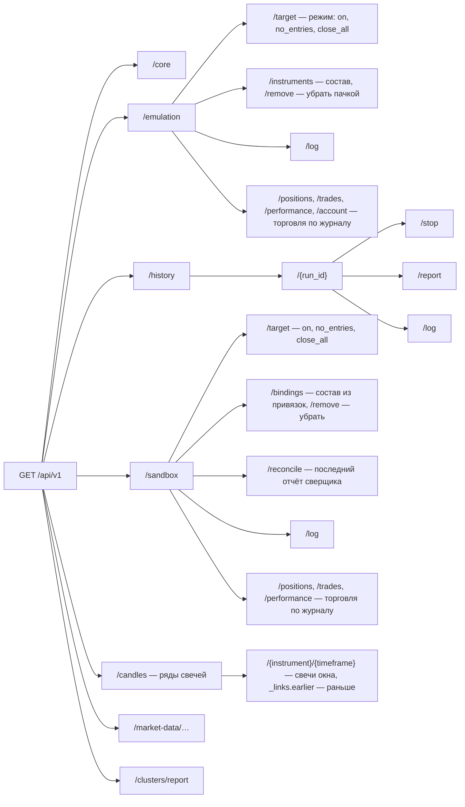

# Контракты API робота

| Файл | Что описывает |
|---|---|
| [openapi.yaml](openapi.yaml) | HTTP API робота, версия 2.3.0: точка входа, ядро, эмуляция, история, песочница, свечи для графиков, экспорт рыночных данных, отчёт кластеров |
| [market-events.asyncapi.yaml](market-events.asyncapi.yaml) | События рыночной структуры в Redis Stream |
| [v2-decisions.md](v2-decisions.md) | Решения API 2.0, таблица «было → станет», план «Счёта» и справочника |

Робот отдаёт `openapi.yaml` по `GET /openapi.yaml` и показывает Swagger UI на
`/docs` (по умолчанию `http://127.0.0.1:8101/docs`).

## Ключи

| Ключ | Переменная `.env` | Что открывает |
|---|---|---|
| `ControlToken` | `ROBOT_CONTROL_TOKEN` | `/api/v1/core`, `/api/v1/emulation…`, `/api/v1/history…`, `/api/v1/sandbox…`, `/api/v1/candles…`; только с `Host` 127.0.0.1, localhost или [::1] |
| `ExportToken` | `MARKET_DATA_EXPORT_TOKEN` | `/api/v1/market-data/…`, `/api/v1/clusters/report` |

Точка входа `GET /api/v1` принимает любой из двух ключей и показывает
разделы, доступные этому ключу. Ключ передаётся только заголовком
`Authorization: Bearer …`.

## Разделы

**Песочница (2.1.0, add-sandbox-contour).** Контур на брокере в песочнице
Т-Инвест. Состав — привязки (`id` из `[strategies.*]`), а не инструменты;
меняется командами и без запущенного процесса. На этапе С2 контур только
читает счёт и сверяет его с журналом: заявок нет, `confirm` не нужен.

**Песочница с заявками (2.2.0, add-tinvest-orders).** При
`[contours.sandbox] orders = true` контур торгует привязками настоящими
заявками в песочнице. Ядро само выбирает контракт привязки по правилам
эмуляции; если не может — `422 BINDINGS_REJECTED` с причиной. В `current`
появились `orders_enabled`, `trades` (открытые сделки), `orders_in_flight`
(незавершённые заявки) и `stream_link`. У привязки `current` — `warming`,
`trading`, `draining`, `closing`, `rejected` (с `reason`) или `watching`.
Снятие привязки с `no_entries` доводит её сделки до выхода, с `close_all` —
закрывает их.

**Свечи (2.3.0, add-candles-api).** Свечи рыночной базы ядра для графиков
UI — только чтение, без запросов к брокеру. `GET /api/v1/candles` — какие
ряды «инструмент × таймфрейм» хранятся; `GET /api/v1/candles/{instrument}/{timeframe}`
— последние `limit` свечей окна `[from, to)` (по умолчанию 500 до текущего
момента), листание назад — по `_links.earlier`. Имена — как в командах
контуров: `NG-12.26` или `SBER`; биржевой тикер и код семейства — `404` с
подсказкой в `suggestions`. Таймфреймы — только хранимые, без агрегации.
Пока ядро не открыло рыночную базу — `503 MARKET_DATA_NOT_READY`.

**Позиции, сделки и итоги контура (2.4.0, add-contour-trades-api).** Только
чтение журнала сделок контура (`trades.sqlite3` в папке контура) — для
карточки «Позиции и сделки» UI. У эмуляции и песочницы одинаково:

- `…/positions` — открытые сделки: привязка, сторона, лоты, средняя цена
  входа, последняя цена (закрытие последней `1m` рыночной базы ядра), стоп,
  цели, исполнения, `realized` (частичные выходы минус все комиссии) и
  `unrealized`;
- `…/trades` — закрытые сделки окна `[from, to)` по `closed_at`, новые
  сверху, `limit` до 1000, фильтр `instrument`; назад — `_links.earlier`;
  `ETag` — номер последнего события журнала, `If-None-Match` → `304`;
- `…/performance?period=day|week|month|all` или `from`/`to` — итоги,
  кривая накопленного нетто, просадка, открытые позиции; «день» — с 19:00 МСК
  накануне;
- `GET /api/v1/emulation/account` — виртуальный счёт эмуляции.

У выхода `kind` — короткий вид для метки (`target`, `stop`, `partial`,
`signal`, `session_end`, `expiry`, `contour`, `other`), `code` и `label` — как
в журнале и CSV. Биржевой тикер наружу не выходит: инструмент — короткое имя,
сделка — непрозрачный `id`. Ответ есть и у остановленного контура; журнала
нет — пустой ответ, журнал не читается — `503 JOURNAL_UNAVAILABLE`.

**Профили привязки (2.5.0, add-binding-profiles-api).** У каждой привязки —
профиль фильтра `filter` (`raw` — без фильтра, `basic_levels`,
`triple_screen`) и профиль управления `management` (`levels_rr`,
`atr_trend`, `ma_cloud`, `pattern_targets`) из текущей конфигурации, без
перевода: подписи — дело UI. Поля есть у участников песочницы
(`bindings`/`members`) и в каталоге `available`. Участник эмуляции получил
`bindings` — привязки, по которым торгует инструмент (`id`, `strategy`,
`timeframe`, `filter`, `management`), подобранные по правилам торговли:
акция по тикеру, фьючерс по семейству.

**Снимок счёта и сторож исполнения (2.6.0, fix-sandbox-restart-safety).** В
`current` песочницы — `account_at`: момент снимка счёта, на который верны
`capital`, `positions`, `orders` и `stop_orders`. Снимок берётся при старте,
на сверке и перед остановкой, поэтому после `close_all` позиции — уже после
выхода. `execution_holds` — инструменты со сделками, у которых исполнение 1m
стоит дольше 5 минут (стоп по ним не проверяется); о таком удержании и его
окончании приходит сообщение в канал песочницы. `PUT /api/v1/sandbox/target` и
`POST /api/v1/sandbox/bindings` определяют инструменты всех привязок одним
пакетом и не держат ресурс на время запросов к брокеру; если состав изменился,
пока они шли, — `412 REVISION_CHANGED`.

**Индикаторы стратегии привязки (2.7.0, add-indicators-api).**
`GET /api/v1/candles/{instrument}/{timeframe}/indicators?binding=<id>` —
значения индикаторов стратегии привязки (`id` из `[strategies.*]`) на том же
окне, что у свечей: те же `from`, `to`, `limit` (до 1000), `times` совпадает
с `open_time` свечей, `_links.earlier` листает индикаторы вместе со свечами.
Описание отрисовки отдаёт робот: `pane` (`price` — на свечах, `separate` —
своя панель), `levels`, у линий `kind` (`line`, `histogram`); цвета — дело
UI. Таймфрейм — любой хранимый; не таймфрейм привязки — `binding_timeframe:
false`.

Два режима расчёта. `strategy` (по умолчанию) — как видела стратегия: точка
свечи считается на хвосте до `depth` свечей, заканчивающемся ею, где
`depth` — глубина расчёта живого анализа, max(минимум допуска,
`[robot] analysis_depth`), по умолчанию 150. Пока в ряду меньше минимума
допуска — `null`: стратегия там не считала. `continuous` — классический
расчёт по окну с прогревом 300 свечей, как в терминалах. На глубине 150
режимы совпадают на графике (MACD расходится на миллионные доли). При малой
`analysis_depth` MACD и RSI стратегии отличаются от терминальных: EMA и RMA
на коротком хвосте ещё помнят точку старта — и стратегия решала именно по
таким значениям.

Расчёт идёт в процессе ядра рядом с живым анализом: одновременно считается
один запрос, остальные ждут; точки завершённых свечей режима `strategy`
кэшируются. Холодный запрос 500 точек `strategy` — 1–2 с, опрос новых точек
— миллисекунды, `continuous` — один расчёт на ответ. У привязок участника
эмуляции и состава песочницы — `_links.indicators` на таймфрейме привязки.

## Форматы

- Ответы управления — `application/json` с `_links` (куда перейти) и
  `_actions` (что сервер примет сейчас: метод, адрес, готовое тело).
- Ошибки управления — `application/problem+json` (RFC 9457) с полем `code`.
- Экспорт рыночных данных и отчёт кластеров — прежний формат 1.8, ошибки
  `{code, message}`: их читает Historical Broker API Emulator.
- Ревизия целевого состояния эмуляции — заголовок `ETag`; команда с
  `If-Match` по устаревшей ревизии получает `412 REVISION_CHANGED`.
