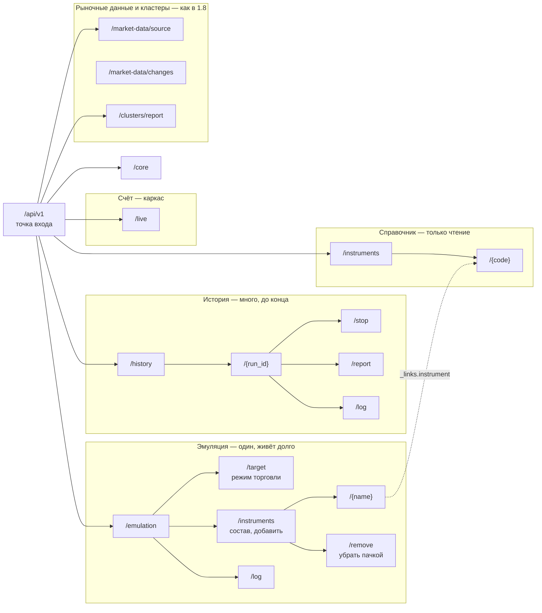

# Проект API 2.0

[openapi-draft.yaml](openapi-draft.yaml) — **проект** контракта, ничего из
него пока не реализовано. Действующий контракт — [docs/openapi.yaml](../openapi.yaml)
(1.8.0), его показывает Swagger UI робота на `/docs`. Проект лежит отдельно,
чтобы `/docs` не показывал маршруты, которых сервер не выполняет.

Реализация — два OpenSpec-изменения:

1. `rework-contour-api` — ресурсы контуров, точка входа, ошибки, ссылки и
   действия, `ETag`, удаление `/api/v1/contours`, перенос контрактов в
   `docs/api/`;
2. справочник `/api/v1/instruments` — следующим изменением.

После реализации контракты лежат так: `docs/api/openapi.yaml` (2.0.0,
из этого проекта), `docs/api/market-events.asyncapi.yaml`,
`docs/api/README.md` — обзор, `docs/api/v2-decisions.md` — этот файл.

## Ресурсы

## Решения

| Решение | Почему |
|---|---|
| У каждого контура свой ресурс вместо `/api/v1/contours` с `oneOf` | Разный жизненный цикл: эмуляция (и будущий «Счёт») живёт долго и меняет состав, прогон истории — задание до конца. Свои схемы без полей `null`, свои коды ответов. Новый контур — новый раздел, а не расширение общего `oneOf`. |
| Общие части — общие схемы | `TradingContour`, `TradingDesired`, `TradingActual`, `Member`, `ContourProcess` подключаются в эмуляцию и в «Счёт»; `ContourProcess` — ещё и в прогон истории. |
| Эмуляция — синглтон `/api/v1/emulation` | Она одна на робота; адреса читаются и набираются руками в Yaak. |
| Режим торговли эмуляции — `PUT /emulation/target` `{mode}` | Команда задаёт целевое состояние (`target`): `on`, `no_entries` или `close_all`; контур достигает её сам на границе тика и показывает в `current`, до какой ревизии дошёл. Ревизия — `ETag`, `If-Match` защищает от двух одновременных команд (`412`). Внутри робота это `desired`/`actual`/`generation` — наружу эти слова не выходят. |
| Остановка прогона — `POST /history/{id}/stop` | Прогон — долгая операция, а не целевое состояние торговли; отмена долгой операции — отдельная команда (как `:cancel` в Google AIP-151). |
| Состав — вложенный ресурс контура | Контур — корень агрегата (DDD): участие инструмента живёт только внутри контура и меняется только через него. Добавление и удаление — пачкой, тело — список. Удаление — `POST …/instruments/remove` (паттерн batch delete), а не `DELETE` с телом: у тела `DELETE` в HTTP нет определённого смысла. |
| Одно имя инструмента во всех командах эмуляции | Контракт — короткое имя (`NG-12.26`), акция — тикер. Код семейства эмуляция не принимает: что передал, то и торгуется, тем же именем и убирается. В истории код семейства остаётся: там он означает автоматическую цепочку контрактов. |
| Справочник `/api/v1/instruments` — только чтение | Что такое инструмент и можно ли его запустить: привязки, контракты, ближайший контракт. Состояния торговли и «где торгуется» в нём нет. Позже в него лягут настройки как объекты БД. |
| `_links` и `_actions` в обычном JSON | UI рисует кнопки по `_actions`, а не по своей таблице состояний. Полный Siren не нужен: строгие схемы и Swagger сохраняются. |
| Ошибки — `application/problem+json` с `code` | Стандарт RFC 9457; коды из 1.8 сохраняются. |
| Рыночные данные и отчёт кластеров — без изменений | Экспорт уже в релизе, его читает Historical Broker API Emulator. Непрозрачный курсор и `problem+json` для него дали бы мало (клиент один и свой), а потребовали бы выпускать робота и эмулятор вместе. Если понадобится — отдельное изменение. |

## Было → станет

Маршруты `/api/v1/contours…` удаляются сразу, без периода `deprecated`:
они не выходили в релизе, на них никто не заложился.

| 1.8 | 2.0 (проект) |
|---|---|
| `GET /api/v1/contours` | `GET /api/v1` (сводка) + `GET /api/v1/emulation` + `GET /api/v1/history` |
| `POST /api/v1/contours` `{kind: emulation}` | `PUT /api/v1/emulation/target` `{mode: on, instruments}` |
| `POST /api/v1/contours/emulation/stop` `{mode}` | `PUT /api/v1/emulation/target` `{mode: no_entries \| close_all}` |
| `POST /api/v1/contours/emulation/instruments` `{add}` | `POST /api/v1/emulation/instruments` `{instruments: [NG-12.26, SBER]}` |
| `POST /api/v1/contours/emulation/instruments` `{remove, mode}` | `POST /api/v1/emulation/instruments/remove` `{instruments: [NG-12.26, SBER], mode}` |
| в эмуляции `NG` → ближайший контракт | только `NG-12.26` или `SBER` — одно имя в запуске, добавлении, составе и удалении; ближайший контракт — `nearest` в справочнике |
| `GET /api/v1/contours/emulation/log` | `GET /api/v1/emulation/log` |
| `POST /api/v1/contours` `{kind: history}` | `POST /api/v1/history` |
| `GET /api/v1/contours/history-20261024-101500` | `GET /api/v1/history/20261024-101500` (без префикса `history-`); итог — `…/report` |
| `POST /api/v1/contours/history-…/stop` | `POST /api/v1/history/{run_id}/stop` |
| `ApiError {code, message}` | `Problem {type, title, status, code, detail}` — кроме рыночных данных и кластеров |
| `/api/v1/market-data/…`, `/api/v1/clusters/report` | без изменений |
| `command` — JSON строкой | `launch.request` — объектом |
| поле `actual` у прогона истории | `progress` (не путать с `current` у торговых контуров) |
| `desired` / `actual` / `generation` | `target` / `current` / `revision` |
| `desired.running` + `stop_mode` | один `mode`: `on`, `no_entries`, `close_all` |

## Открытые вопросы

1. «Счёт»: отдельный ключ, подтверждение команд, лимиты — решит документ 2.
2. Справочник берёт контракты у брокера; пока ядро не готово, `contracts` —
   `null`. Нужно ли брать их у эмулятора данных, как история?
