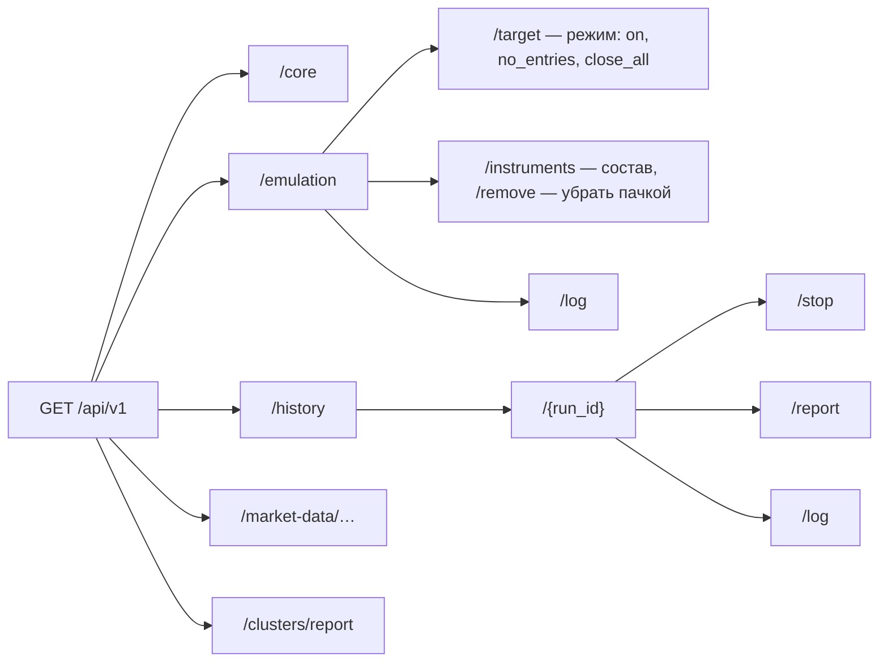

# Контракты API робота

| Файл | Что описывает |
|---|---|
| [openapi.yaml](openapi.yaml) | HTTP API робота, версия 2.0.0: точка входа, ядро, эмуляция, история, экспорт рыночных данных, отчёт кластеров |
| [market-events.asyncapi.yaml](market-events.asyncapi.yaml) | События рыночной структуры в Redis Stream |
| [v2-decisions.md](v2-decisions.md) | Решения API 2.0, таблица «было → станет», план «Счёта» и справочника |

Робот отдаёт `openapi.yaml` по `GET /openapi.yaml` и показывает Swagger UI на
`/docs` (по умолчанию `http://127.0.0.1:8101/docs`).

## Ключи

| Ключ | Переменная `.env` | Что открывает |
|---|---|---|
| `ControlToken` | `ROBOT_CONTROL_TOKEN` | `/api/v1/core`, `/api/v1/emulation…`, `/api/v1/history…`; только с `Host` 127.0.0.1, localhost или [::1] |
| `ExportToken` | `MARKET_DATA_EXPORT_TOKEN` | `/api/v1/market-data/…`, `/api/v1/clusters/report` |

Точка входа `GET /api/v1` принимает любой из двух ключей и показывает
разделы, доступные этому ключу. Ключ передаётся только заголовком
`Authorization: Bearer …`.

## Разделы

## Форматы

- Ответы управления — `application/json` с `_links` (куда перейти) и
  `_actions` (что сервер примет сейчас: метод, адрес, готовое тело).
- Ошибки управления — `application/problem+json` (RFC 9457) с полем `code`.
- Экспорт рыночных данных и отчёт кластеров — прежний формат 1.8, ошибки
  `{code, message}`: их читает Historical Broker API Emulator.
- Ревизия целевого состояния эмуляции — заголовок `ETag`; команда с
  `If-Match` по устаревшей ревизии получает `412 REVISION_CHANGED`.
