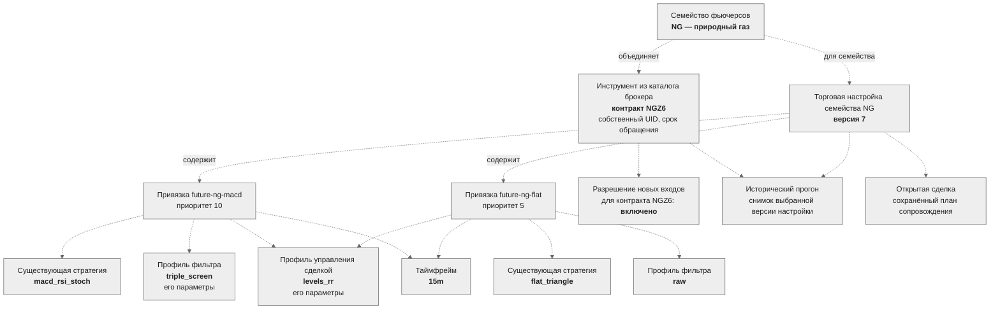

# Торговые настройки как объекты: целевая модель и схема БД

Цель — хранить **предметные объекты** в БД робота. TOML нужен
только для однократного переноса уже заданных настроек. После переноса робот
загружает торговые настройки из БД; изменение TOML не меняет их автоматически.
Это проект, текущий код по-прежнему читает TOML при запуске.

## 1. Объекты на примере природного газа

Пунктирные связи показывают предлагаемую модель. Здесь показаны две
привязки стратегии для наглядности; в текущем `default.toml` у семейства NG
их три. Названия стратегий, фильтров и профилей взяты из конфигурации;
контракт и состояние UI в примере условные.



**Торговая настройка** — целый объект с одной или несколькими привязками.
Каждая привязка соединяет существующую стратегию, профиль фильтра,
таймфрейм, профиль управления и приоритет. Привязка соответствует нынешнему
`src.strategies.contracts.Assignment`, а не строке TOML как таковой.

**Семейство NG и контракт NGZ6 — разные объекты.** Сегодня стратегии
назначаются всему семейству NG и наследуются его контрактами. UI сможет
включать новые входы для конкретного контракта; фактические сделки всегда
ссылаются на UID контракта. Если потребуется особое правило для одного
контракта, ему можно дать собственную торговую настройку с явно заданным
приоритетом над семейной. Правило разрешения конфликтов ещё нужно утвердить.

**Справочники алгоритмов** отражают реально установленный код:
`src.strategies.registry` для стратегий,
`src.decision.filters.PROFILES` для фильтров и
`src.trade_management.profiles.registry` для управления. Запись в БД сама
по себе не создаёт новую реализацию алгоритма. При запуске робот сверяет
сохранённые ссылки с доступным кодом и показывает несовместимые настройки.
Перечень таймфреймов сейчас задаёт `src.config.TIMEFRAMES`.

**Профиль** — отдельно выбранный набор параметров алгоритма. Например,
`triple_screen` задаёт вид фильтра, а профиль хранит его `multiplier`,
`macd_fast` и другие параметры. `levels_rr` аналогично имеет параметры
управления. Это позволяет одной настройке инструмента ссылаться на готовый
профиль, а при необходимости создать другой профиль того же вида. Сохранённый
профиль неизменяем: редактирование создаёт новую версию профиля, чтобы старые
версии торговых настроек и исторические прогоны сохраняли прежние параметры.

## 2. Черновая раскладка объектов по таблицам

Это проект логической схемы БД. Названия таблиц, типы SQLite, ключи и
назначение полей показаны в прямоугольниках; «лапки» на связях показывают
кратность. **`TRADES (УЖЕ ЕСТЬ)` — существующая таблица журнала сделок.**
`setup_revision_id` внутри неё помечен как новое поле. Все остальные таблицы
на этой схеме только предлагаются. Существующие таблицы журнала, которые не
связаны напрямую с торговыми настройками, здесь не показаны.

Настройки предлагается хранить в уже используемой роботом SQLite БД
`trades.sqlite3`. Робот остаётся её владельцем, а будущий UI обращается к
его API. Отдельный сервер PostgreSQL для этой локальной схемы пока не нужен.

```mermaid
%%{init: {'theme': 'base', 'themeVariables': {'primaryColor': '#eeeeee', 'primaryTextColor': '#222222', 'primaryBorderColor': '#666666', 'lineColor': '#666666', 'secondaryColor': '#eeeeee', 'tertiaryColor': '#ffffff'}}}%%
erDiagram
    FUTURES_FAMILY {
        TEXT family_code PK "NG"
        TEXT display_name "Природный газ"
    }
    INSTRUMENT {
        TEXT instrument_uid PK "Устойчивый UID брокера"
        TEXT family_code FK "Семейство, если фьючерс"
        TEXT ticker "Например, NGZ6"
        TEXT instrument_type "future или share"
        TEXT expiration_at "Срок контракта"
    }
    STRATEGY_KIND {
        TEXT code PK "Имя реализованной стратегии"
    }
    FILTER_KIND {
        TEXT code PK "Имя реализованного фильтра"
    }
    FILTER_PROFILE {
        TEXT profile_id PK "Неизменяемый набор параметров"
        TEXT filter_code FK "Вид фильтра"
        TEXT display_name "Название для UI"
        TEXT parameters_json "Параметры одного фильтра"
    }
    MANAGEMENT_KIND {
        TEXT code PK "Имя реализованного менеджера"
    }
    MANAGEMENT_PROFILE {
        TEXT profile_id PK "Неизменяемый набор параметров"
        TEXT management_code FK "Вид управления"
        TEXT display_name "Название для UI"
        TEXT parameters_json "Параметры одного профиля"
    }
    TIMEFRAME {
        TEXT code PK "15m, 1h и другие"
    }
    TRADING_SETUP {
        TEXT setup_id PK "Настройка семьи или инструмента"
        TEXT family_code FK "Заполнено для семейства"
        TEXT instrument_uid FK "Заполнено для контракта или акции"
    }
    SETUP_REVISION {
        INTEGER revision_id PK "Неизменяемая версия настройки"
        TEXT setup_id FK "Чья версия"
        TEXT created_at "Когда создана"
    }
    ACTIVE_SETUP_REVISION {
        TEXT setup_id PK, FK "Какая настройка"
        INTEGER revision_id FK "Активная версия"
    }
    ASSIGNMENT {
        INTEGER row_id PK "Строка привязки в версии"
        INTEGER revision_id FK "Версия настройки"
        TEXT assignment_key "Устойчивый ID привязки"
        TEXT strategy_code FK "Стратегия"
        TEXT filter_profile_id FK "Профиль фильтра"
        TEXT management_profile_id FK "Профиль управления"
        TEXT timeframe_code FK "Рабочий таймфрейм"
        INTEGER priority "Приоритет"
    }
    INSTRUMENT_ACTIVATION {
        TEXT instrument_uid PK, FK "Конкретный инструмент"
        INTEGER new_entries_allowed "0 или 1"
        TEXT updated_at "Последняя команда UI"
    }
    TRADES["TRADES (УЖЕ ЕСТЬ)"] {
        TEXT trade_id PK "Существующее поле: ID сделки"
        TEXT assignment_id "Существующее поле: ID привязки"
        TEXT instrument_id "Существующее поле: инструмент сделки"
        TEXT plan_json "Сохранённый план сделки"
        TEXT profile_json "Снимок управления"
        INTEGER setup_revision_id FK "НОВОЕ поле: версия при открытии"
    }

    FUTURES_FAMILY ||--o{ INSTRUMENT : "содержит контракты"
    FUTURES_FAMILY o|--o| TRADING_SETUP : "настройка семьи"
    INSTRUMENT o|--o| TRADING_SETUP : "настройка инструмента"
    INSTRUMENT ||--o| INSTRUMENT_ACTIVATION : "разрешение входов"
    TRADING_SETUP ||--o{ SETUP_REVISION : "имеет версии"
    TRADING_SETUP ||--o| ACTIVE_SETUP_REVISION : "имеет активную версию"
    SETUP_REVISION ||--o| ACTIVE_SETUP_REVISION : "может быть активной"
    SETUP_REVISION ||--o{ ASSIGNMENT : "содержит привязки"
    STRATEGY_KIND ||--o{ ASSIGNMENT : "используется"
    FILTER_KIND ||--o{ FILTER_PROFILE : "имеет профили"
    FILTER_PROFILE ||--o{ ASSIGNMENT : "используется"
    MANAGEMENT_KIND ||--o{ MANAGEMENT_PROFILE : "имеет профили"
    MANAGEMENT_PROFILE ||--o{ ASSIGNMENT : "используется"
    TIMEFRAME ||--o{ ASSIGNMENT : "используется"
    INSTRUMENT ||--o{ TRADES : "фактический контракт"
    SETUP_REVISION o|--o{ TRADES : "сделки по версии"
```



### Пример заполнения всех таблиц схемы

Это **единый условный пример**: семейство NG, контракт NGZ6 и версия его
семейной настройки `7`. UID, даты, сделка и номера строк вымышленные;
названия алгоритмов и значения показанных параметров взяты из действующей
конфигурации. Ниже перечислены все таблицы диаграммы. Для `TRADES` показаны
только поля, относящиеся к этой схеме; остальные обязательные поля
существующей таблицы опущены. `setup_revision_id` будет заполняться только
после предлагаемой миграции.

```yaml
FUTURES_FAMILY:  # новая таблица
  family_code: NG
  display_name: Природный газ

INSTRUMENT:  # новая таблица; UID здесь условный
  instrument_uid: example-uid-ngz6
  family_code: NG
  ticker: NGZ6
  instrument_type: future
  expiration_at: "2026-12-01T00:00:00Z"

STRATEGY_KIND:  # новая таблица; две строки справочника
  - {code: macd_rsi_stoch}
  - {code: flat_triangle}

FILTER_KIND:  # новая таблица; две строки справочника
  - {code: triple_screen}
  - {code: raw}

FILTER_PROFILE:  # новая таблица; два готовых профиля
  - profile_id: filter-elder-v1
    filter_code: triple_screen
    display_name: Три экрана — базовый
    parameters_json: '{"multiplier":5,"macd_fast":12,"macd_slow":26,"macd_signal":9,"stoch_k":14,"stoch_d":3,"stoch_smooth_k":3,"oversold":20,"overbought":80}'
  - profile_id: filter-raw-v1
    filter_code: raw
    display_name: Без дополнительного фильтра
    parameters_json: '{}'

MANAGEMENT_KIND:  # новая таблица
  code: levels_rr

MANAGEMENT_PROFILE:  # новая таблица
  profile_id: management-levels-v1
  management_code: levels_rr
  display_name: Уровни и две цели
  parameters_json: '{"buffer_ticks":1,"target_R":[1.0,2.0],"shares":[0.5,0.5],"max_adds":0,"min_be_r":1.5,"min_stop_atr":1.5,"min_stop_ticks":10,"stop_beyond_bar":1.0,"max_stop_atr":6.0}'

TIMEFRAME:  # новая таблица
  code: 15m

TRADING_SETUP:  # новая таблица; настройка относится к семейству
  setup_id: family-NG
  family_code: NG
  instrument_uid: null

SETUP_REVISION:  # новая таблица; версия неизменяема
  revision_id: 7
  setup_id: family-NG
  created_at: "2026-10-11T09:00:00Z"

ACTIVE_SETUP_REVISION:  # новая таблица
  setup_id: family-NG
  revision_id: 7

ASSIGNMENT:  # новая таблица; две строки одной версии
  - row_id: 501
    revision_id: 7
    assignment_key: future-ng-macd
    strategy_code: macd_rsi_stoch
    filter_profile_id: filter-elder-v1
    management_profile_id: management-levels-v1
    timeframe_code: 15m
    priority: 10
  - row_id: 502
    revision_id: 7
    assignment_key: future-ng-flat
    strategy_code: flat_triangle
    filter_profile_id: filter-raw-v1
    management_profile_id: management-levels-v1
    timeframe_code: 15m
    priority: 5

INSTRUMENT_ACTIVATION:  # новая таблица; новые входы разрешены
  instrument_uid: example-uid-ngz6
  new_entries_allowed: 1
  updated_at: "2026-10-11T09:05:00Z"

TRADES:  # таблица уже существует; строка показана частично
  trade_id: example-trade-1
  assignment_id: future-ng-macd
  instrument_id: example-uid-ngz6
  plan_json: '{"side":"BUY","quantity":2}'  # условный фрагмент
  profile_json: '{"name":"levels_rr","version":"1","parameters":{"buffer_ticks":1}}'  # фрагмент
  setup_revision_id: 7  # НОВОЕ поле; сейчас в БД его нет
```

Все ссылки в примере сходятся: обе привязки входят в версию `7`, версия
принадлежит настройке `family-NG`, а конкретный контракт наследует её через
семейство `NG`. Открытая сделка запоминает использованную версию. Отмена
разрешения в `INSTRUMENT_ACTIVATION` прекращает новые входы, но не удаляет
`TRADES` и не меняет сохранённый план её сопровождения.

Для `TRADING_SETUP` заполнен **ровно один** адрес: `family_code` либо
`instrument_uid`; оба поля требуют ограничения уникальности по отдельности.
Семейная настройка даёт правила всем контрактам NG;
настройка конкретного инструмента потребуется только для явного исключения.
Одна версия может иметь несколько `ASSIGNMENT`; сочетание
`(revision_id, assignment_key)` уникально. Изменение через UI создаёт новую
`SETUP_REVISION` и новый набор строк `ASSIGNMENT`, затем переключает
`ACTIVE_SETUP_REVISION` на границе торгового цикла. У уже открытой сделки
остаются старая версия и сохранённый план сопровождения. Связь `TRADES` с
`INSTRUMENT` сейчас логическая: в существующей таблице `instrument_id` не
объявлен внешним ключом. Связь с `SETUP_REVISION` и сам столбец
`setup_revision_id` потребуют миграции; для старых сделок ссылка может быть
пустой.

`parameters_json` относится к **одному** профилю конкретного вида, а не ко
всей конфигурации робота. Робот проверяет его по схеме параметров соответствующего
алгоритма до сохранения. Профили не редактируются на месте: новая комбинация
параметров получает новый `profile_id`. Если понадобится анализировать
параметры SQL-запросами, для отдельных видов можно выделить типизированные
таблицы, например `TRIPLE_SCREEN_PARAMS` и `LEVELS_RR_PARAMS`. При появлении
изменяемых параметров самой стратегии аналогично потребуется профиль
стратегии, связанный с `STRATEGY_KIND`.

Отдельные объекты нужны для общих правил риска, направлений торговли,
клиринга и перекладки контрактов. Настройки уведомлений и работы сервиса
также не являются свойствами конкретного инструмента. `initial_deposit` —
начальное состояние счёта, а не постоянно изменяемый параметр стратегии.
Пути к БД и секреты останутся небольшим загрузочным окружением приложения:
расположение БД можно взять из стандартного каталога данных или переменной
окружения, секреты — из переменных окружения.

| Нынешняя часть TOML | Целевой объект |
|---|---|
| `strategies.share.*`, `strategies.future.*` | `TRADING_SETUP`, его версии и `ASSIGNMENT` |
| `strategies.filter.triple_screen` | Профиль фильтра с проверяемым набором параметров |
| `trade_management.profiles.*` | Профиль управления с проверяемым набором параметров |
| `trading.risk_limits`, `trading.directions` | Политика риска и правила направлений |
| `historical.rollover`, `trading.contract_expiry_block_days` | Правила семейства фьючерсов и экспирации |
| `notifier.*` | Настройки подписок и доставки уведомлений |
| `robot`, `tick`, `market_data`, `logging`, `trading.clearing_times` | Настройки работы сервиса и расписания |
| `trading.initial_deposit` | Однократное создание начального состояния счёта |
| `instruments.fallback_*` | Уходит вместе с интерактивным выбором при запуске |

Первый перенос из `default.toml` и `robot.toml` должен создать эти объекты
одной миграцией с проверкой ссылок. После успешного переноса новые запуски
не перечитывают TOML как источник торговых настроек. Исторический прогон
получает снимок выбранных версий для выбранных инструментов и работает
независимо от живого разрешения `INSTRUMENT_ACTIVATION`.

## 3. Что придётся поменять в роботе

Сейчас `src.config` создаёт глобальные словари `SHARE_STRATEGIES` и
`FUTURE_STRATEGIES` при импорте, а `run.py` и `TradingBot` используют их на
весь запуск. Для динамического управления нужен сервис торговых настроек:
он читает активные версии из БД, строит и проверяет объекты `Assignment`,
а затем передаёт роботу целый неизменяемый снимок. При активации новой версии
нужно пересчитать рабочие таймфреймы, прогрев истории и кэш экземпляров
стратегий для затронутых инструментов. Разрешение новых входов проверяется
отдельно от сопровождения открытых сделок. При перезапуске сначала
восстанавливаются сделки и их планы, после чего разрешается обработка новых
сигналов.
