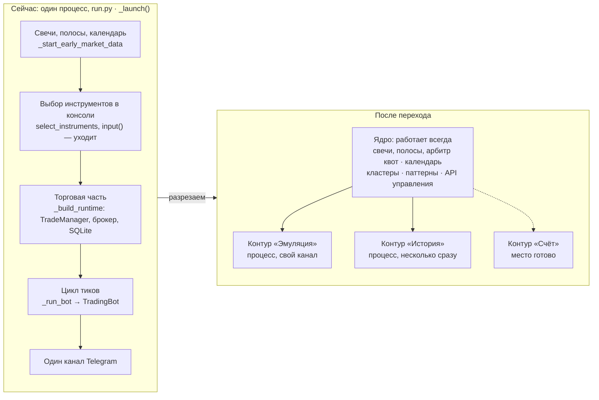
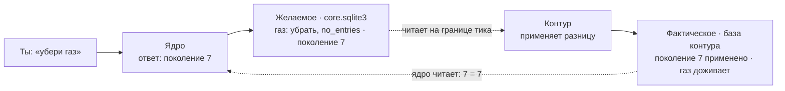
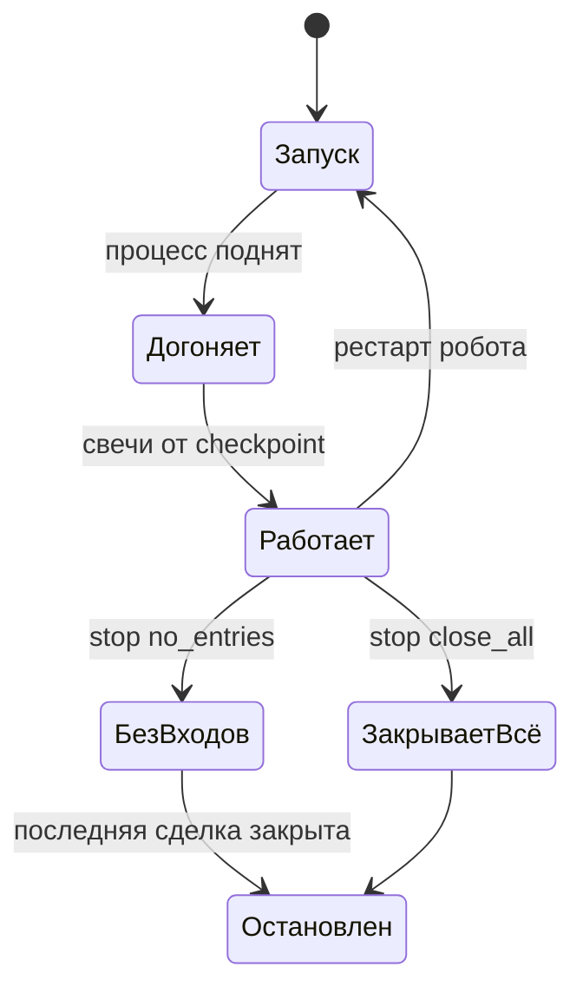
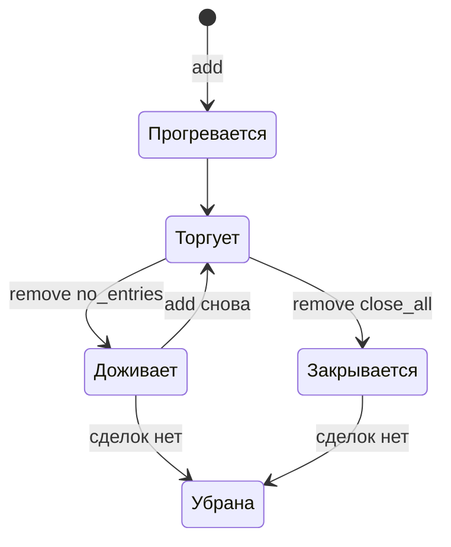
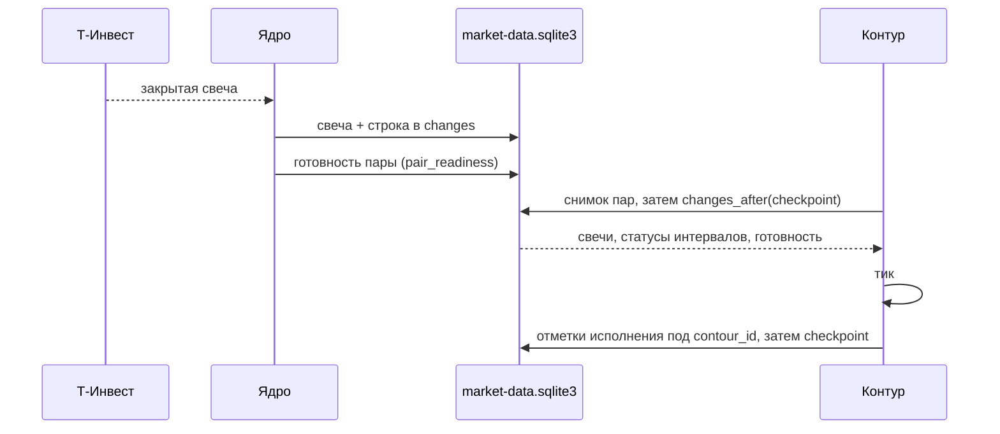
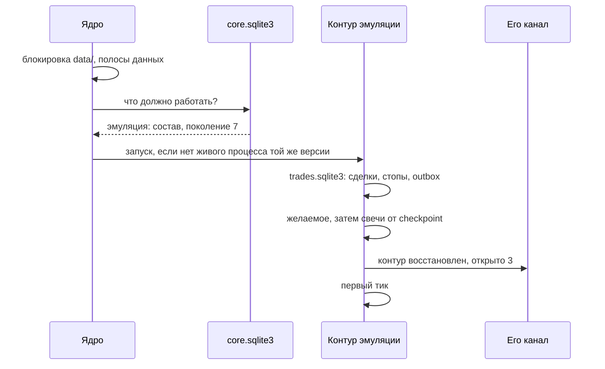

# Ядро и торговые контуры робота

> Целевая архитектура переходного периода. Это план, а не описание текущего
> кода: этапы П1–П7 реализуются отдельными change в OpenSpec. Подключение
> реального счёта описано отдельно и начинается после этого перехода.

Робот становится службой. **Ядро** запускается один раз, держит свечи и
данные свежими и само не торгует. Торговля идёт в **торговых контурах**,
которые запускаются по запросу через API отдельными процессами. Переход
делается без денег: сегодняшняя эмуляция и история переезжают в контуры, а
место для контура «Счёт» остаётся готовым.

**Торговый контур** — процесс, который ведёт один вид торговли: эмуляцию,
историю или счёт. Внутри контура работают стратегии, фильтры, TradeManager,
брокер и свой журнал. Слово «сессия» не используется: в коде оно уже занято
(`RunSession`, `MarketDataStreamSession`) и означает торговые сессии биржи.

| Что получим | Что не меняется | Чего здесь нет |
| --- | --- | --- |
| Один запуск робота. Эмуляция и прогоны истории включаются и выключаются командами API, в том числе параллельно. Привязки добавляются в эмуляцию и убираются из неё на ходу. | Стратегии, фильтры, TradeManager, симулятор, журнал SQLite, расчёты. Сделки эмуляции продолжаются после переезда. | Контура «Счёт». Он подключается, когда этот переход закончен. |

## 1. Было и стало



Разрез проходит почти по готовому шву. Боевой запуск уже поднимает данные в
`_start_early_market_data` до выбора инструментов и до торговли. Ядро забирает
себе всё, что выше этого шва, а контуры всё, что ниже. Ядро и контуры — роли
процессов, а не разные программы: код один и бинарник один, каждый процесс
использует свою часть.

## 2. Известные паттерны в этой схеме

| Что у нас | Паттерн | Где так делают |
| --- | --- | --- |
| Ядро запускает контуры, следит за ними и поднимает упавшие | Supervisor, дерево надзора | Erlang/OTP, systemd, supervisord |
| Ядро пишет желаемое состояние с номером поколения, контур приводит себя к нему и сообщает применённое поколение | Желаемое и фактическое состояние, цикл согласования | Kubernetes: spec и status, generation и observedGeneration |
| API ядра управляет, контуры торгуют | Control plane и data plane | Kubernetes, сетевое оборудование |
| Каждый контур в своём процессе, падение одного не роняет другие | Bulkhead, переборки | М. Найгард, «Release It!» |
| Контур читает ленту `changes` и запоминает, докуда дочитал | Журнал событий с позициями потребителей | Kafka, CDC |
| Один источник рыночных данных кормит несколько стратегий | Feed handler и strategy engines | NautilusTrader, QuantConnect LEAN |

В одном месте выбран простой приём вместо эталонного: лента свечей читается
опросом SQLite, а не через шину сообщений (см. раздел 10).

## 3. Что куда переезжает

| Сейчас в коде | Куда | Что меняется |
| --- | --- | --- |
| `_start_early_market_data`, `LiveMarketDataPoller`, `RequestBudget` | ядро | Работают постоянно. Состав пар берётся из всех привязок конфига. |
| `MarketCalendar`, сверка рынка | ядро | Контуры читают расписание из базы ядра. |
| чтение Redis кластеров, `cluster-events.sqlite3` | ядро | Одна группа потребителей на весь робот. |
| кластерный вердикт привязки | контур | Читает `cluster-events.sqlite3` ядра. |
| `PatternWorker` | ядро | Паттерны публикуются один раз. Закрытые бары ставит сторож ядра по парам привязок из потребностей контура (П3.1 ✓). |
| локальный API экспорта | ядро | Остаётся как есть, без токена не запускается. |
| `select_instruments` с вопросами в консоли | уходит | Инструменты задаются параметрами запуска и привязками. |
| `_build_runtime`: TradeManager, JournalBroker, Storage, CSV, аудит | контур | Код не меняется, у каждого контура своя папка. |
| `_run_bot`, `TradingBot` | контур | Тик по свечам из базы ядра. Состав меняется на границе тика. |
| `build_channels`, канал Telegram | контур | Канал берётся из конфига контура. |
| `_run_history`, `ask_history_range` | контур | «История» — вид контура, даты и привязки приходят в запросе. |
| глобальные константы `src/config.py` | оба | Настройки контура передаются объектом при сборке. |
| `setup_logging`, `acquire_runtime_lock` | оба | У каждого процесса свой лог и блокировка папки, в каждой строке лога `contour_id`. |

## 4. Папки, конфиг, состояние

```text
robot/
├── robot-vX.Y.Z
├── robot.toml        # один конфиг на всё
├── .env
└── data/             # ядро
    ├── market-data.sqlite3
    ├── cluster-events.sqlite3
    ├── core.sqlite3  # желаемое, команды, пульс
    ├── robot.pid
    └── contours/
        ├── emulation/   # сюда переезжает сегодняшний журнал
        │   ├── trades.sqlite3
        │   ├── trade_event.csv
        │   ├── bot_debug.log
        │   ├── status.json
        │   └── robot.pid
        └── history/
            └── 2026-10-21_1015/   # прогон
```

```toml
[core]
control_host = "127.0.0.1"
control_port = 8200
telegram_channel_env = "TELEGRAM_CHANNEL_ID"
max_history_runs = 2      # одновременных прогонов

[contours.emulation]
telegram_channel_env = "TELEGRAM_CHANNEL_ID"
assignments = "all"       # стартовый состав, дальше через API
```

- В `.env` добавляется `ROBOT_CONTROL_TOKEN` — ключ ControlToken для API. Он
  сразу попадает в `secrets` логгера.
- Канал задаётся именем переменной из `.env`, а не самим id.
- У истории нет секции в конфиге: даты и привязки приходят в запросе.

### Кто пишет состояние

У каждого факта ровно один владелец, остальные только читают.

| Где | Что хранится | Пишет | Читает |
| --- | --- | --- | --- |
| `core.sqlite3` · `contours` | Желаемое: вид контура, должен ли работать, режим остановки, поколение | ядро | контур |
| `core.sqlite3` · `contour_assignments` | Желаемый состав привязок | ядро | контур |
| `core.sqlite3` · `contour_commands` | Журнал команд | ядро | API |
| `core.sqlite3` · `heartbeat` | Пульс ядра и его версия | ядро | контур |
| база контура · `contour_state` | Фактическое: применённое поколение, статусы привязок | контур | ядро |
| `contours/*/status.json` | Снимок для API, `schema_version` | контур | ядро |

Контур никогда не пишет в `core.sqlite3`, ядро никогда не пишет в базу
контура. Переезд журнала эмуляции выполняется один раз и оставляет копию для
отката на прежнюю версию.

## 5. Как команда доходит до контура



- Команда выполнена, когда применённое поколение догнало желаемое.
- Повтор безопасен: после сбоя контур перечитывает желаемое и применяет его снова.
- «Газ убран» и «газ доживает одну сделку» — два разных факта у двух владельцев.
- Новая команда — новое поле желаемого состояния, а не новый механизм доставки.

## 6. API управления

Первые два запроса (`GET` и `POST /api/v1/contours`, только эмуляция) появляются уже на П1, в том же процессе; остальные — на П4. Ядро слушает только `127.0.0.1`. Ключ передаётся только в заголовке
`Authorization: Bearer`, ядро проверяет `Host` и не отдаёт `CORS *`.
Команды отвечают номером поколения.

| Запрос | Что делает ядро |
| --- | --- |
| `GET /api/v1/core` | Состояние данных и остаток квот. |
| `GET /api/v1/contours` | Контуры: состояние, поколения, состав и статусы привязок, сделки, ошибки. |
| `POST /api/v1/contours` `{"kind": "emulation", "assignments": [...]}` | Создаёт контур, если его нет. Второй не создаётся. |
| `POST /api/v1/contours/{id}/assignments` `{"add": [...]}` | Добавить привязку. |
| `POST /api/v1/contours/{id}/assignments` `{"remove": [...], "mode": "no_entries"}` | Убрать привязку, её сделки доживают. |
| `POST /api/v1/contours/{id}/assignments` `{"remove": [...], "mode": "close_all"}` | Убрать привязку и закрыть её сделки. |
| `POST /api/v1/contours/{id}/stop` `{"mode": "no_entries" \| "close_all"}` | Остановить весь контур. |
| `POST /api/v1/history` `{"from", "to", "pause", "assignments"}` | Прогон истории или очередь. |
| `GET /api/v1/contours/{id}/log?tail=200` | Последние строки лога. |

## 7. Жизнь контура и привязки





Состав меняется только между тиками. После рестарта контур поднимается в том
же состоянии и с тем же составом.

## 8. Как контур получает свечи



- Свечи, состояния интервалов и готовность пар пишет только ядро.
- **Исключение (П3.1, решение владельца):** контур пишет в рыночную базу свои
  отметки исполнения — закрепление входа, границу обработки, курсоры анализа —
  только под своим `contour_id`. Ядро читает их для удержания целостности:
  коррекция минуты, которую прошёл хотя бы один контур, останавливает UID.
- Кэш контура собирается снимком базы и дополняется лентой; в сеть за
  свечами контур не ходит, недостающую историю запрашивает у ядра.
- Готовность пары ядро публикует текущим состоянием в `pair_readiness`, а не
  событием: контракт `/changes` для внешних потребителей не меняется.
- Статусы интервалов идут в той же ленте: контур видит пропуски так же, как ядро.
- Checkpoint сохраняется после тика, идемпотентность журнала не даёт задвоить сделки.
- Контур читает короткими транзакциями, чтобы не раздувать файл `-wal`.
- Очистка ленты уже работает (`add-changes-retention`): строки старше
  `changes_retention_days` удаляются, но не дальше наименьшего подтверждённого
  курсора зарегистрированных потребителей. Каждый контур регистрируется под
  своим `contour_id` (курсор `contour-<вид>`, префикс закрыт для внешних
  потребителей); навсегда убранный контур снимается с регистрации.
- Контур позади удалённого края получает `410 CURSOR_EXPIRED` и догружает
  свечи из текущего состояния базы.

## 9. Рестарт



Ядро подхватывает работающий процесс контура только той же версии; иначе
просит его завершиться и запускает контур из нового бинарника.

## 10. Нюансы

- **Изменение состава на ходу (П5).** На границе тика контур создаёт стратегию
  новой привязки, прогревает индикаторы, добавляет и убирает таймфреймы
  планировщика. Убранная привязка остаётся в журнале, пока её сделки открыты.
- **Команда применяется не мгновенно (П4).** Базовый поток 1m гарантирует
  границу тика не реже раза в минуту.
- **Привязки вне состава ядра (П5).** Ядро догревает пары, привязка ждёт в
  статусе «прогревается». Привязки не из конфига отклоняются.
- **Ядро упало, контур жив (П6).** Без пульса контур перестаёт входить и ждёт.
- **Тик без своего приёма данных (П3.1 ✓).** Сигнал «свеча готова» приходит из
  ленты ядра, правила опоздания свечей прежние.
- **Лента без шины сообщений (П3.1 ✓).** SQLite в режиме WAL даёт хранение, повтор
  и чтение несколькими процессами. При задержке — уведомление через Redis.
- **Закрыть всё в эмуляции (П4).** Выход на открытии следующего бара.
- **История и эмулятор (П7).** Сохраняется проверка импорта, прогонов не
  больше `max_history_runs`.
- **Что П3.1 оставил на П3.2.** Кластерный вердикт, общий календарь и арбитр
  лимитов контур пока берёт у ядра в том же процессе; потребности и запросы
  истории передаются вызовом. Отдельному процессу нужны чтение
  `cluster-events.sqlite3` и расписаний из базы и межпроцессный канал спроса.
- **Запуск процессов (П3.2).** Тот же бинарник с параметрами; остановка через
  желаемое состояние, без сигналов ОС.
- **Консоль больше не спрашивает (П1).** Меню — тонкая обёртка над теми же
  параметрами запуска.
- **Обновление версии (П6).** Остановить всё, новая версия поднимает контуры.
- **Ядро делает много (принято).** При падении ядро перезапускается.

## 11. Осознанно отложено

- **Новые привязки без рестарта** — перенос настроек в базу, ветка `feature/experiment`.
- **Разные версии ядра и контуров** — протокол уже несёт `schema_version`.
- **Приём данных отдельным процессом** — риск принят.
- **Отдельные Telegram-боты** — перед подключением счёта.

## 12. Этапы

| Этап | Change | Делаем | Готово, когда |
| --- | --- | --- | --- |
| П1 | `add-noninteractive-launch` | Робот стартует, греет данные и ждёт команды: `POST /api/v1/contours` запускает эмуляцию выбранными контрактами, `GET` показывает состояние, ключ `ControlToken`. Параметры командной строки для эмуляции и истории, инструменты из привязок, меню собирает те же параметры. Процесс пока один и торгует одним набором. | эмуляция запускается командой API, ни один режим не требует `input()` |
| П2 ✓ | `refactor-core-contour-split` | `_launch` распадается на объекты ядра и контура, процесс пока один. Сделано: пакет `src/assembly/` (`LiveCore`, `HistoricalMarketServices`, `TradingContour`, порт `MarketServices`, потребности `ContourDemand`). | исторический прогон до и после даёт те же сделки |
| П3.1 ✓ | `add-contour-market-feed` | Свечи из ленты ядра в своём кэше контура, готовность пар в базе, отметки под `contour_id`, паттерны ставит ядро; процесс пока один. Откат — `[contours] market_feed = false`. | эмуляция на ленте принимает те же решения, что на памяти ядра |
| П3.2 | `add-contour-process` | Контур отдельным процессом, папка `data/contours/emulation/`, переезд журнала, канал Telegram из конфига. | неделя эмуляции без расхождений |
| П4 | `add-control-api` | `core.sqlite3`, поколения, остальные команды `/api/v1` (остановка, повторный запуск), `status.json`. | эмуляция управляется только через API |
| П5 | `add-contour-membership` | `add` и `remove`, состав на границе тика. | привязки меняются без перезапуска |
| П6 | `add-contour-recovery` | Автоподъём, подхват той же версии, пульс. | три рестарта без потерь и двойных контуров |
| П7 | `add-history-contour` | `POST /api/v1/history`, очередь прогонов. | история параллельно с эмуляцией |

Главный страховочный тест всего перехода: один и тот же исторический диапазон
до и после каждого этапа даёт одинаковые сделки.
