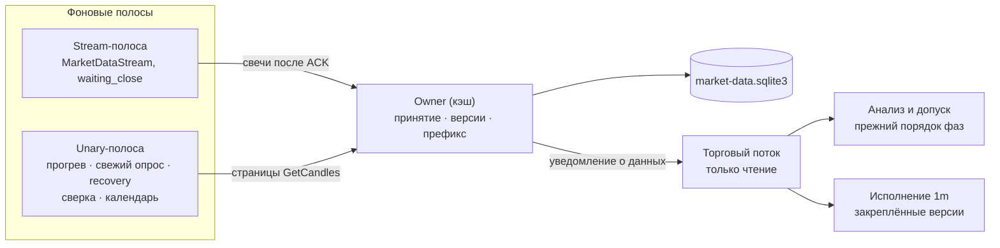
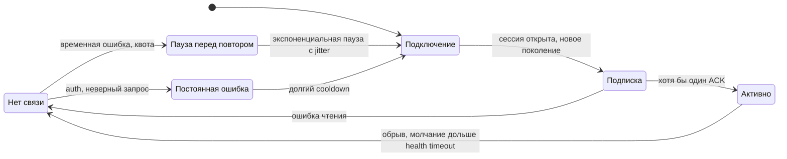
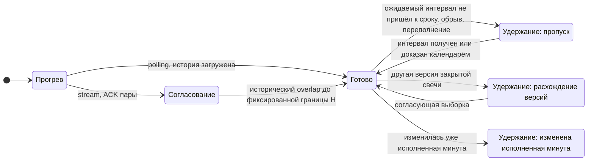
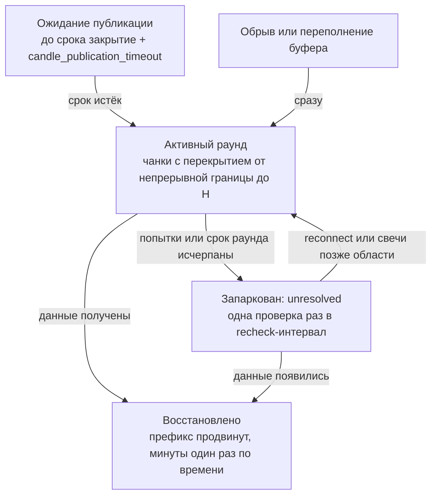

# Надёжный приём live-свечей

> Реализация change `openspec/changes/reliable-live-candle-ingestion`.
> Это транспорт рыночных **данных**: заявки по-прежнему исполняет симулятор
> `JournalBroker` (или работает NotifyOnly), реального исполнителя биржи нет.

Торговый поток только читает готовые кадры. Вся сеть — подписка, история,
восстановление, сверка и календарь — работает в фоновых полосах и передаёт
свечи единственному владельцу входа (owner). Торговое действие возникает только
по доказанно непрерывному входу.

## Как устроен поток данных

Owner принимает свечу в одной транзакции: дубль не создаёт версию и тик, а
отличающаяся поздняя версия сохраняется как конфликт и проверяется согласующей
выборкой, а не по порядку доставки. Свеча без явного признака закрытия входом
не становится.

## Транспорт и готовность — разные состояния

Состояние соединения:

Готовность пары «UID × таймфрейм», на которую смотрят анализ и допуск:

Выход из «Удержание: изменена исполненная минута» намеренно не автоматический:
ни переподключение, ни перезапуск его не снимают. Расследование и повторный прогон
делаются отдельно на фиксированном историческом снимке.

ACK обязателен для каждой пары. Частичный ACK, неверный интервал или источник
отклоняют только свою пару. Свеча до ACK своего поколения и события прежнего
поколения готовность не открывают.

## Что удерживается при пропуске

| Удерживается до разрешения | Продолжается |
| --- | --- |
| Свечное исполнение неизвестной и следующих минут UID | Приём и сохранение данных всех пар |
| Новые входы, доборы, индикаторное сопровождение UID | Здоровые UID — данные, анализ, защита |
| Текущее решение рабочего бара: ждёт 1m-префикс, курсор не сдвигается | Уже полученные подтверждения брокера |
| Доставка зависимых команд outbox (остаются PENDING с причиной) | Доказанный защитный guard-close по факту FILL |

Ничего не выдумывается: нет синтетических OHLC, срабатываний стопа, закрытий
по таймауту и отмены защиты. Удержанное ранее намерение без доказанной
актуальности не доставляется и остаётся PENDING.

## Жизнь пропуска

Срок раунда ограничивает интенсивную работу, а не жизнь пропуска. Удлинение
того же обрыва новый раунд не открывает. Начало раунда, попытки, чекпоинт чанка и
следующая проверка сохраняются в рыночной базе и переживают перезапуск. Пустой
ответ не означает отсутствия сделок. Перерыв, подтверждённый применимым
календарём, свечей не требует; неизвестное расписание перерывом не считается.

Старые пробелы вне необходимого префикса обслуживает отдельный ограниченный
бюджет с паузой. Каждая страница GetCandles расходует общий поминутный потолок
запросов.

## Настройки `[market_data]`

Все числа — инженерные гипотезы, а не гарантии брокера. Ни одна настройка
не наследуется от `[tick] timeout_secs`. Эффективный профиль пишется в лог при
запуске.

| Ключ | Назначение | По умолчанию |
| --- | --- | --- |
| `live_transport` | `polling` или `stream` | `polling` |
| `stream_fallback_polling` | при отказе stream перейти на опрос, а не удерживать пары | `true` |
| `candle_publication_timeout_secs` | срок публикации свечи после закрытия | 65 |
| `recovery_round_timeout_secs`, `recovery_max_attempts`, `recovery_backoff_max_secs` | пределы активного раунда | 900, 5, 300 |
| `recovery_recheck_interval_secs` | ритм проверки запаркованного пропуска | 300 |
| `recent_reconciliation_interval_secs`, `recent_reconciliation_bars` | недорогая сверка последних баров | 300, 2 |
| `unary_requests_per_minute` | потолок фактических RPC (лимит API 600) | 120 |
| `stream_ack_timeout_seconds`, `stream_ping_interval_ms`, `stream_health_timeout_seconds` | ACK и здоровье соединения | 30, 15000, 45 |
| `stream_reconnect_initial_secs`, `stream_reconnect_max_secs`, `stream_reconnect_jitter_pct`, `stream_control_cooldown_secs` | повтор соединения и пауза control-запросов | 1, 30, 20, 60 |
| `stream_buffer_max_events`, `stream_buffer_max_bytes` | предел буфера между чтением и owner | 50000, 64 МиБ |
| `stream_control_queue_max_messages`, `stream_subscription_soft_limit`, `stream_control_requests_per_minute` | очередь и ёмкость подписок (лимиты API 300 и 100) | 128, 280, 90 |
| `subscription_check_interval_secs`, `status_repeat_interval_secs` | сверка членства и повтор статуса | 300, 60 |

При нехватке ёмкости подписки первыми получают базовая 1m и рабочие таймфреймы,
остальные пары объявленно обслуживает опрос.

## Включение и откат

Stream включается явно: `live_transport = "stream"`. Откат — вернуть
`polling`. Обе схемы работают через одного owner: переключение не обнуляет
курсоры, пропуски и инциденты и не меняет source-profile (`UNSPECIFIED`).
Исторический режим настройку транспорта игнорирует и stream не открывает.

## Диагностика

`market_data_status` содержит срез `ingestion`: транспорт и поколение, признак
резервного опроса, состояние готовности, границы получения, разрешения и
исполнения, пропуск с попытками и следующей проверкой, инцидент целостности.
В консоли и Telegram это строка «Источник данных: …», удержание объясняется в
причине. Переходы stream — подписка, отказ пары, fallback, потеря, новое
поколение — пишутся в лог.

## Известные ограничения

- Совместимость с реальным брокером (ACK нужных UID/ТФ, равенство источников
  stream и GetCandles, задержка публикации, расход памяти) ещё не проверена
  read-only пробой — это отдельный шаг 8.5 с разрешения владельца. Числовой
  профиль подбирается после неё.
- Live-анализ по-прежнему рассчитывает вход до сопровождения
  (`_calculate` перед `_manage`), вопреки архитектурному контракту. Это отдельная
  предсуществующая проблема, транспорт её не меняет.
- Доказательство отсутствия сделок источником пока не используется: такой
  интервал остаётся неразрешённым.
