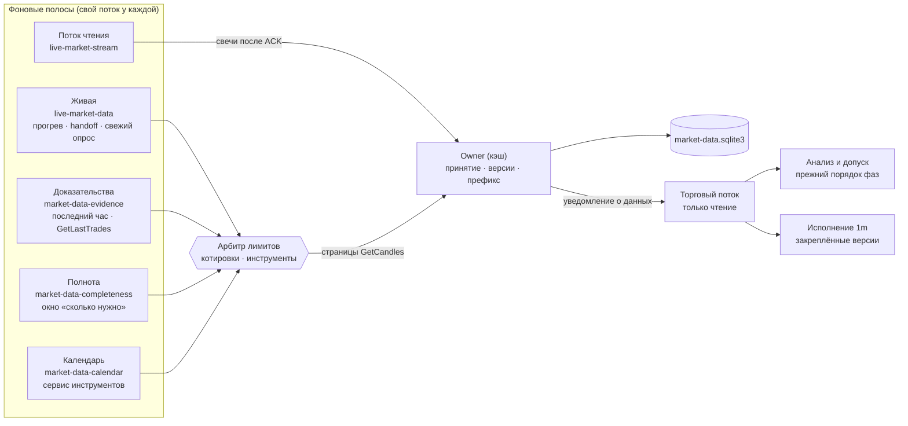
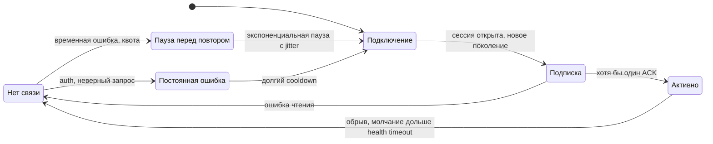
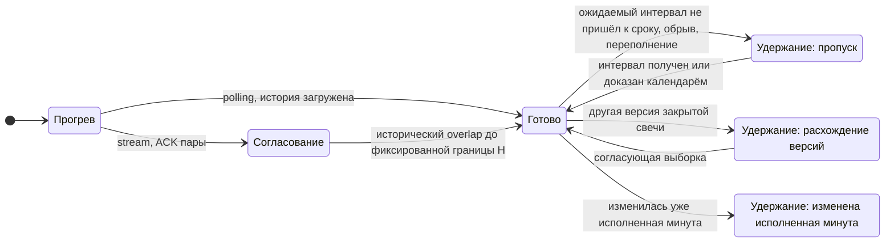
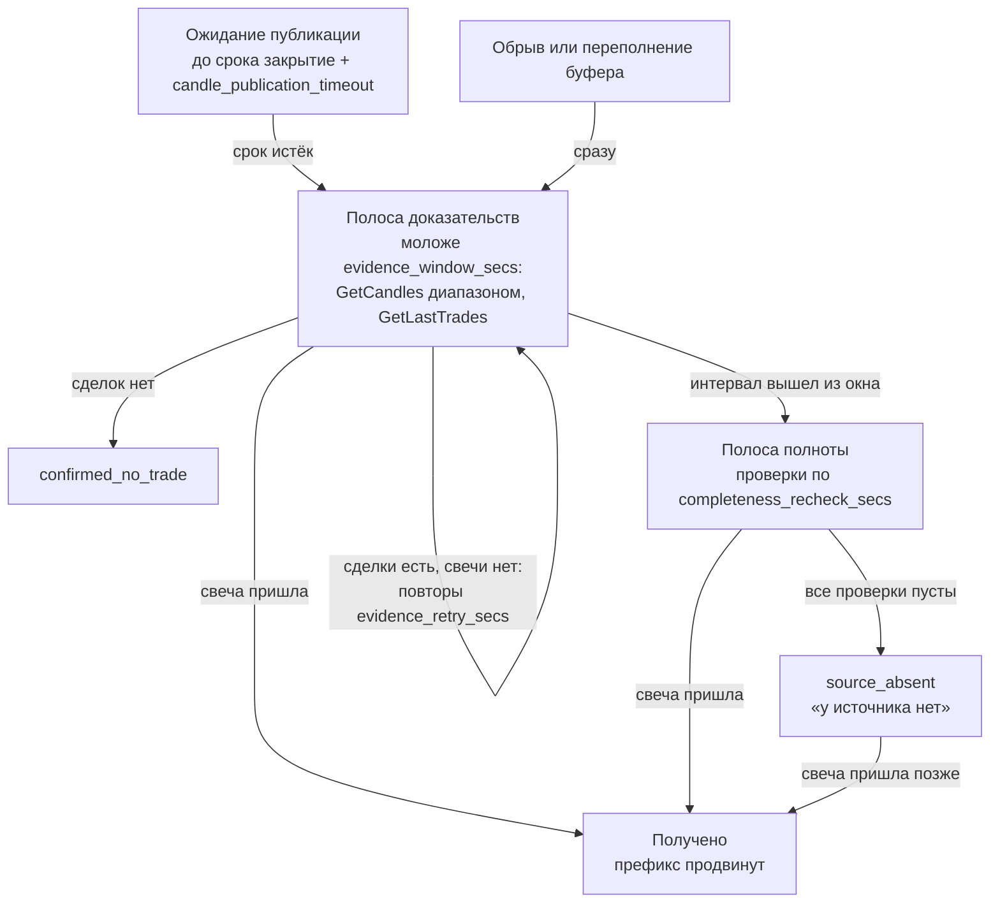

# Надёжный приём live-свечей

> Реализация change `reliable-live-candle-ingestion` (архив
> `openspec/changes/archive/2026-10-13-reliable-live-candle-ingestion`; нормативный
> текст — `openspec/specs/market-data-stream` и связанные спеки) и change
> `add-independent-market-data-lanes` (независимые полосы, арбитр лимитов,
> окно полноты, ранний старт).
> Это транспорт рыночных **данных**: заявки по-прежнему исполняет симулятор
> `JournalBroker` (или работает NotifyOnly), реального исполнителя биржи нет.

Торговый поток только читает готовые кадры. Вся сеть — подписка, история,
восстановление, сверка и календарь — работает в фоновых полосах и передаёт
свечи единственному владельцу входа (owner). Торговое действие возникает только
по доказанно непрерывному входу.

## Как устроен поток данных

По умолчанию (`independent_lanes = true`) у каждого вида работы свой поток и своя
гарантированная доля лимита брокера. Медленная работа (старые дыры, календарь)
не задерживает оперативную, а оперативная не съедает весь лимит.



| Полоса | Что делает | Чего не делает |
| --- | --- | --- |
| Живая | прогрев выбранных пар, согласование потока (handoff), свежий опрос не чаще `data_refresh_min_interval` на пару | не ищет старые дыры и не ходит в календарь |
| Доказательства | отсутствующий интервал моложе `evidence_window_secs`: диапазонный GetCandles, затем GetLastTrades; потеря доставки — сразу, без ожидания срока публикации; сверка последних баров | не трогает интервалы старше окна |
| Полнота | дыры окна полноты старше окна доказательства: диапазоны по чанкам, расписание повторов, итог «у источника нет» | не продлевает окно глубже, чем нужно потребителям |
| Календарь | привязки инструментов и расписание торгов | не расходует квоту котировок |

Ошибка одной полосы не останавливает другие: поток полосы пишет предупреждение
и делает паузу. Остановка робота прерывает полосы посреди RPC без потери
сохранённого прогресса.

Owner принимает свечу в одной транзакции: дубль не создаёт версию и тик, а
отличающаяся поздняя версия сохраняется как конфликт и проверяется согласующей
выборкой, а не по порядку доставки. Свеча без явного признака закрытия входом
не становится.

## Арбитр лимитов

Все unary-запросы процесса, включая выбор инструментов в консоли и загрузку
контрактов, идут через один арбитр (`RequestBudget`). У брокера два независимых
сервиса, у арбитра — два независимых окна:

| Сервис | Потолок робота | Доли полос по умолчанию |
| --- | --- | --- |
| котировки (GetCandles, GetLastTrades) | `unary_requests_per_minute` = 300 (лимит брокера 600) | живая 50 %, доказательства 25 %, полнота 25 % |
| инструменты (расписание, поиск, контракты) | `instrument_requests_per_minute` = 150 (лимит брокера 200) | интерактивный выбор 50 %, календарь 50 % |

Своя доля полосе гарантирована. Незанятую чужую долю полоса может занять, если
более приоритетная полоса сейчас не ждёт квоты. Приоритет при конкуренции:
интерактивный выбор → живая → доказательства → полнота → календарь.
`RESOURCE_EXHAUSTED` ставит паузу только своему сервису (по `ratelimit_reset`
из ошибки либо фиксированную): ограничение котировок не останавливает
календарь. Одинаковые диапазоны из разных полос не запрашиваются дважды.
Глобального окна темпа «один запрос в 5 секунд» в режиме полос нет.

SDK брокера не отдаёт остаток квоты в успешном ответе — только в ошибке,
поэтому арбитр держит собственный счёт запросов и не подстраивается под
остаток заранее.

## Окно полноты

Полнота держит целыми ровно те бары, которые нужны потребителям, а не всю
историю. Нижняя граница пары «UID × таймфрейм» — самая ранняя из:

- прогрева стратегий (`min_bars` пары);
- 80 баров картинки сделки (`CANDLE_LIMIT`) для всех таймфреймов, кроме базовой 1m;
- для 1m — границы исполнения незавершённой сделки, а без сделки — границы
  запуска (минуты после старта процесса проверяются строго).

Счёт баров идёт по сетке таймфрейма, а ожидаемые бары — по календарю
торгов там, где он известен; иначе по сетке. Окно пересчитывается при смене
состава, открытии и закрытии сделки и раз в `completeness_rescan_interval_secs`;
нижняя граница сохраняется в составе (`market_data_roster`).

Очередь полноты по уровням, внутри уровня — по кругу:

1. 1m незавершённых сделок от границы исполнения;
2. остальные таймфреймы пар со сделками (окно картинки);
3. рабочие и старшие таймфреймы выбранных пар;
4. базовая 1m выбранных пар.

Дыры объединяются в диапазоны и запрашиваются чанками (`CHUNK_SPAN`) — сутки
простоя восстанавливаются единицами запросов, а не по запросу на бар.
Прогресс (число проверок, время первой и последней, срок следующей) хранится
в `interval_checks` и переживает перезапуск: повторного полного скана нет.

Старые книги диапазонов `RecoveryRange` прежней очереди при первом шаге полосы
полноты забираются и удаляются; их минуты внутри окна становятся обычными
дырами окна.

## Пробел перед исполнением действующей сделки

Главный поток передаёт загрузчику снимок незавершённых финансовых обязательств
и границу исполнения каждой пары. Ключ снимка — UID рыночной пары: сделка в
журнале может лежать под биржевым тикером, UID или псевдонимом контракта, а
инструмент live-выбора — не знать UID в карточке. Адрес переводится в UID
зарегистрированной 1m-пары, а если пара выбора ещё не зарегистрирована — в UID
единственной пары сохранённого состава с тем же тикером. Обязательство без
найденной пары остаётся под адресом журнала и переводится на следующем тике.
Минуты от этой границы — первый уровень полосы полноты, а свежие из них —
работа полосы доказательств; другие пары и старые дыры их не задерживают.
Изменение набора обязательств будит полосу полноты: окно и очерёдность пар
пересчитываются сразу, а не через период пересчёта.

Минуту разрешает полученная закрытая свеча, применимое доказательство
закрытого рынка или отсутствия сделок либо итог «у источника нет» после всех
проверок (см. ниже). Пустой исторический `GetCandles` и недоступное расписание
прошлой даты сами по себе доказательством не являются: до конца расписания
проверок минута остаётся `pending`/`unresolved`, а исполнение ждёт.

## Транспорт и готовность — разные состояния

Состояние соединения:



Готовность пары «UID × таймфрейм», на которую смотрят анализ и допуск:



Выход из «Удержание: изменена исполненная минута» намеренно не автоматический:
ни переподключение, ни перезапуск его не снимают. Расследование и повторный прогон
делаются отдельно на фиксированном историческом снимке.

ACK обязателен для каждой пары. Частичный ACK, неверный интервал или источник
отклоняют только свою пару. Свеча до ACK своего поколения и события прежнего
поколения готовность не открывают.

## Что удерживается при пропуске

| Удерживается до разрешения | Продолжается |
| --- | --- |
| Свечное исполнение неизвестной и следующих минут UID | Приём и сохранение данных всех пар |
| Новые входы, доборы, индикаторное сопровождение UID | Здоровые UID — данные, анализ, защита |
| Текущее решение рабочего бара: ждёт 1m-префикс, курсор не сдвигается | Уже полученные подтверждения брокера |
| Доставка зависимых команд outbox (остаются PENDING с причиной) | Доказанный защитный guard-close по факту FILL |

Ничего не выдумывается: нет синтетических OHLC, срабатываний стопа, закрытий
по таймауту и отмены защиты. Удержанное ранее намерение без доказанной
актуальности не доставляется и остаётся PENDING.

## Жизнь пропуска



С расписанием по умолчанию: повторы через 1, 3 и 10 минут, пока интервал
моложе 55 минут; затем проверки полноты сразу, через час и через сутки. Ошибка
источника или ограничение запросов пустой проверкой не считается.

Пустой ответ GetCandles не означает отсутствия сделок. Свечи не требуют:

- перерыв по расписанию брокера (аукционы и клиринг — тоже перерыв); неизвестное
  расписание перерывом не считается;
- интервал последнего часа, в котором GetLastTrades не вернул ни одной сделки
  ни из одного источника, включая дилерские (`confirmed_no_trade`). Так разрешаются тихие минуты неликвидных контрактов.
  Интервал со сделкой, но без свечи, остаётся пропуском; ответ от 1000 сделок
  считается неубедительным. Старше часа такого доказательства нет.

Каждая страница GetCandles расходует квоту своей полосы в арбитре.

## Итоговые состояния интервала

| Состояние | Откуда | Проходит барьер исполнения | В экспорте `/changes` |
| --- | --- | --- | --- |
| `received` | закрытая свеча получена | да | `received` |
| `scheduled_closed` | перерыв по расписанию | да | `scheduled_closed` |
| `confirmed_no_trade` | GetLastTrades без сделок за последний час | да | `confirmed_no_trade` |
| `source_absent` | все проверки полноты пусты | да, с пометкой в журнале сделки | `unresolved`, evidence `source_absent:checks=N:first=…:last=…` |
| `pending`, `unresolved` | ещё проверяется | нет | без изменений |

`source_absent` — не «сделок не было», а «брокер свечу так и не отдал». По
решению владельца (13.10.2026) исполнение проходит такую минуту без стопа,
тейка и переоценки; до продвижения границы исполнения в журнал сделки пишется
`MARKET_DATA_SOURCE_ABSENT`, а в аудит — запись
`execution.source_absent_minute`. Если свеча всё же придёт позже, она
сохраняется и экспортируется как обычная, а в журнале появляется
`MARKET_DATA_LATE_CANDLE` с признаком возможного касания стопа или цели;
финансовые факты задним числом не меняются (см.
`docs/trade-management/storage-and-audit.md`).

## Ранний старт

Полосы начинают работать до выбора инструментов в консоли:

```mermaid
sequenceDiagram
    participant M as Главный поток
    participant B as Полосы
    participant U as Пользователь
    M->>M: блокировка процесса, журнал
    M->>B: хранилище, арбитр, календарь, owner<br/>граница запуска = старт процесса
    M->>B: сохранённый состав и пары незавершённых сделок
    B-->>B: календарь, доказательства, полнота
    M->>U: выбор инструментов (через тот же арбитр)
    U-->>M: выбранные пары
    M->>B: новый состав; невыбранные пары — из очередей, данные остаются
    M->>B: живая полоса и поток
    M->>M: первый торговый шаг после прогрева и handoff
```

Обязательства незавершённых сделок становятся известны после выбора, когда
полосы уже работают по сохранённому составу. До этого окно 1m пары начинается
с границы запуска; с приходом обязательств оно сразу расширяется до границы
исполнения, а начатое до перезапуска расписание проверок минут продолжается с
сохранёнными счётчиками.

Первый торговый шаг ждёт только прогрева выбранных пар и подключения потока,
а не окончания полноты. Перед ожиданием пары сохранённого состава, чей
таймфрейм не запросили ни стратегии и фильтры, ни сопровождение сделок,
снимаются и в составе становятся прошлыми: их прогрев не начнётся никогда.
Так бывает, когда из конфига убирают таймфрейм инструмента, по которому
открыта сделка. Ожидание ограничено `startup_wait_timeout_secs`: после него
стартовый обзор выходит с неготовыми парами и причиной, а журнал перечисляет,
каких пар ждал старт. Первый запуск без сохранённого состава до выбора
запросов по парам не делает. Исторический режим полосы и ранний сбор не
запускает.

## Граница запуска

Брокер не отдаёт расписание прошедших дат, поэтому доказать ночи и выходные до
запуска можно только сохранённым ранее расписанием. Отсюда правило: у инструмента
без открытых обязательств непрерывность проверяется от момента запуска. Пробелы
прогрева до запуска без доказательства не блокируют расчёт, их число показывается
в статусе («пробелов до запуска без подтверждения»). После запуска проверка строгая.
Для инструмента с сохранённой позицией или заявкой минутный ряд проверяется строго
от границы исполнения из журнала сделок.

## Настройки `[market_data]`

Все числа — инженерные гипотезы, а не гарантии брокера. Ни одна настройка
не наследуется от `[tick] timeout_secs`. Эффективный профиль пишется в лог при
запуске.

| Ключ | Назначение | По умолчанию |
| --- | --- | --- |
| `live_transport` | `polling` или `stream` | `polling` (в `default.toml` — `stream`) |
| `stream_fallback_polling` | при отказе stream перейти на опрос, а не удерживать пары | `true` |
| `candle_publication_timeout_secs` | срок публикации свечи после закрытия | 65 |
| `independent_lanes` | независимые полосы; `false` — прежняя общая очередь | `true` |
| `unary_requests_per_minute` | потолок робота на сервисе котировок (лимит API 600) | 300 |
| `instrument_requests_per_minute` | потолок на сервисе инструментов (лимит API 200) | 150 |
| `quote_lane_shares` | доли полос котировок, сумма 100 | `{live = 50, evidence = 25, completeness = 25}` |
| `instrument_lane_shares` | доли полос инструментов, сумма 100 | `{interactive = 50, calendar = 50}` |
| `evidence_window_secs` | окно доказательства, не больше 3600 | 3300 |
| `evidence_retry_secs` | повторы GetCandles внутри окна, строго возрастают | `[60, 180, 600]` |
| `completeness_recheck_secs` | повторные проверки полноты; после последней — `source_absent` | `[3600, 86400]` |
| `completeness_rescan_interval_secs` | пересчёт окна полноты и поиск дыр | 3600 |
| `lane_status_log_interval_secs` | период сводки полос в журнале | 300 |
| `startup_wait_timeout_secs` | предел ожидания прогрева перед стартовым обзором; дальше неготовые пары выходят с причиной и догружаются в фоне | 600 |
| `recent_reconciliation_interval_secs`, `recent_reconciliation_bars` | недорогая сверка последних баров (в режиме полос — полоса доказательств) | 300, 2 |
| `recovery_round_timeout_secs`, `recovery_max_attempts`, `recovery_backoff_max_secs` | пределы активного раунда прежней очереди; при полосах устарели | 900, 5, 300 |
| `recovery_recheck_interval_secs` | ритм проверки запаркованного пропуска прежней очереди; при полосах устарел | 300 |
| `stream_ack_timeout_seconds`, `stream_ping_interval_ms`, `stream_health_timeout_seconds` | ACK и здоровье соединения | 30, 15000, 45 |
| `stream_reconnect_initial_secs`, `stream_reconnect_max_secs`, `stream_reconnect_jitter_pct`, `stream_control_cooldown_secs` | повтор соединения и пауза control-запросов | 1, 30, 20, 60 |
| `stream_buffer_max_events`, `stream_buffer_max_bytes` | предел буфера между чтением и owner | 50000, 64 МиБ |
| `stream_control_queue_max_messages`, `stream_subscription_soft_limit`, `stream_control_requests_per_minute` | очередь и ёмкость подписок (лимиты API 300 и 100) | 128, 280, 90 |
| `subscription_check_interval_secs`, `status_repeat_interval_secs` | сверка членства и повтор статуса | 300, 60 |

При нехватке ёмкости подписки первыми получают базовая 1m и рабочие таймфреймы,
остальные пары объявленно обслуживает опрос.

Устаревшие параметры раунда принимаются без ошибки; если полосы включены и
параметр задан в конфиге, журнал предупреждает, что он не используется.

## Включение и откат

Stream включается явно: `live_transport = "stream"`; так настроен
`default.toml` проекта после проверки на брокере. Без ключа выбирается polling.
Откат — `live_transport = "polling"`. Обе схемы работают через одного owner: переключение не обнуляет
курсоры, пропуски и инциденты и не меняет source-profile (`UNSPECIFIED`).
Исторический режим настройку транспорта игнорирует и stream не открывает.

Полосы включены по умолчанию (после приёмки на копии рабочей базы 13–14.10.2026),
откат — `independent_lanes = false`: вернётся прежняя общая очередь. Первый
запуск новой версии переводит рыночную базу на схему 4 (состояние `source_absent`, состав пар, отметки проверок). Перед
миграцией рядом с базой создаётся копия
`market-data.sqlite3.before-schema-4-<время>.bak` — для рабочей базы около 1 ГБ,
место на диске нужно заранее. Прежний код состояние `source_absent` не знает,
поэтому откат на версию со схемой 3 — только с этой копии.

## Диагностика

`market_data_status` содержит срез `ingestion`: транспорт и поколение, признак
резервного опроса, состояние готовности, границы получения, разрешения и
исполнения, пропуск с попытками и следующей проверкой, инцидент целостности.
В режиме полос там же `ingestion.lanes`:

- `completeness` — `window_lower`, `window_upper`, `holes_due` (дыры к
  проверке сейчас), `first_hole`, `source_absent` (сколько минут окна в этом
  состоянии), `next_check_at`, `checked_at`;
- `evidence` — `missing` (недавний пропуск), `attempts`, `next_check_at`, `checked_at`.

Раз в `lane_status_log_interval_secs` в журнал пишется сводка: запросы за
минуту по сервисам и полосам, число дыр окна к проверке и пар, ждущих
доказательства.
В Telegram при явной подписке это строка «Источник данных: …»; консоль показывает
только короткое предупреждение о проблеме, а подробный срез остаётся в событии.
Переходы stream — подписка, отказ пары, fallback, потеря, новое
поколение — пишутся в лог.

## Известные ограничения

- Профиль чисел проверен одной read-only пробой (2026-10-12/13, три инструмента):
  ACK всех 27 пар, задержка закрытой свечи p95 0,085 с, пик 11 событий/с,
  расхождений stream и GetCandles и коррекций нет. Это наблюдение, а не гарантия
  брокера.
- Live-анализ по-прежнему рассчитывает вход до сопровождения
  (`_calculate` перед `_manage`), вопреки архитектурному контракту. Это отдельная
  предсуществующая проблема, транспорт её не меняет.
- Отсутствие сделок старше часа доказать нечем. Такой интервал проходит
  расписание проверок полноты и получает итог `source_absent`, а не
  `confirmed_no_trade`.
- Окно полноты не глубже, чем нужно потребителям: дыры старше окна полоса не
  запрашивает.
