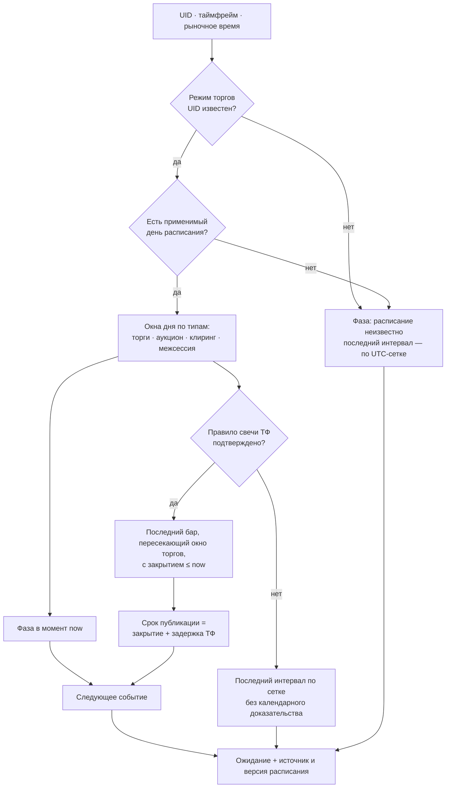
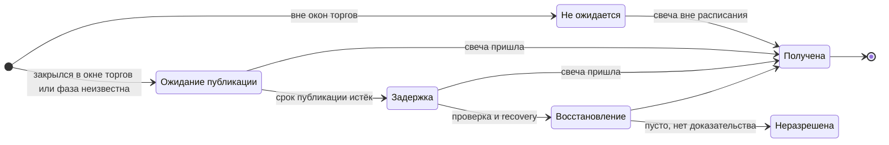
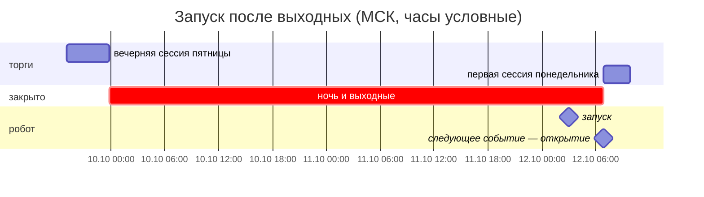
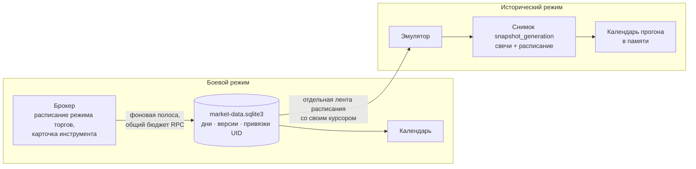
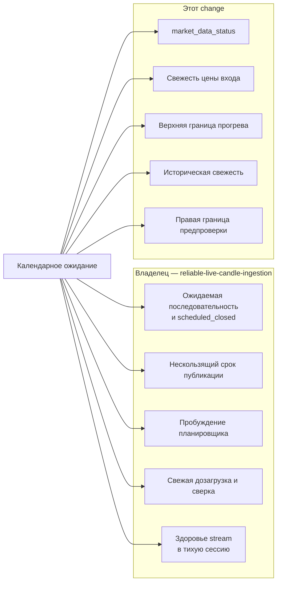

# Календарь торгов и ожидание свечей

> Проектное решение change `openspec/changes/add-trading-calendar-expectations`.
> **Не реализовано.** Нормативный текст — дельты спецификаций этого change.
> Строится поверх `reliable-live-candle-ingestion` и согласовано с
> `remove-mandatory-preflight-gap-scan`.

Робот судит о свежести свечей по расписанию торгов, а не по возрасту последнего
бара. Цель — отличить нормальное отсутствие новых свечей (ночь, выходные,
клиринг, аукцион) от необъяснённой нехватки данных, не маскируя реальные сбои.

## Календарное ожидание

Для пары «инструмент × таймфрейм» в заданный момент рыночного времени календарь
возвращает один ответ. Все потребители берут его отсюда и не считают сами.

| Поле | Смысл |
| --- | --- |
| Фаза | `торги`, `перерыв`, `закрыто` или `расписание неизвестно` |
| Последний ожидаемый интервал | Самый поздний бар этого ТФ, который по расписанию должен был завершиться; может отсутствовать |
| Срок публикации | Закрытие этого интервала плюс допустимая задержка публикации ТФ |
| Следующее событие | Вид и время ближайшего: закрытие бара, открытие/закрытие сессии, начало/конец перерыва, срок публикации, обновление расписания |
| Расписание | Источник, режим торгов, версии использованных дней, признак устаревания |
| Причина | Обязательна для неизвестной фазы, неподтверждённого правила ТФ и неизвестного типа интервала |

Ожидание читается без сети: если расписания ещё нет, ответ сразу
`расписание неизвестно`, а загрузка уходит в фоновую очередь.

## Фазы торгового дня

Фаза определяется только по расписанию режима торгов инструмента на конкретную
торговую дату. Правила «будни — торги, выходные — закрыто» нет: праздник в
будний день, рабочая суббота и сессии выходного дня берутся из расписания.

Иллюстрация. Часы условные, реальные окна приходят от брокера:

```mermaid
gantt
    title Один торговый день (часы условные)
    dateFormat HH:mm
    axisFormat %H:%M
    todayMarker off
    section закрыто
    до открытия                 :crit, c1, 00:00, 08:50
    после вечерней сессии       :crit, c2, 23:50, 23:59
    section перерыв
    аукцион открытия            :active, b1, 08:50, 09:00
    дневной клиринг             :active, b2, 14:00, 14:05
    вечерний клиринг            :active, b3, 18:45, 19:05
    section торги
    основная сессия             :t1, 09:00, 14:00
    основная сессия             :t2, 14:05, 18:45
    вечерняя сессия             :t3, 19:05, 23:50
```

Три правила, которые не видны на диаграмме:

- **`расписание неизвестно` ≠ `закрыто`.** Она не сокращает запросы свечей, не
  подавляет задержку и не доказывает плановое отсутствие свечи.
- **Неизвестный тип интервала считается торгами.** Возможна ложная задержка,
  зато реальный сбой не будет скрыт. Тип при этом попадает в диагностику.
- **Если закрытие подтверждено, а расписание следующей даты не получено,** фаза
  `закрыто`, но следующее открытие объявляется неизвестным, а не вычисляется по
  дню недели.

## Как считается ожидание

### Правила свечи по таймфрейму

| ТФ | Границы бара | Статус правила |
| --- | --- | --- |
| 1m, 5m, 15m, 30m, 1h | UTC-сетка | подтверждено |
| 4h | сетка от 00:00 UTC | по документации, нужен контрактный тест |
| 1d, 1w, 1M | календарные сутки, неделя, месяц брокера; не биржевой день фьючерса и не «30 дней» | проверить |

Бар ожидается, если он пересекается с окном торгов. Бар на конце сессии
закрывается по своей сетке, а не по времени конца сессии или последней сделки.
Пока правило ТФ не подтверждено, отсутствие его свечи не признаётся плановым.

## Жизнь ожидаемого интервала

«Не ожидается» соответствует `scheduled_closed`, «Неразрешена» — `unresolved`.
Всё после истечения срока публикации — зона `reliable-live-candle-ingestion`:
нескользящий срок, раунды recovery, парковка, барьер готовности. Календарь
задаёт только, какой интервал ожидается и когда истекает его срок.

Ожидаемый интервал означает «свеча могла появиться», а не «свеча обязана быть».
Пропуск в торговом окне никогда не превращается в `scheduled_closed` или
отсутствие сделок по календарю. Полученная свеча принимается в любой фазе:
профиль источника `UNSPECIFIED` может давать свечи вне биржевых окон.

## Пример: запуск в понедельник 03:00

В момент запуска фаза `закрыто`. Последний ожидаемый интервал — последний бар
пятничной вечерней сессии. Если он получен, данные актуальны: прогрев не ждёт
понедельника, восстановление и задержка не запускаются. Если не получен,
закрытие рынка этого не скрывает: срок публикации считается от его закрытия.

## Источники расписания

| | Боевой | Исторический |
| --- | --- | --- |
| Когда день применим | Наблюдён не раньше `schedule_max_age_secs` до начала торговой даты | День есть в снимке |
| Нет расписания | `неизвестно`, повтор через общий бюджет | `неизвестно` на затронутые даты, прогон идёт по прежним правилам, даты перечислены в отчёте |
| Обращение к брокеру | да, по режиму торгов, а не по каждому UID | никогда |
| Зависимость от эмулятора | нет | номер снимка в ответе должен совпасть, иначе ошибка подготовки |

**Версии.** Версия дня — хеш исходного ответа брокера за этот день.
- Изменение дня создаёт новую версию, старая сохраняется.
- Повтор без изменений только подтверждает существующую версию.
- Ранее записанные `scheduled_closed` хранят версию, на которой основаны.
- Возраст наблюдения отсчитывается от торговой даты, а не от «сейчас»: прошлый
  день, наблюдённый вовремя, остаётся доказательством навсегда.

**Почему отдельная лента.** Текущий импорт эмулятора отвергает неизвестные
виды изменений, поэтому `/changes` не меняется. Ресурс расписания на стороне
эмулятора — отдельное изменение в его репозитории. Без него робот работает,
но с фазой `неизвестно`.

## Кто использует ожидание

Календарь не принимает решений о пропусках и готовности. Он даёт механизмам
ingestion вход, а не второй детектор, второй срок или второй барьер.

Особенности потребителей, которых нет на схеме:

- **Цена входа** актуальна только в фазе `торги` с полученной последней
  ожидаемой минутой. В перерыве и закрытии вход отклоняется с названием
  причины. Окно актуальности решения календарь не расширяет.
- **Правая граница исторической предпроверки.** Расписание снимка может
  доказать плановый перерыв без бара-продолжения. Правило соседних баров
  остаётся и описывает разрыв как наблюдаемый. Расписание никогда не отклоняет
  то, что это правило принимает, и не используется для подсчёта разрывов.

## Закрытый рынок

Правила действуют для пары в `перерыве` или `закрыто`, у которой все ожидаемые
интервалы получены или разрешены.

| Приостанавливается до следующего события | Продолжается |
| --- | --- |
| Свежие запросы свечей пары | Подписки и приём событий stream |
| Плановая сверка последних баров | Восстановление старых `unresolved` |
| | Сопровождение позиций, подтверждения, сроки заявок и контрактов |
| | Клиринг `JournalBroker` по `[trading] clearing_times` |
| | Обновление расписания, `market_data_status`, сердцебиение |

При фазе `неизвестно` ничего не приостанавливается. Если окна клиринга из
расписания расходятся с `clearing_times`, публикуется предупреждение;
поведение клиринга не меняется.

## Настройки `market_data`

| Ключ | Назначение | Предварительно |
| --- | --- | --- |
| `schedule_refresh_interval_secs` | Период обновления расписания | 3600 |
| `schedule_max_age_secs` | Предел возраста наблюдения относительно торговой даты (только боевой режим) | 129600 |
| `schedule_horizon_days` | Сколько дней вперёд запрашивать | 7 |
| `candle_publication_timeout_by_tf` | Уточнение задержки публикации по ТФ поверх `candle_publication_timeout_secs` из ingestion | — |
| `calendar_evidence` | `false` — откат: календарь не разрешает интервалы и не сокращает запросы, но фаза и события видны | `true` |

Числа — инженерные гипотезы, а не гарантии брокера. Ни один ключ не
наследуется от `tick.timeout_secs`.

## Открытые технические проверки

Решаются контрактными тестами или read-only пробой брокера с отдельного
разрешения. Пока проверка не пройдена, соответствующее календарное
доказательство не включается.

1. Не сдвигается ли торговая дата `TradingDay.date` на сутки из-за пояса площадки.
2. Полный словарь типов интервалов и окна при пустом `intervals`.
3. Границы 1d, 1w, 1M у брокера.
4. Включает ли профиль `UNSPECIFIED` дилерские свечи выходного дня и есть ли у них расписание.
5. Доступны ли прошлые даты в расписании брокера (для эмулятора).
6. Реальная задержка публикации по ТФ.

## Ссылки

- OpenSpec: [proposal](../../openspec/changes/add-trading-calendar-expectations/proposal.md),
  [design](../../openspec/changes/add-trading-calendar-expectations/design.md),
  [tasks](../../openspec/changes/add-trading-calendar-expectations/tasks.md),
  [спецификация календаря](../../openspec/changes/add-trading-calendar-expectations/specs/trading-calendar/spec.md).
- Приём и восстановление свечей: [README рыночных данных](README.md),
  `openspec/changes/reliable-live-candle-ingestion`.
- Стартовый обзор и сообщения ожидания: [сценарий живого анализа](../live-session-analysis.md).
