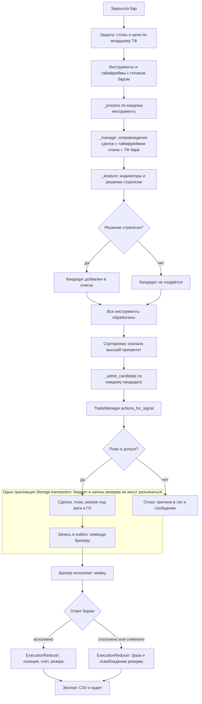
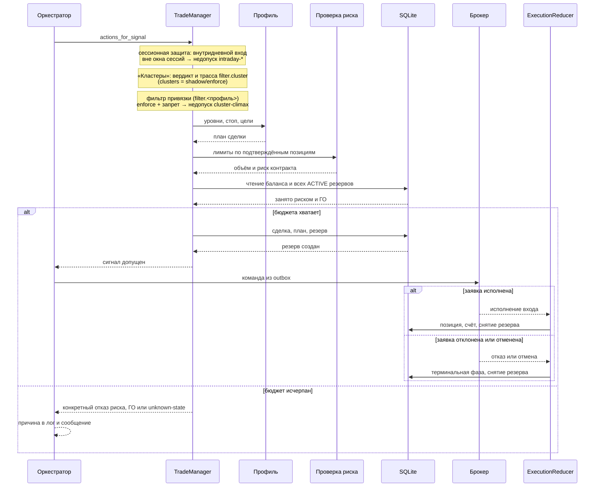
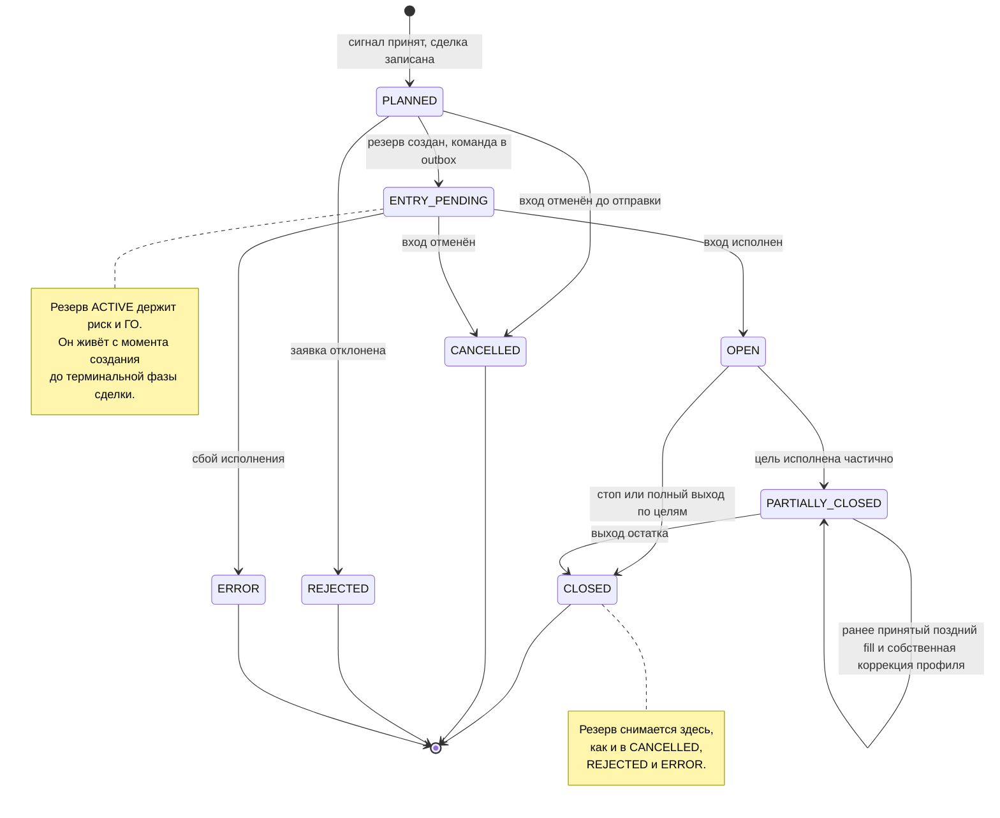

# Конвейер сигнала: от решения до исполнения

Документ отвечает на два вопроса, которые не закрывает ни один другой файл
репозитория:

1. **Что происходит с сигналом по шагам** — от закрытия бара до записи в журнал.
2. **Кто за что отвечает** — какой компонент владеет состоянием, кто имеет
   право его менять, а кто только читает.

Смежные документы: [profiles.md](profiles.md) — как профили выбирают уровни,
стоп и цели; [storage-and-audit.md](storage-and-audit.md) — как устроено
хранение, экспорт и аудит; [../database.md](../database.md) — схема БД;
[../notification/events.md](../notification/events.md) — шина уведомлений: какие
события о чём сообщают и кто их публикует.

Живое состояние базы смотрится утилитой `tools/show_state.py` (раздел 5).

---

## 1. Порядок шагов тика

Один тик оркестратора проходит через инструменты и таймфреймы в строгом
порядке. Порядок важен: сопровождение уже открытых позиций выполняется **до**
того, как стратегии ищут новые входы, а допуск кандидатов — **после** того, как
известны все кандидаты текущего тика, иначе приоритет зависел бы от порядка
инструментов.



`_manage` вызывается на каждом таймфрейме с готовым баром, но профиль считает
только сделки, у которых таймфрейм плана совпадает с таймфреймом этого бара.
На защитном 1m выполняются лишь действия, не связанные с баром: таймаут
незаполненного входа, близкая экспирация и переход контракта. Таймфрейм открытой
сделки обходится, даже если привязок на нём не осталось.

Три места, где тик может остановиться, и они не равнозначны:

| Место | Что произошло | Что записывается в журнал |
| --- | --- | --- |
| Стратегия не дала решения | Торговать нечего | Ничего |
| Профиль или фильтр отклонили | Торговать нельзя по правилам | Аудит и причина, без новой сделки/заявки |
| Не хватило бюджета риска или ГО | Торговать нельзя по деньгам | Аудит и конкретный `risk-budget`, `margin-budget` либо `margin-committed-by-pending-orders`, без новой заявки |

До допуска сохраняются расчётные трассы, в том числе отказов, без фиктивного
trade FK. Неизменяемый план/сделка, резерв и outbox фиксируются атомарно после
положительного максимального sizing и экономических проверок.

---

## 2. Путь одного сигнала



### Один ledger открытого риска и незаполненных резервов

Sizing и reserve учитывают одни и те же фактические остатки и ACTIVE-резервы:
`U=open risk+pending risk`, база `B=max(0,min(balance,equity))`, общий лимит
`B×portfolio_pct/100`. Вход выбирает максимальный целый Q по свободным риску/ГО,
запросу и пределам профиля; меньший положительный объём по ГО — успешный допуск.
После sizing до reserve проверяются экономика и её пороги.

В транзакции резервирования состояние проверяется заново. При гонке — конкретный
отказ и полный rollback, не скрытая замена уже записанного плана. Partial fill
переносит заполненную часть в факт, pending хранит только оставшуюся часть;
original reservation amounts остаются аудитом. Отмена освобождает остаток после
подтверждения. Намерение перенести стоп не освобождает риск до подтверждения.

Резерв завершённой сделки — дефект, который read-only `show_state.py` отмечает
`СИРОТА`; отчёт ничего не освобождает. Неизвестные стопы/факторы/суммы дают
unknown-state, а превышение блокирует новые увеличения без бюджетной продажи.

---

### «Кластеры»: кластерный фильтр входа

Для кандидата нового входа привязки с `clusters = "shadow"` или `"enforce"`
`TradeManager._plan_entry` до фильтра профиля считает вердикт по событиям
ClusterSource (Redis Stream `cluster.events`, локальная копия
`cluster-events.sqlite3`) и 1m свечам робота: `veto_strong`, `veto`,
`confirm`, `neutral` или `unknown`. Вердикт пишется трассой `filter.cluster`
и уходит в событие `signal` или `rejected` ключом `clusters`; консоль
показывает его строкой «Кластеры: …» в блоке ПЛАН или ОТКЛОНЕНО (кроме
`neutral`). В `shadow` допуск не меняется; в `enforce` запрет не ниже
`[clusters] enforce_level` после фильтра профиля даёт недопуск
`cluster-climax`. `unknown` (нет данных, отставание чтения Redis, другой
контракт у коллектора) никогда не запрещает вход. Сигналы по открытой
сделке и доборы вердикт не получают. Алгоритм и пример расчёта —
`openspec/changes/add-cluster-filter/design.md` (D5); отчёт по вердиктам —
`GET /api/v1/clusters/report` в [OpenAPI](../openapi.yaml).

### Сессионная защита внутридневных сделок

Сделка внутридневная, если таймфрейм её плана не больше
`[trading.intraday] max_timeframe` (по умолчанию `15m`); сделки на `1h` и
выше правило не трогает. Окна берутся из расписания брокера для режима торгов
инструмента (`market-data.sqlite3`, в истории — снимок прогона): разрешённые
типы сессий из `entry_sessions` сливаются в блок, конец блока округляется
вверх до минуты (у акций — конец непрерывных торгов, без аукциона закрытия).

| Шаг | Где | Что делает |
|---|---|---|
| Допуск входа | `actions_for_signal`, до `_plan_entry` | вне блока — `intraday-session-closed`; позже `конец − no_entry_before_close_min` — `intraday-close-near`; без расписания — `session-schedule-unknown` |
| Ожидающий вход | `manage`, цикл 1m | после рубежа входа — `CancelEntry` с причиной `intraday-session-end` |
| Позиция | `manage`, цикл 1m | с `конец − flatten_before_close_min` и вне блоков: `CloseTrade` (`intraday-session-end`) либо перенос, если взята первая цель и стоп не хуже безубытка всей сделки (иначе `MoveStop` в безубыток, `intraday-carry-break-even`, когда рынок по правильную сторону) |
| Добор | `submit_action` | вне окна входа отклоняется тем же кодом |

Для расписания 16.10.2026 рубежи такие: акции — вход до 17:55, закрытие в
18:35; фьючерсы — вход до 18:00, закрытие в 18:40 (МСК). В live решения о
закрытии принимаются на каждом новом 1m-баре (`LiveAnalysis._guard_sessions`),
в истории — на защитном 1m каждого тика. Одобренный перенос хранится в
состоянии сделки (`intraday_carry_at`) и действует до следующего рубежа
закрытия. Каждое решение пишется трассой `session.intraday`. Экспирация и
контрактный переход имеют приоритет. Подробности —
`openspec/changes/add-intraday-session-guard/design.md`.

## 3. Фазы сделки и время жизни резерва



Терминальные фазы — `CLOSED`, `CANCELLED`, `REJECTED`, `ERROR`. В них сделка
больше не участвует в расчёте риска, и её резервы обязаны быть свободны.
Фаза `PARTIALLY_CLOSED` терминальной не является: позиция ещё открыта частью.

Сделка в `ENTRY_PENDING` без резерва и резерв без сделки в нетерминальной фазе —
невозможные состояния. Если такое сочетание всё же встретилось, это дефект
записи, а не нормальный режим работы.

---

## 4. Кто за что отвечает

| Объект | Где живёт | Что владеет | Кто имеет право менять | Чего не может |
| --- | --- | --- | --- | --- |
| SQLite-журнал | `data/trades.sqlite3` | Сделки, позиции, заявки, счета, резервы, аудит | Reducer и Storage, каждый в своей транзакции | Не хранит состояние в памяти процесса |
| `Storage` | `src/trade_journal/storage.py` | Единственное соединение и границы транзакций | Вызывающий код, только через `transaction()` | Не решает, что торговать |
| `ExecutionReducer` | `src/trade_journal/reducer.py` | Позиция, счёт и резервы по факту исполнения | Брокер, через `apply()` | Не принимает торговых решений |
| `TradeManager` | `src/trade_management/manager.py` | Расчёт плана, размер, допуск, резервирование | Оркестратор, через `actions_for_signal` | Не исполняет заявки |
| Профиль | `src/trade_management/profiles/` | Уровни, стоп, цели | Конфигурация | Не знает о состоянии сделки |
| Проверка риска | `src/portfolio/risk.py` | Лимиты по переданному снимку сделок | `TradeManager`, передавая снимок | Не читает базу сама |
| `JournalBroker` | `src/broker/journal_broker.py` | Исполнение заявок, память симулятора | Порт исполнения | Его память — не источник истины |
| Оркестратор | `src/bot/trading_bot.py` | Порядок шагов тика | Главный цикл | Не пишет состояние напрямую |
| CSV-проекции | `src/trade_journal/export.py` | Файлы `trade_event.csv`, `trade_summary.csv` | Только чтение базы | Не являются источником истины |
| Отчёт о состоянии | `tools/show_state.py` | Ничего | Только чтение базы | Не чинит и не меняет резервы |

Три правила, которые следуют из таблицы:

1. **SQLite — единственный источник истины.** Память брокера-симулятора и
   файлы CSV — производные, их можно пересобрать, состояние в них — нет.
2. **Писатель состояния один.** Позицию, счёт и резервы изменяет
   `ExecutionReducer`. Всё остальное только читает или просит.
3. **Наблюдатель не пишет.** `tools/show_state.py` и CSV-проекции не имеют
   права освобождать «зависший» резерв: это сделало бы их вторым владельцем
   состояния. Освобождение резерва — операция Reducer'а.

---

## 5. Где смотреть живое состояние

`tools/show_state.py` печатает один согласованный снимок базы в четырёх блоках:
счёт с загрузкой лимитов, сделки в работе, активные резервы и последние
отказы. Открывает базу только на чтение, поэтому его можно запускать при
работающем роботе.

```
.venv/bin/python tools/show_state.py
```

Резерв в статусе `ACTIVE`, чья сделка уже в терминальной фазе, помечается
меткой `СИРОТА` — это тот самый дефект, который иначе ищется чтением лога
построчно.

---

## 6. Правило именования

Пользователю всегда показывается короткое имя контракта (`NG-10.26`), а не
биржевой тикер. В базе тикер лежит в колонке `trades.instrument_id`, а карта
«тикер → короткое имя» хранится в таблице `instrument_names` (версия схемы
9) и заполняется при старте робота. Инструменты, открывающие базу без робота,
читают карту из базы — пересобирать её через селектор нельзя, он интерактивен
и ходит в сеть.
