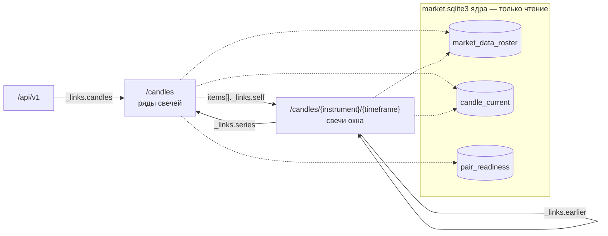
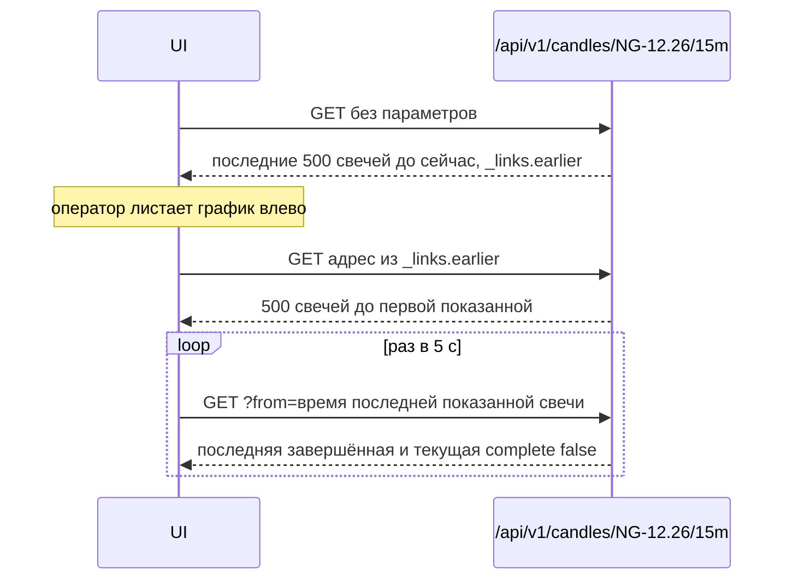

## Context

- **Рыночная база ядра** (`MarketDataStore`, `market.sqlite3`). `candle_current` хранит последнюю версию каждой свечи пары: ключ `(source, instrument_uid, interval, open_time_utc)`, цены — десятичным текстом, `is_complete`. Свечи не удаляются. Незавершённая (предварительная) свеча пишется только туда и не попадает в экспорт; завершённая её вытесняет.
- **Состав рыночной базы** (`market_data_roster`): пара `instrument_uid × interval` с `ticker`, `instrument_type`, `short_name` и происхождением `selected`, `obligation` или `previous` (пара больше не нужна, но её свечи лежат). Таймфреймы пар — родные таймфреймы брокера (`NATIVE_TIMEFRAMES`: `1m` … `1M`); какие именно есть у инструмента — решают привязки стратегий и исполнение по `1m`.
- **Готовность пары** (`pair_readiness`) — состояние живой пары (`READY`, `GAP_HOLD`, …), его уже показывает `GET /api/v1/core`.
- **API.** `LocalExportServer` (`src/data/export_api.py`) обслуживает и управление, и экспорт. Рыночная база появляется у сервера, когда ядро её открыло (`attach_market`); до этого `store` равен `None`.
- **Потребитель** — UI робота: свечной график выбранного инструмента (Lightweight Charts), мини-графики дня, опрос раз в 5 с.

## Goals / Non-Goals

**Goals:**

- Отдать UI свечи любого хранимого ряда за окно одним простым запросом.
- Те же имена инструментов, что в командах контуров; никаких `instrument_uid` и биржевых тикеров наружу.
- Листание графика назад без знания внутреннего устройства базы.
- Ноль влияния на приём данных и торговлю.

**Non-Goals:**

- Агрегация таймфреймов (строить `15m` из `1m`) — см. решение 3.
- Сделки, маркеры входов и выходов, линии позиции — отдельное изменение (журнал сделок, итерация 2 UI).
- Свечи прогонов истории — они живут у эмулятора данных, не в базе ядра.
- Поток событий вместо опроса, `ETag`/`304` для свечей.
- Справочник `/api/v1/instruments` (шаг 2 из `v2-decisions.md`).
- Состояние покрытия по каждому интервалу (`interval_coverage`: «сессия закрыта», «сделок не было», «нет у источника») — открытый вопрос 2.

## Decisions

### 1. Адрес: `/api/v1/candles`, а не под справочником и не под экспортом

| Вариант | За | Против |
|---|---|---|
| **`/api/v1/candles/{instrument}/{timeframe}`** | ряд свечей — свой ресурс, как пара в базе; не ждёт справочника; читается и набирается руками | ещё один корневой раздел |
| `/api/v1/instruments/{name}/candles` | естественно для REST | справочника нет; в его плане `/{code}` — код семейства, а свечи — у контракта |
| `/api/v1/market-data/candles` | рядом с рыночными данными | раздел экспорта: ключ экспорта, формат 1.8, курсоры; смешение машинного и UI-контракта |

Выбран первый. Когда появится справочник, контракт в нём получит `_links.candles` на этот же ресурс.

### 2. Где ресурс в схеме разделов



### 3. Только хранимые ряды, без агрегации

Ресурс отдаёт ровно то, что ядро получило от брокера. Таймфрейм, которого нет у инструмента в составе базы, — `404` со списком имеющихся в `suggestions`.

Почему не собирать `15m` из `1m`:

- брокер строит `4h` и `1d` только из биржевых сделок, а `1m` есть и в дилерские сессии: собранная из `1m` свеча разошлась бы с той, на которой торгует стратегия;
- график должен показывать то, что видела стратегия.

UI берёт список таймфреймов из `GET /api/v1/candles`.

### 4. Имя инструмента

Разрешение по составу рыночной базы, всех происхождений (и `previous` — у истёкших контрактов свечи остаются):

| Запрос | Ответ |
|---|---|
| `NG-12.26` — `short_name` пары | ряд контракта |
| `SBER` — тикер акции (у акции тикер и есть короткое имя) | ряд акции |
| `NGZ6` — биржевой тикер контракта | `404`, `suggestions: ["NG-12.26"]` |
| `NG` — код семейства | `404`, `suggestions` — короткие имена хранимых контрактов семейства: сначала текущего состава по возрастанию экспирации, затем прошлые, новые первыми |
| неизвестное имя | `404` без `suggestions` |

Сравнение без учёта регистра; в ответе имя — каноническое (`NG-12.26`). Биржевой тикер в ответах не появляется (`openspec/config.yaml`).

### 5. Окно и листание



- Окно `[from, to)` по времени открытия свечи, моменты — ISO 8601 с зоной.
- `to` по умолчанию — сейчас (открытая граница, текущая свеча попадает).
- Отдаются **последние** `limit` свечей окна (ближайшие к `to`), по возрастанию времени. `limit` — 1…5000, по умолчанию 500.
- `from` по умолчанию не ограничен: «последние `limit` свечей до `to`».
- `_links.earlier` есть, если до первой отданной свечи в ряду есть ещё: `to` = время первой отданной, тот же `limit`. Так листание не зависит от сессий и выходных.
- `from ≥ to`, неверный момент, `limit` вне диапазона — `400 INVALID_REQUEST`.

### 6. Незавершённая свеча

`candle_current` может держать предварительную свечу. Отдаётся только одна — **последняя в ряду**, если она позже последней завершённой, с `complete: false`. Предварительные строки внутри ряда (свеча так и не завершилась) не отдаются: на графике они выглядели бы как настоящие.

### 7. Формат свечи

```json
{"open_time": "2026-10-30T06:00:00Z", "open": "3.331", "high": "3.344", "low": "3.327", "close": "3.340", "volume": 1250, "complete": true}
```

- Цены — десятичной строкой (`DecimalPrice`), как в экспорте и в деньгах API: без потерь точности.
- `volume` — в лотах, как у брокера.
- Длинные имена полей, как в остальном API управления; 5000 свечей — около 0,6 МБ локально, сжатие не нужно.

### 8. Чтение не мешает ядру

- Один `SELECT … ORDER BY open_time_utc DESC LIMIT ?` по первичному ключу `candle_current` (индекс уже есть) плюс один запрос на «есть ли раньше». Лимит 5000 ограничивает время под блокировкой хранилища.
- Список рядов: состав базы, `MIN`/`MAX` по ключу каждой пары, готовность — одна транзакция чтения.
- Никаких запросов к брокеру, записей в базу, изменений курсоров, покрытия и ленты `changes`.

### 9. Ошибки и доступ

- Ключ управления, проверка `Host`, без CORS — требование «Доступ к управлению».
- `503 MARKET_DATA_NOT_READY` — рыночная база ещё не открыта ядром (`store is None`). Это не `409 CORE_NOT_READY`: база открывается при старте ядра и остаётся, даже если ядро потом повторяет старт.
- `404 NOT_FOUND` с `suggestions` — имя или таймфрейм не найдены.

### 10. Версия контракта

Действующий `docs/api/openapi.yaml` в `release/release-11` — 2.1.0. Версию 2.2.0 занимает `add-tinvest-orders` (ветка `feature/tinvest-orders`, ещё не влита). Черновик — 2.3.0; если `add-tinvest-orders` вольётся раньше, черновик переносится поверх 2.2.0, если позже — номера меняются местами при влитии.

## Risks / Trade-offs

- **[Ряд «дырявый»]** Сессии, выходные и пропуски видны только как отсутствие свечей. → Lightweight Charts не рисует пустых мест по времени; причины пропусков — открытый вопрос 2.
- **[Нет нужного таймфрейма]** У инструмента только таймфреймы его привязок и `1m`. → UI показывает в выборе только имеющиеся; агрегация — если понадобится, отдельным изменением с явной пометкой «собрано из 1m».
- **[Опрос раз в 5 с по нескольким рядам]** Обзор с 4–6 мини-графиками — до 6 лёгких запросов за опрос. → `limit` маленький, запросы по ключу; поток событий — позже.

## Open Questions

1. Шаг цены и число знаков для оси графика: в составе базы их нет. Отдавать из кэша инструментов брокера (`price_step`) или UI выводит знаки из самих цен?
2. Нужны ли графику причины пропусков (`interval_coverage`) — например, полупрозрачные зоны «сессия закрыта» и красные «нет данных»?
3. Мини-графику обзора нужно «изменение за день»: считать в UI по свечам или отдать готовым полем в списке рядов (`day_change`)?
