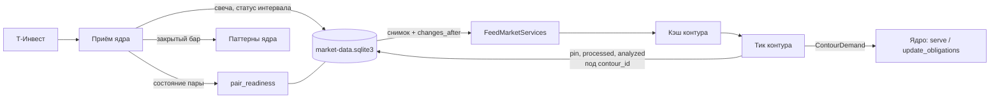
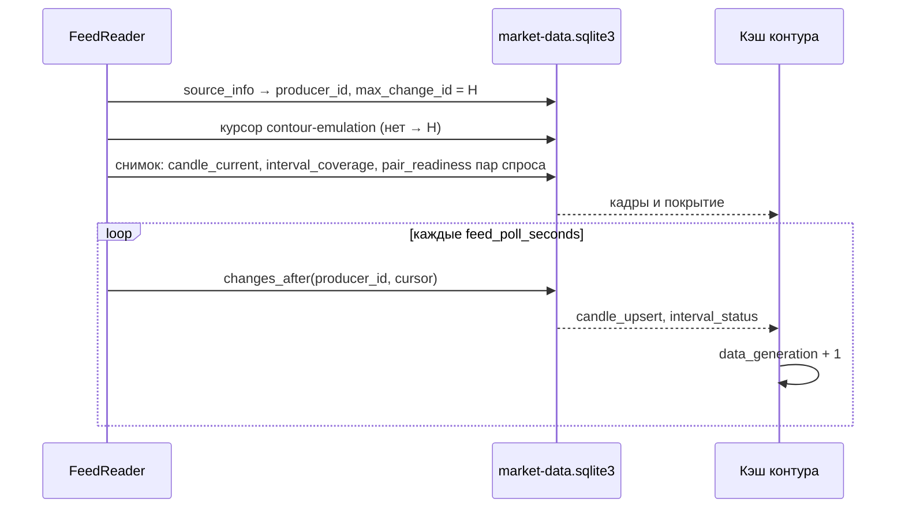
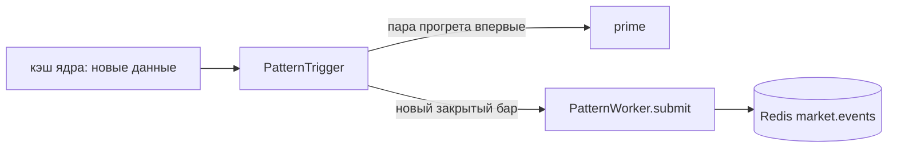

## Context

После П2 сборка состоит из ядра (`LiveCore`) и контура (`TradingContour`).
Контур видит данные через порт `MarketServices`, но в эмуляции порт отдаёт
общий объект `MarketDataCache` ядра. Этот кэш одновременно:

- наполняется приёмом данных: `_frames`, `_live_members`, полосы, разрывы;
- отвечает на вопросы тика: `frame_for`, `pair_status`, `coverage_for`,
  `has_fresh_closed_bar`, `entry_market`;
- пишет в рыночную базу отметки исполнения: `pin_input`, `mark_processed`,
  `mark_analyzed`;
- через сверку пишет состояние интервала `scheduled_closed`, когда тик
  спрашивает про покрытие.

Отдельный процесс не увидит память ядра. Значит, контуру нужны свой кэш,
источник свечей из базы и долговечный источник готовности пар.

## Goals / Non-Goals

**Goals:**

- Контур эмуляции принимает те же решения, что и сейчас, но получает свечи
  только из рыночной базы через ленту `changes`.
- Всё, что контур читает о рынке, лежит в рыночной базе. В П3.2 останется
  только сменить процесс.
- Контур пишет в рыночную базу только свои строки под своим ключом.

**Non-Goals:**

- Отдельный процесс, папки контуров, переезд журнала, каналы Telegram — это
  П3.2.
- `core.sqlite3`, поколения, команды остановки — П4.
- Удержание целостности отдельно для каждого контура: пока оно общее на UID
  (см. «Риски»).
- Исторический прогон на ленте — П7.
- Уведомление о новых строках ленты через Redis: в П3.1 контур опрашивает
  базу.

## Decisions

### 1. Поток данных



`FeedMarketServices` (новый `src/assembly/feed.py`) реализует
`MarketServices` для контура. В П3.1 он получает ссылку на ядро и передаёт
ему потребности вызовом в том же процессе. Собственные части:

| Часть | Что делает |
| --- | --- |
| `timeline`, `market_calendar` | общие с ядром: только чтение расписаний из базы |
| `market_store` | общая база; контур пишет только отметки под `contour=` |
| `data_cache` | `MarketDataCache` в режиме ведомого (`follower`) |
| `FeedReader` | фоновый поток: снимок, затем `changes_after` с курсора |
| `request_budget` | `None`: контур не вызывает свечные методы T-Invest |

Альтернатива — второй экземпляр приёма данных в контуре — отклонена: она
удваивает нагрузку на лимиты T-Invest и нарушает «одного владельца на факт».

### 2. Кэш контура: снимок, затем лента



- Курсор берётся до снимка, поэтому строка, записанная между ними, придёт
  повторно. Применение идемпотентно: свеча заменяется по
  `(uid, interval, open_time)` и `revision` не уменьшается.
- Строки ленты для пар вне спроса пропускаются, но курсор их проходит.
- Новая пара в спросе подгружается снимком из `candle_current` и встаёт в
  поток с текущего курсора.
- `CursorExpired` и `ProducerMismatch` означают одно: кэш пересобирается из
  снимка, курсор ставится на `max_change_id`. Пропущенный тик не
  проигрывается: границы обработки лежат в базе, и контур продолжает от
  `processed_through`, как после рестарта.
- Чтение идёт короткими транзакциями порциями по 500 строк, чтобы файл `-wal`
  не рос.
- `feed_poll_seconds` по умолчанию равен 1 с. Новая строка повышает
  `data_generation`; ожидание тика (`wait_for_data_change`) и правила
  опоздания свечей не меняются.

**Подтверждение.** `acknowledge("contour-emulation", producer_id, id)`
выполняется после commit тика и отметки `mark_processed`, на наибольший
применённый `change_id`. Очистка ленты учитывает курсор контура через
существующий `consumer_checkpoints`. Префикс `contour-` зарезервирован; ID
внешних потребителей с ним отклоняются.

### 3. Готовность пар из базы

Сейчас `pair_status` собирается из `_live_members` в памяти. Ядро будет
публиковать снимок готовности при каждом изменении состояния пары: регистрация,
прогрев, ошибка истории, разрыв, смена полосы, граница запуска.

```sql
CREATE TABLE pair_readiness (
  source TEXT, instrument_uid TEXT, interval TEXT,
  status_json TEXT,     -- тикер, тип, state, transport, epoch, history,
                        -- history_error, gap, cutover, live_floor, lanes
  updated_at TEXT,
  PRIMARY KEY (source, instrument_uid, interval)
);
```

Тикер и тип в статусе нужны контуру, чтобы найти UID пары инструмента без
UID в карточке (live-выбор), как это делает `pair_uid` ядра. Сводка полос
меняется на каждой проверке, поэтому без смены состояния пишется не чаще
раза в 30 с. При старте ядро очищает таблицу: готовность прошлого запуска не
действует.

Таблица хранит текущее состояние, а не события. Поэтому её нет в ленте
`changes`, и внешний контракт `/changes` не меняется. Ведомый кэш читает её
вместе с курсорами и `live_state(uid)` (удержание целостности): `pair_status`
возвращает те же поля, что и сейчас. `pre_cutover_gaps` считает кэш контура:
это его диагностика покрытия.

### 4. Отметки исполнения под ключом контура

Решение владельца: вариант 1, отметки остаются в рыночной базе.

| Отметка | Было | Стало |
| --- | --- | --- |
| закрепление входа | `facts.input_reference` | `facts.input_references[contour_id]` |
| граница обработки | `market_cursors.processed_through` | `contour_cursors(contour_id, source, uid, interval, processed_through)` |
| курсор анализа | `analysis_cursors(…, assignment_id)` | `+ contour_id` в первичном ключе |

Удержание целостности смотрит на отметки всех контуров. Свеча считается
потреблённой, если её закрепил (`consumed`) или прошёл (`processed_through`)
хотя бы один контур. Удержание и инцидент остаются общими на UID, в инцидент
добавляется `contour_id`.

`market_cursors.processed_through` перестаёт обновляться. Для диагностики и
`pair_status` ядро отдаёт наибольшую границу по контурам.

**Миграция** выполняется вперёд, в одной транзакции, при открытии базы
(версия схемы в `metadata`):

- `processed_through` переносится в `contour_cursors` контура `emulation`;
- `input_reference` переходит в `input_references["emulation"]`;
- в `analysis_cursors` добавляется `contour_id = 'emulation'`; SQLite не
  меняет первичный ключ, поэтому таблица пересоздаётся.

Почему `emulation`: до П3.1 отметки в живую базу писала только эмуляция.
История работает на копии базы.

**Запись.** Методы отметок `MarketDataStore` принимают `contour=` и без него
отклоняются (`ValueError`), поэтому ядро не может случайно записать отметку.
Кэш несёт `contour_id`; его задаёт сборка контура.

### 5. Сверка интервалов только для чтения

`MarketReconciler.interval_state` пишет `scheduled_closed`, когда у интервала
уже есть `pending` или `unresolved`. Ведомый кэш создаёт сверку с флагом
`read_only=True`: состояние по расписанию вычисляется так же, но не
записывается. Долговечное решение принимает ядро своим путём сверки. Ответ на
вопрос контура от этого не меняется.

### 6. Паттерны в ядре

Сейчас `TradingBot` ставит закрытый бар в очередь `PatternWorker` на своём
тике. В П3.1 ставит ядро: сторож `PatternTrigger` (поток ядра) просыпается на
изменении данных кэша ядра и проходит пары `ContourDemand.pattern_pairs` (ТФ
привязок выбранных инструментов, как у тика). Когда пара впервые прогрета,
сторож вызывает `prime` с её последним закрытым баром — бары догружаемой
истории в очередь не попадают. Дальше каждый новый последний закрытый бар
уходит в `submit`. Повторы отсекает сам воркер, как сейчас.



Набор задач остаётся прежним: пары спроса совпадают с парами тика контура.
Задача может прийти раньше тика контура. Это допустимо: паттерны не зависят
от решений контура. `pattern_sink` уходит из `MarketServices`, параметр
`pattern_worker` уходит из `TradingBot`.

### 7. Потребности и недостающая история

- `serve(demand)` передаёт спрос ядру (`LiveCore.serve`) и подписывает
  `FeedReader` на пары спроса. Он возвращает ожидание старта: пары спроса
  готовы по `pair_readiness`, и кэш контура догнал ленту до `max_change_id`,
  который был на момент окончания прогрева ядром.
- `update_obligations` передаётся ядру без изменений.
- `prepare_live_history`, а также `frame_for` неизвестной пары в ведомом кэше
  не идут в сеть. Они ставят запрос ядру (`core.request_history(instrument,
  tf, min_bars)`), а пара остаётся `BOOTSTRAPPING`, пока ядро её не прогреет.

### 8. Переключатель на время П3.1

`[contours] market_feed` (по умолчанию `true`). При `false` `run.py` отдаёт
контуру `LiveCore`, как в П2. Отметки в обоих режимах пишутся под
`contour_id`. Переключатель нужен, чтобы откатиться без смены версии, если
неделя эмуляции покажет расхождения. В П3.2 его удалят.

## Risks / Trade-offs

- **Задержка тика до `feed_poll_seconds`.** Свеча доходит до контура на
  ≤ 1 с позже. Правила опоздания считают от `input_ready_at` свечи, а не от
  момента чтения, поэтому решения не меняются. → Тест эквивалентности и
  диагностика `feed_lag` в сердцебиении.
- **Двойная память.** Кадры хранятся и у ядра, и у контура. → Контур держит
  только пары спроса; объём того же порядка, что сейчас.
- **Общее удержание на UID.** Исправление минуты, которую потребила эмуляция,
  остановит и будущий контур счёта по этому UID. → Принято до документа 2;
  инцидент уже несёт `contour_id`.
- **Расхождение `pair_readiness` с памятью ядра.** Если публикацию забыть в
  одной из веток, контур будет видеть устаревшее состояние. → Публикация в
  одном месте (`_refresh_member_state` и смены полос). Тест сравнивает
  `pair_status` ведомого и ведущего кэша на сценариях существующих тестов
  приёма.
- **Миграция `analysis_cursors`.** Таблица пересоздаётся. → Одна транзакция,
  тест на копии реальной схемы, резервная копия базы перед первым запуском
  (`*.pre-contour-feed`).

## Migration Plan

1. Робот новой версии мигрирует `market-data.sqlite3` при старте.
2. Эмуляция сразу работает на ленте (`market_feed = true`).
3. При расхождении: `market_feed = false`, рестарт. Схема остаётся новой, в
   откате участвует только источник кадров.
4. Возврат на версию до П3.1 требует резервной копии базы: старый код не знает
   `contour_cursors`.

## Open Questions

Нет. Отметки остаются в рыночной базе, вариант 1. П3 разбит на два change.
