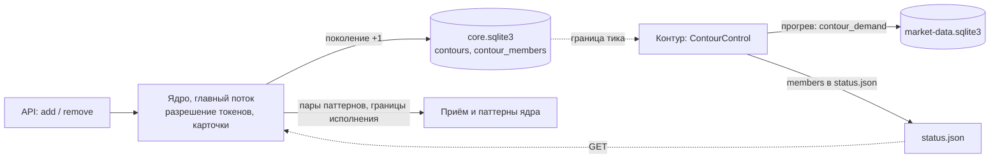
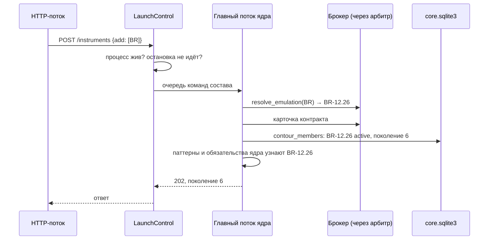
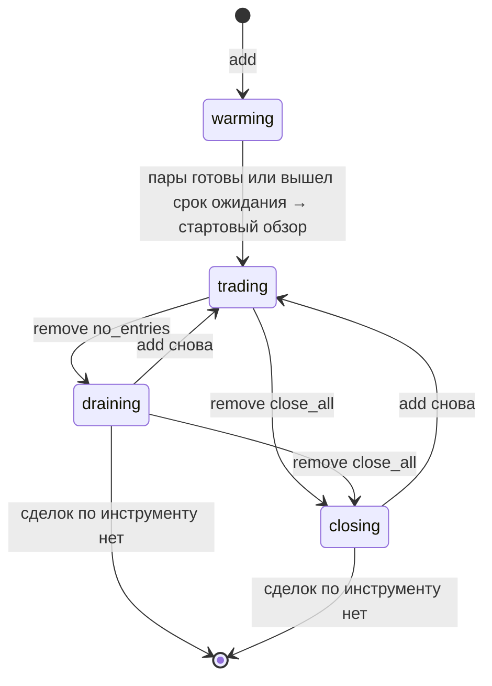
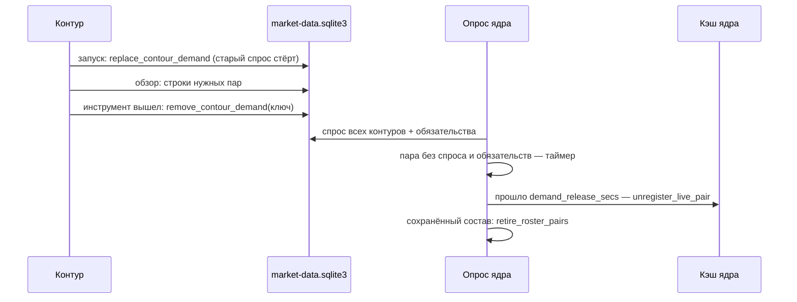

## Context

После П4:

- **Ядро** хранит желаемое контура в `core.sqlite3`: `running`, режим
  остановки, поколение и состав запуска (`instruments_json`). Главный поток
  ядра надзирает за процессом контура (`_supervise`). Команды из HTTP-потока
  разбирает главный поток: разрешение токенов ходит к брокеру.
- **Контур** (`ContourControl`) на границе тика читает желаемое и применяет
  остановку через менеджер сделок.
- **Состав контура** фиксируется при запуске. Он хранится в:
  - `TradingBot._instruments`;
  - `ConstantContractLifecycle`;
  - `runtime.execution_aliases` и `runtime.execution_instruments`;
  - карточках брокера и журнала.

  Стартовый обзор (`LiveAnalysis._bootstrap`) выполняется один раз по всем
  инструментам.
- **Готовые механизмы:**
  - стратегии бот строит для всех привязок конфига сразу
    (`_strategy_cache`);
  - брокер и журнал умеют дополнять карточки (`set_contracts`,
    `set_contract_metadata`);
  - контур запрашивает недостающую историю у ядра строками
    `contour_demand`.

## Goals / Non-Goals

**Goals:**

- Добавить и убрать инструмент командой, не останавливая контур и не трогая
  остальные инструменты.
- Добавленный инструмент не торгует, пока его пары не прогреты, а первый
  обзор не переигрывает историю.
- Убранный инструмент доводит свои сделки так же безопасно, как остановка
  контура в П4.
- Карточку нового контракта получает ядро, контур к брокеру не ходит.

**Non-Goals:**

- Снятие одной привязки по id.
- Сброс устаревшего курсора анализа у возвращённого инструмента (решение
  владельца: догон остаётся, как после рестарта).
- Автоподъём (П6), история через API (П7).

## Decisions

### 1. Кто что пишет



| Факт | Где | Пишет |
| --- | --- | --- |
| желаемый состав: инструмент, карточка, `active`/`removed`, режим | `core.sqlite3` · `contour_members` | ядро |
| поколение контура | `core.sqlite3` · `contours.generation` | ядро |
| фактические состояния участников | `status.json` · `members` | контур |
| применённое поколение | `trades.sqlite3` · `contour_state` | контур |

Отдельной таблицы фактического состава у контура нет. После рестарта
процесса состав восстанавливается из желаемого и открытых сделок журнала.

### 2. Схема `contour_members`

```sql
CREATE TABLE IF NOT EXISTS contour_members (
  contour_id TEXT NOT NULL,
  instrument_key TEXT NOT NULL,         -- ключ инструмента (uid или тикер), как в журнале
  instrument_json TEXT NOT NULL,        -- карточка: имя, тикер, тип, семейство, токен, дни до экспирации
  contract_json TEXT,                   -- шаг цены, стоимость шага, ГО — от ядра
  desired TEXT NOT NULL CHECK(desired IN ('active', 'removed')),
  remove_mode TEXT CHECK(remove_mode IN ('no_entries', 'close_all')),
  changed_generation INTEGER NOT NULL,
  updated_at TEXT NOT NULL,
  PRIMARY KEY (contour_id, instrument_key));
```

- `record_launch` удаляет участников контура и вставляет состав запуска как
  `active`. Поле `instruments_json` в `contours` остаётся для совместимости.
- `add`: инструмент становится `active`, режим снимается, поколение растёт.
  Уже активный — `ignored`.
- `remove`: инструмент становится `removed` с режимом, поколение растёт.
  Повтор с тем же режимом — `ignored`. `close_all` поверх `no_entries` —
  новое поколение. `no_entries` поверх `close_all` — `conflict`. Инструмента
  нет в составе — отказ с причиной.
- Одна команда меняет несколько строк в одной транзакции и поднимает
  поколение один раз.

### 3. Команда в ядре



- `_supervise` вместо `sleep` ждёт команду состава из очереди
  (`control.next_membership(poll_secs)`). Разрешение токенов и карточки
  выполняются там же, где при запуске: в главном потоке и через арбитр
  лимитов ядра.
- **Ответы:**
  - ответ не уложился в 60 с — `202` без поколения, итог виден в `GET`;
  - хотя бы один токен `add` отклонён — `422` с отказами, состав не меняется;
  - токен `remove` разрешается по участникам контура: короткое имя
    контракта, тикер акции или код семейства, если в составе ровно один его
    контракт. Не найден — `422`.
- **Отказы `409`:**
  - процесс контура не работает — `NOT_RUNNING`;
  - контур выполняет остановку — `STOPPING`.

### 4. Контур: применение состава



`ContourControl.before_tick` сравнивает желаемый состав с текущим. Изменения
применяются только на границе тика, никогда посреди тика.

- **Добавление.**
  - Карточка уходит в брокер и журнал.
  - Инструмент попадает в список прогрева, а не в цикл бота.
  - Контур регистрирует его потребности (`register_needs` для одного
    инструмента), ядро прогревает пары.
  - Инструмент выходит из прогрева, когда пары его привязок и защитный 1m
    не в `BOOTSTRAPPING`, либо через `startup_wait_timeout_secs`, как
    стартовое ожидание. Тогда выполняется стартовый обзор этого инструмента
    (`LiveAnalysis.bootstrap_instrument`). Курсор анализа — сохранённый или
    последний бар, история не переигрывается.
  - После обзора инструмент добавляется в `TradingBot._instruments`, в
    жизненный цикл и в алиасы исполнения.
- **Снятие.**
  - Менеджер получает остановку инструмента
    (`stop_instrument(key, mode)`).
  - Инструмент остаётся в цикле бота: сопровождение и защитный 1m
    продолжаются.
  - Когда по инструменту нет открытых позиций и неисполненных входов,
    инструмент выходит из цикла бота, жизненного цикла и списков исполнения.
- **Возврат.** `add` доживающего или закрывающегося снимает остановку
  инструмента, прогрев и обзор не нужны.
- **Повтор после сбоя.** Остановка инструмента повторяется каждый тик, пока
  он не вышел; повтор идемпотентен, как в П4. При старте процесса контур
  применяет весь желаемый состав. Инструменты `removed` с открытыми сделками
  в журнале остаются в цикле, пока не доживут.

### 5. Менеджер сделок: остановка инструмента

`stop_contour(mode)` из П4 обобщается:

- **Хранение.** `_contour_stop` остаётся на весь контур, рядом появляется
  `_instrument_stops: dict[ключ, режим]`.
- **Новый вход** отклоняется, если остановлен контур (`contour-stopping`)
  или его инструмент (`instrument-removing`).
- **Добор** отклоняется так же.
- **`stop_instrument(key, mode | None)`** снимает входы, а при `close_all`
  закрывает позиции только этого инструмента. `None` снимает остановку.
  Причина действий — `instrument-remove`.
- **Остаток.** `contour_remainder(key=None)` считает открытые позиции и
  неисполненные входы контура или одного инструмента.

### 6. Состояние в API

```json
"instruments": [{"token": "NG", "name": "NG-12.26", "instrument_type": "future", "days_to_expiry": 52}],
"members": [
  {"name": "NG-12.26", "instrument_type": "future", "desired": "active", "remove_mode": null, "actual": "trading"},
  {"name": "SBER", "instrument_type": "share", "desired": "removed", "remove_mode": "no_entries", "actual": "draining"},
  {"name": "BR-12.26", "instrument_type": "future", "desired": "active", "remove_mode": null, "actual": "warming"}
]
```

- `instruments` — текущий желаемый активный состав.
- `members` — все строки `contour_members` с фактическим состоянием из
  `status.json`. `actual = null`: контур ещё не применил изменение или
  инструмент уже вышел из состава.

### 7. Спрос контура и пары ядра

С П3.2 строки `contour_demand` только добавляются (`record_contour_demand`,
upsert с ростом глубины). Ядро (`ContourDemandPoller`) читает их все и
держит каждую пару. В итоге пара любого инструмента, который контур
когда-либо торговал, остаётся у ядра навсегда, в том числе после рестарта.



- **Контур.**
  - `FeedMarketServices.serve` начинает с `replace_contour_demand`: строки
    контура заменяются начальным спросом из `ContourDemand`.
  - При выходе инструмента из состава `StoreCoreLink.forget(instrument)`
    удаляет его строки и забывает отправленные глубины.
- **Ядро.** `ContourDemandPoller` помнит пары, которые сам зарегистрировал.
  Пара получает отметку «без спроса», если выполнены оба условия:
  - её нет в объединённом спросе ни одного контура;
  - инструмент не держится объединёнными обязательствами: ни ключ, ни UID
    пары.

  Через `demand_release_secs` после отметки пара снимается:
  - `unregister_live_pair` в кэше;
  - `retire_roster_pairs` у владельца входа, чтобы она не вернулась из
    сохранённого состава после рестарта;
  - пары паттернов этого инструмента — у сторожа ядра.

  Появился спрос раньше срока — отметка снимается.
- **Почему выдержка.** При запуске контур сначала очищает спрос, а затем
  заполняет его заново, пока идёт стартовый обзор (минуты). Без выдержки
  ядро сняло бы пары и тут же начало греть их снова.
- **Пары вне строк спроса** (сохранённый состав и пары, зарегистрированные
  до первой строки) по-прежнему снимает существующий механизм
  `retire_unrequested_pairs` при старте.

## Risks / Trade-offs

- **Долгий прогрев на выходных.** Пары нового инструмента могут не
  прогреться, пока рынок закрыт. → Через `startup_wait_timeout_secs`
  обзор выполняется с причинами, как при запуске. Торговля начнётся, когда
  данные придут.
- **Догон по старому курсору анализа.** Если инструмент торговал раньше, его
  сохранённый курсор старый, и обзор догоняет пропущенные бары так же, как
  после рестарта. → Принято. Поведение то же, что у запуска.
- **Повторное добавление в пределах выдержки.** Если инструмент вернули
  раньше `demand_release_secs`, пары ещё не сняты и прогрев не нужен. Если
  позже — пары прогреваются заново. → Это ожидаемо, а выдержка
  настраивается.
- **Ключ участника.** Для фьючерса ключом служит контракт (`NG-12.26`), а
  не семейство. Переход семейства на следующий контракт — это remove старого
  и add нового. → Явная модель, автоматического перехода в эмуляции нет и
  сейчас.

## Migration Plan

- `contour_members` создаётся при первом открытии `core.sqlite3`. Если
  контур уже запущен по старой схеме, ядро заполняет участников из
  `instruments_json` при первом изменении состава.
- `members` в `status.json` — новое необязательное поле. API показывает
  `actual = null`, пока контур его не пишет.
- Накопленные строки `contour_demand` (BR-11.26, NG-10.26 на рабочей базе)
  заменяются при первом запуске контура новой версии. Их пары ядро снимет
  через `demand_release_secs`, если по ним нет сделок.

## Open Questions

Нет. Решения владельца:
- единица состава — инструмент;
- `remove` без режима — `no_entries`;
- спрос контура очищается, ядро снимает пары без спроса после выдержки;
- догон по старому курсору анализа не меняется.
