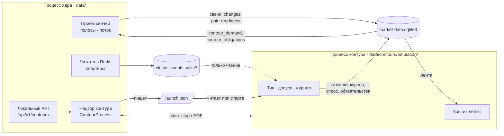

## Context

После П3.1 (`add-contour-market-feed`) контур эмуляции собран на
`FeedMarketServices`: свой кэш свечей из ленты `changes`, курсор
`contour-emulation`, отметки исполнения под ключом контура. Но служба ленты
держит ссылку на объект ядра и вызывает его в том же процессе:

```
FeedMarketServices
 ├─ _CoreLink.request_history / touch  → core.data_cache (спрос пар, глубина истории)
 ├─ core.serve(demand)                  → приём, поток, обработчик паттернов
 ├─ core.update_obligations(...)        → владелец входа, каждый тик
 ├─ core.cluster_gate(state_dir)        → хранилище кластеров и кэш ядра
 └─ core.timeline / market_calendar / request_budget
TradingContour._build_runtime
 └─ _load_contracts_metadata(...)       → брокер через арбитр ядра
```

Решения владельца перед этим изменением:

1. Потребности контура идут через рыночную базу строками под `contour_id`,
   ядро их опрашивает.
2. Состав и карточки контрактов контур получает от ядра файлом запуска и к
   брокеру не обращается.
3. Если ядро завершилось, контур доделывает тик и выходит.
4. Вывод контура — в ту же консоль, что ядро.

## Goals / Non-Goals

**Goals:**

- Контур эмуляции работает отдельным процессом и не держит в памяти ни одного
  объекта ядра.
- Квоты T-Invest тратит только ядро.
- Решения контура те же, что в П3.1.
- Журнал эмуляции переезжает в папку контура без потерь и с копией для отката.

**Non-Goals:** см. proposal.

## Схема процессов



## Decisions

### D1. Процесс контура — тот же исполняемый файл

Ядро запускает контур командой `<исполняемый файл> --contour emulation` (в
разработке — `python run.py --contour emulation`). Флаг служебный: в справке
не показывается и не сочетается с `--mode`. Процесс:

- берёт блокировку `data/contours/emulation/robot.pid`;
- пишет технический журнал в `data/contours/emulation/bot_debug.log` с теми
  же секретами в маске, что ядро;
- читает `launch.json`, открывает `market-data.sqlite3` и
  `cluster-events.sqlite3`, собирает `TradingContour` на `FeedMarketServices`
  без объекта ядра и запускает тик.

Вывод (stdout, stderr) наследуется от ядра, поэтому СИГНАЛ, ПЛАН и ОТКЛОНЕНО
видны в той же консоли.

*Альтернатива:* `multiprocessing` с общими объектами. Отклонена: дочерний
процесс зависел бы от памяти родителя, а П6 требует, чтобы контур пережил
рестарт ядра.

### D2. Файл запуска `launch.json`

Пишет ядро перед запуском процесса, читает контур один раз при старте. Один
владелец — ядро.

```json
{
  "schema_version": 1,
  "contour_id": "emulation",
  "kind": "emulation",
  "core_pid": 81306,
  "core_version": "7.0.0",
  "source": "api",
  "command": "--mode emulation --instruments NG-12.26,SBER",
  "telegram_channel_env": "TELEGRAM_CHANNEL_ID",
  "instruments": [
    {"label": "NG-12.26", "ticker": "NGZ6", "instrument_type": "future", "short_name": "NG-12.26",
     "uid": "…", "family": "NG"}
  ],
  "contracts": {"<uid>": {"price_step": "0.001", "step_cost": "…", "go_buy": "…", "go_sell": "…",
                          "currency": "RUB", "expiration_date": "2026-12-26"}}
}
```

Карточки контрактов (`_load_contracts_metadata`) переезжают в ядро: оно
запрашивает их через свой арбитр до запуска контура. Контур с другой
`schema_version` или чужим `contour_id` не стартует и пишет причину.
Значений секретов в файле нет, только имя переменной канала.

### D3. Потребности строками в рыночной базе

Новые таблицы `market-data.sqlite3` создаются при открытии базы, как
таблицы П3.1; версия схемы экспорта (`schema_version` в `/source`) не
меняется — контракт `/changes` тот же. Пишет только контур своего
`contour_id`, читает ядро.

```sql
contour_demand(contour_id TEXT, instrument_key TEXT, interval TEXT, min_bars INTEGER,
               instrument_json TEXT, updated_at TEXT,
               PRIMARY KEY (contour_id, instrument_key, interval))
contour_obligations(contour_id TEXT, instrument_key TEXT, lower_open_time TEXT,
                    inclusive INTEGER, updated_at TEXT,
                    PRIMARY KEY (contour_id, instrument_key))
```

`instrument_key` — UID, если он есть у инструмента, иначе биржевой тикер:
инструменты live-выбора строятся без UID. `instrument_json` — карточка
инструмента (метка, тикер, тип, короткое имя, UID, семейство), по которой
ядро регистрирует пару. Ключ обязательства — UID рыночной пары, как прежде
передавал `_market_obligations`.

- `contour_demand` заменяет `_CoreLink.request_history` и `touch`: строка
  появляется при первом запросе кадра и при росте глубины; глубина не
  уменьшается, пока контур жив.
- `contour_obligations` заменяет `update_obligations`: после commit тика
  контур одной транзакцией заменяет свои строки текущим снимком обязательств
  (`_market_obligations`). Пустой снимок удаляет строки.
- Ядро опрашивает обе таблицы раз в `[contours] feed_poll_secs` (1 с) в
  потоке приёма. Обязательства всех контуров объединяются: на UID берётся
  самая ранняя граница, при равной — включительная. Спрос объединяется по
  наибольшей глубине.
- Строки остановленного контура остаются: обязательства его незавершённых
  сделок должны удерживать целостность, пока он не запущен снова (П6).

*Альтернатива:* служебные HTTP-маршруты ядра. Отклонена владельцем: связь
рвётся при рестарте ядра, а запись в базу переживает его.

### D4. Ожидание старта и состояние `running`

Ядро до запуска процесса прогревает пары выбранных инструментов, как сейчас
`serve(demand)`. Контур при старте записывает спрос из своей финансовой базы
(сопровождение открытых сделок может требовать большей глубины), ждёт
готовности пар в `pair_readiness` и догоняет ленту — прежнее ожидание
`FeedMarketServices`.

Ядро показывает `running`, когда процесс жив и контур первый раз подтвердил
курсор `contour-emulation` после запуска. До этого — `starting`.

### D5. Жизнь процесса: канал stdin

```mermaid
sequenceDiagram
    participant A as API / меню / CLI
    participant C as Ядро
    participant P as Процесс контура
    A->>C: инструменты выбраны
    C->>C: карточки контрактов, прогрев пар
    C->>P: launch.json + запуск (stdin открыт)
    P->>P: тики
    alt штатная остановка ядра (Ctrl+C, завершение)
        C->>P: stdin: "stop"
        P->>P: доделать тик, commit, курсор
        P-->>C: exit 0
        C->>C: ждёт до 30 с, иначе kill
    else ядро упало
        C--xP: stdin: EOF
        P->>P: доделать тик, commit, выйти
    else контур упал
        P--xC: exit ≠ 0
        C->>C: state = failed, exit_code; торговля не перезапускается
    end
```

- Поток контура читает stdin построчно. `stop` или конец потока ставят флаг
  остановки; оркестратор проверяет его на границе тика.
- Ctrl+C в консоли доходит до обоих процессов. Контур обрабатывает его как
  `stop`, ядро — как прежде, затем ждёт контур.
- Перезапуска упавшего контура нет: это П6. Ядро пишет ERROR в журнал и
  консоль и показывает `failed` с кодом выхода.
- Канал stdin — временный механизм П3.2. В П4 желаемое состояние уходит в
  `core.sqlite3`, stdin остаётся только признаком жизни ядра.

*Альтернатива:* сигналы (SIGTERM). Отклонена: на Windows `terminate` —
жёсткое завершение без commit тика.

### D6. Папка контура и переезд журнала

Каталог состояния контура — `data/contours/emulation/`. В нём `trades.sqlite3`,
`trade_event.csv`, `trade_summary.csv`, `trade_decision_trace.log*`,
`telegram_delivery.sqlite3`, `telegram-diagnostics/`, `bot_debug.log*`,
`robot.pid`, `launch.json`.

Переезд делает ядро один раз перед первым запуском контура, если в папке
контура ещё нет `trades.sqlite3`, а в `data/` он есть:

1. SQLite-файлы копируются через `sqlite3.backup` (с учётом WAL), остальные —
   копией файла.
2. В папке контура пишется `migrated-from.json` (откуда, когда, версия).
3. Исходные файлы в `data/` не удаляются — это копия для отката на прежнюю
   версию. Новая версия их больше не читает и не пишет.

Если копирование прервалось, неполная папка удаляется, контур не
запускается, причина в консоли.

### D7. Кластеры

Читатель Redis и `cluster-events.sqlite3` остаются у ядра (`data/`). Контур
открывает хранилище в режиме только чтения (`mode=ro`, без создания схемы) и
считает вердикт по своему кэшу; UID пары даёт `FollowerMarketDataCache.pair_uid`.
Отчёт `GET /api/v1/clusters/report` читает `data/contours/emulation/trades.sqlite3`.

### D8. Календарь, часы и квоты в процессе контура

- Планировщик тиков контур строит сам, по тем же ТФ привязок.
- Календарь — `MarketCalendar` над рыночной базой без сетевого источника:
  расписание пишет ядро, контур его читает.
- Арбитра квот у контура нет (`request_budget = None`). Свечные и
  инструментальные методы T-Invest контур не вызывает; попытка — ошибка
  сборки, а не тихий запрос.

### D9. Канал Telegram

`[contours.emulation] telegram_channel_env` — имя переменной окружения с id
канала (по умолчанию `TELEGRAM_CHANNEL_ID`). Токен бота общий,
`TELEGRAM_BOT_TOKEN`. Если переменная не задана, контур работает без Telegram
и пишет предупреждение. Значение id в журнал не попадает.

### D10. Удаление `market_feed`

Ключ `[contours] market_feed` и путь контура на памяти ядра удаляются. Ключ
в `robot.toml` пользователя даёт понятный `ConfigError` с подсказкой удалить
строку. Откат — запуск прежней версии на сохранённых в `data/` файлах.

## Risks / Trade-offs

- **Задержка спроса.** Запрос истории идёт через опрос (до 1 с), а не вызовом.
  Пара остаётся `BOOTSTRAPPING` на секунду дольше; ожидание тика это уже
  учитывает.
- **Два писателя одного файла SQLite.** Рыночную базу пишут ядро и контур
  (свои строки). WAL и короткие транзакции; `busy_timeout` 30 с. Нагрузка
  контура — несколько строк на тик.
- **Обязательства остановленного контура** удерживают целостность UID, пока
  его строки в базе. Это намеренно; снятие строк — команда П4/П5.
- **Двойной процесс контура.** Блокировка `robot.pid` в папке контура не даёт
  запустить второй, даже если ядро ошиблось.
- **Откат на прежнюю версию** продолжит со старого журнала в `data/`: сделки,
  открытые новой версией после переезда, там не видны. Это записано в
  CHANGELOG.

## Migration Plan

1. Новая версия при первом запуске эмуляции переносит журнал (D6).
2. Неделя эмуляции: сравнение сигналов и сделок с прежними днями, ошибки
   `failed` и расхождения ленты в журнале ядра.
3. Откат — прежняя версия; её файлы в `data/` не тронуты.
