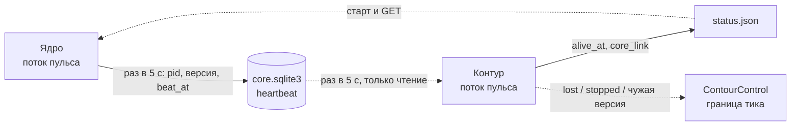
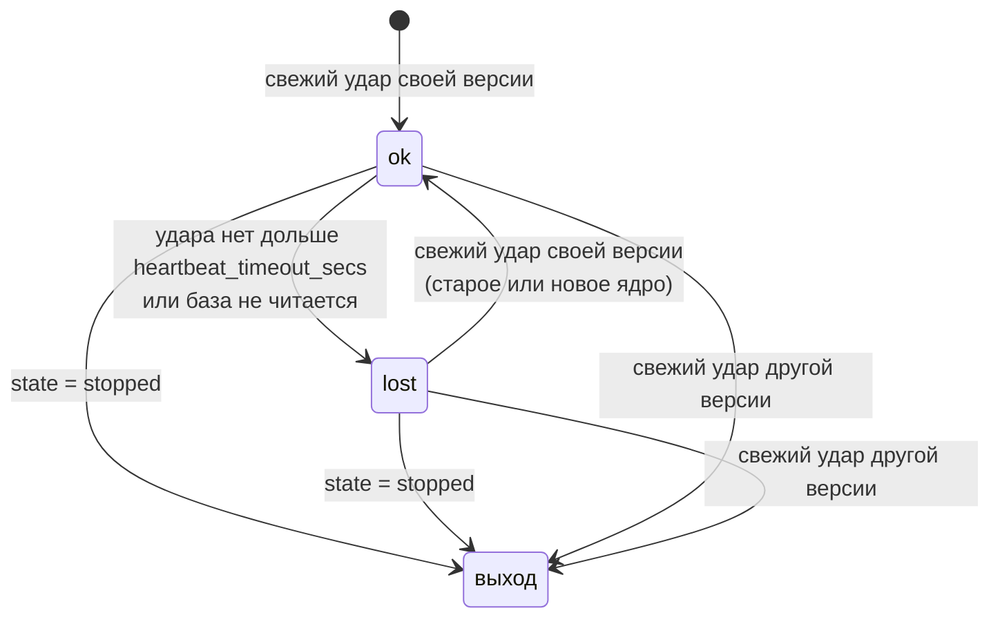
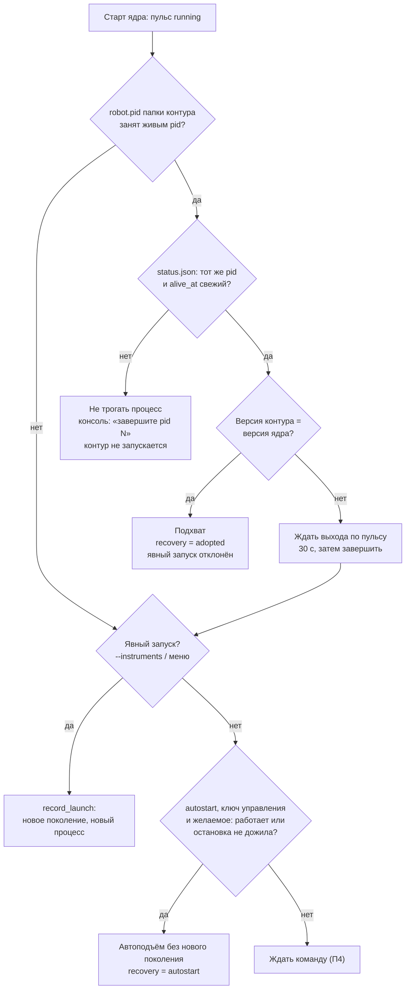
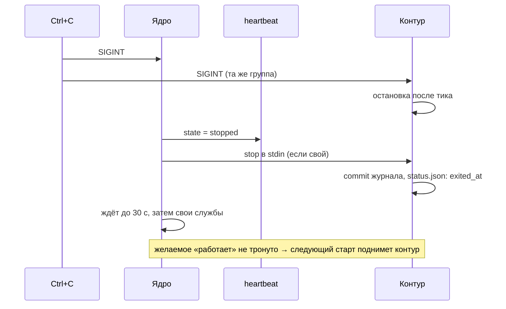

## Context

После П5:

- **Ядро** хранит желаемое контура в `core.sqlite3`: `contours` и
  `contour_members`. Стоп и состав доходят до контура через базу на
  границе тика. stdin нужен только для двух вещей: строка `stop` при
  остановке ядра и конец потока как сигнал «ядро завершилось».
- **Контур** держит `robot.pid` в своей папке
  (`acquire_runtime_lock`) и пишет `status.json` после каждого тика: pid,
  версия, состояние, поколение, участники.
- **Старт ядра** (`_launch` в `run.py`):
  1. ранние полосы данных;
  2. API;
  3. `_choose_instruments` ждёт команду или берёт параметры;
  4. `LiveCore.run_contour` всегда пишет новое желаемое (`record_launch`)
     и запускает новый процесс.
- **Ctrl+C** доходит до обоих процессов: контур в той же группе процессов.
  Контур останавливается на границе тика, ядро шлёт `stop` и ждёт до 30 с.

## Goals / Non-Goals

**Goals:**

- Три рестарта без потерь сделок и без двух контуров на одной папке:
  - штатная остановка ядра и новый старт;
  - аварийная смерть ядра при живом контуре;
  - обновление версии.
- Контур без ядра не входит в новые сделки и не теряет открытые.
- Ядро после рестарта само возвращает контур в желаемое состояние.

**Non-Goals:**

- Telegram-сообщения о связи с ядром — нет канала системных сообщений.
- Автоматический перезапуск упавшего контура в работающем ядре.
- Сторож зависшего главного потока ядра.
- Отдельная группа процессов контура: Ctrl+C и закрытие терминала по-прежнему
  останавливают оба процесса (решение владельца — Ctrl+C останавливает всё).

## Decisions

### 1. Кто что пишет



- `heartbeat` — одна строка на ядро: `core_pid`, `core_version`,
  `started_at`, `beat_at`, `state` (`running` / `stopped`). Пишет только
  ядро, правило П4 сохраняется.
- Ядро пишет первый удар **до** подхвата или запуска контура. Иначе
  свежий контур прочитал бы `stopped` прошлого ядра и сразу вышел.
- Контур не пишет в `core.sqlite3`. Свой признак жизни он кладёт в
  `status.json` (`alive_at`), под тем же замком, что и запись после тика.

Альтернатива — пульс файлом рядом с базой — отклонена: `core.sqlite3` уже
читается контуром на каждом тике, а WAL даёт атомарность без своих
временных файлов.

### 2. Пульс глазами контура



- `lost` переводит менеджер сделок в запрет входов `core-lost` на ближайшей
  границе тика. Неисполненные входы не снимаются: без свечей ядра они не
  исполнятся, а после возврата ядра догон идёт по обычным правилам.
- Тик может идти и без ядра, пока контур дочитывает ленту. Поэтому запрет
  ставится явно, а не выводится из отсутствия свечей.
- Выход — тот же путь, что `stop` в stdin: `StdinStop.request(причина)`,
  остановка после тика, commit журнала и курсора. Желаемое не меняется.
- Выдержка 30 с при ударе раз в 5 с переживает шесть пропусков записи:
  длинный checkpoint WAL или занятую базу.

### 3. stdin больше не сигнал смерти

`StdinStop` реагирует только на строку `stop`. Конец потока лишь пишется
в журнал контура: ядро могло умереть, а могло быть подхвачено новым ядром
без stdin. Что делать, решает поток пульса.

### 4. Старт ядра



- **Признак живого контура** — три условия: pid из `robot.pid` жив,
  `status.json` называет тот же pid и `alive_at` свежее
  `heartbeat_timeout_secs`. Это защищает от чужого процесса, получившего
  тот же pid, и от зависшего контура. Такой процесс ядро не завершает:
  неизвестно, что это за процесс.
- **Ожидание другой версии.** Новое ядро уже пишет пульс своей версии,
  поэтому старый контур выходит сам на ближайшей проверке пульса. Ядро
  ждёт освобождения `robot.pid` до 30 с (`STOP_TIMEOUT_SECS`) и только
  затем завершает процесс: `SIGKILL` на POSIX, `TerminateProcess` на
  Windows.
- **«Остановка не дожила»** — желаемое `running = false`, а последний
  `status.json` показывает `stopping_*`, а не `stopped`. Контур поднимается,
  применяет остановку при старте (П4) и доводит сделки.
- **Без `ROBOT_CONTROL_TOKEN` автоподъёма нет:** поднятый сам контур
  было бы нечем остановить, кроме Ctrl+C, а ожидание команды без ключа и
  так отказывает с кодом 2.
- **Явный запуск при живом контуре той же версии** отклоняется сообщением
  в консоли: «Контур уже работает (pid N) и подхвачен; состав меняется
  командой /instruments». Это тот же ответ, что `409 ALREADY_RUNNING` у
  `POST`.

### 5. Автоподъём

- Состав запуска:
  - все `active` участники;
  - `removed` участники, которых последний `status.json` ещё показывал в
    `members`, — у них были сделки.

  Без `status.json` берутся все `removed`, контур снимет лишних на первом
  тике (П5).
- Карточки контрактов ядро запрашивает заново, как при обычном запуске.
  При сбое берутся сохранённые `contract_json`.
- `record_launch` не вызывается: поколение и режим остановки остаются.
  `launch.json` получает текущее поколение.
- Источник в API — прежний из желаемого (`cli`, `menu`, `api`) и
  `recovery = "autostart"`.

### 6. Подхват

- Ядро не владеет `Popen` подхваченного процесса. Его заменяет
  `AdoptedProcess(pid)` с тем же интерфейсом, что у `ContourProcess`:
  `running`, `pid`, `exit_code`, `stop()`. Поток раз в `poll_secs`
  проверяет `_process_alive(pid)`.
- Команды стопа и состава идут через `core.sqlite3` — им stdin не нужен.
- **Итог выхода** без кода возврата: `status.json` с `exited_at` позже
  подхвата — `stopped` (код 0), иначе `failed` с `exit_code = null`.
- **`stop()` при Ctrl+C нового ядра:** ядро пишет пульс `stopped`, ждёт
  выхода до 30 с и затем завершает процесс.
- `starting` → `running` — по первому подтверждению курсора ленты после
  старта ядра, как у своего процесса.

### 7. Штатная остановка ядра



### 8. `GET /api/v1/core`

Ключ управления, как у маршрутов контуров.

```json
{
  "version": "7.1.0", "pid": 4242, "started_at": "...",
  "heartbeat": {"beat_at": "...", "interval_secs": 5},
  "market_data": {"producer_id": "...", "max_change_id": 812345,
                  "pairs": {"total": 14, "by_status": {"READY": 13, "BOOTSTRAPPING": 1}}},
  "quotas": {"quotes": {"per_minute": 41, "ceiling": 180, "lanes": {"live": 30, "evidence": 11},
                        "retry_after": null}}
}
```

- `pairs` — сводка `pair_readiness_all` без списка пар.
- `quotas` — `RequestBudget.snapshot()`.

Ответ не содержит секретов, адресов и токенов.

### 9. Настройки

```toml
[contours]
heartbeat_secs = 5            # Как часто ядро бьёт пульс, а контур его читает, секунд.
heartbeat_timeout_secs = 30   # Без пульса дольше — контур не входит в новые сделки.
autostart = true              # Поднимать контур при старте ядра в ожидании команды.
```

`heartbeat_timeout_secs` должен быть больше `heartbeat_secs`, иначе
конфиг отклоняется.

## Risks / Trade-offs

- **Ядро убито, терминал жив, контур пишет в консоль.** Вывод контура
  идёт в терминал старого ядра. Если терминал закрыт, контур получает
  SIGHUP и завершается. Это допустимо: журнал цел, автоподъём при
  следующем старте.
- **Повторное использование pid.** Закрыто третьим условием: свежий
  `alive_at`. Процесс, не подтвердивший себя, ядро не завершает, а
  выводит pid в консоль.
- **Без пульса контур ждёт без срока** (решение владельца). Процесс-сирота
  живёт, пока его не подхватят или не завершат. Видно в его логе и в
  `status.json` (`core_link: lost`).
- **Автоподъём сразу после обновления.** Первый старт новой версии в
  ожидании команды поднимет эмуляцию, если перед остановкой она работала.
  Об этом сказано в README и CHANGELOG. Отключение —
  `[contours] autostart = false`.

## Migration Plan

- Таблица `heartbeat` создаётся при открытии `CoreStateStore`.
- Старый `status.json` без `alive_at` означает, что живой контур не
  подтверждён. Контур прежней версии и так завершается при смерти ядра
  по концу stdin.
- Откат на П5: таблица и новые поля игнорируются. Ядро П5 после рестарта
  снова ждёт команду.

## Open Questions

Нет.
