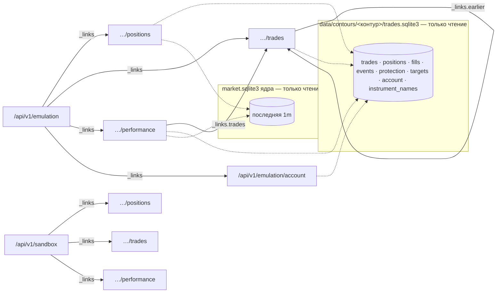

## Context

- **Журнал сделок контура** (`src/trade_journal/`, `trades.sqlite3`):
  - лежит в папке контура — `data/contours/emulation/` и `data/contours/sandbox/`, требование «Журнал эмуляции в папке контура»;
  - пишет его только процесс контура, режим WAL.
- **Таблицы журнала:**

  | Таблица | Что в ней |
  |---|---|
  | `trades` | сделка: `trade_id`, `assignment_id` (= id привязки из `robot.toml`), `instrument_id` (биржевой тикер, `SiZ6`), `side`, `phase`, `price_step`, `step_cost`, `created_at` |
  | `positions` | `quantity`, `average_price`, `realized_pnl`, `fees`, `net_realized_pnl` |
  | `orders` + `fills` | исполнения с `action_type`: `OPEN`, `ADD` — вход; `REDUCE`, `TARGET:<id>`, `STOP`, `CLOSE` — выход |
  | `events` | причина исполнения (`payload_json.reason`) |
  | `protection` | `confirmed_stop`, `pending_stop` |
  | `targets` | цели: цена, план и исполнено по лотам |
  | `account` | виртуальный счёт: `balance`, `realized_pnl`, `fees`, `net_realized_pnl` |
  | `instrument_names` | тикер → короткое имя |

- **Фазы сделки** (`reducer._update_phase`):
  - открыта: `OPEN`, `BUILDING`, `REDUCING`;
  - конечные: `CLOSED`, `CANCELLED`, `REJECTED`, `ERROR`.

  Живой журнал эмуляции на 31.10: 33 `CLOSED`, 7 `CANCELLED`, 1 `OPEN`. Журнал песочницы в С3 существует, но может быть пустым и даже без таблиц.
- **Карточка сделки уже собирается** в `CsvExporter._position_card` (`src/trade_journal/export.py`):
  - средние цены входа и выхода;
  - `max_quantity`;
  - сценарий выхода («частичный выход (часть) + стоп (остаток)»);
  - брутто, комиссия, нетто;
  - `result_r`;
  - подписи причин — `reasons.py`.
- **Ядро уже читает файлы контура:**
  - `GET /api/v1/sandbox/reconcile` — `broker.sqlite3`;
  - отчёт кластеров — `trades.sqlite3` эмуляции вместе с `1m` из рыночной базы ядра.
- **Потребитель** — UI робота, карточка «Позиции и сделки» (`UI/docs/api/trading.md`, `UI/docs/screens/contour.md`). Опрос раз в 5–15 с.

## Goals / Non-Goals

**Goals:**

- Отдать UI открытые позиции, закрытые сделки и итоги периода одинаково для эмуляции и песочницы.
- Считать итоги и кривую на роботе, а не в браузере: на «Всё» иначе пришлось бы тянуть в браузер весь журнал.
- Ноль влияния на торговлю: только чтение, без участия процесса контура.
- Схемы, которые без изменений подойдут прогонам Истории.

**Non-Goals:**

- Ресурсы для прогонов Истории (`/api/v1/history/{run_id}/…`) — позже, на этих же схемах; закроют пробел UI № 3.
- Метки сделок на свечном графике как отдельный ресурс — UI строит их из `entries` и `exits` в `…/trades?instrument=` и `…/positions`.
- Заявки на вход, которые ждут исполнения (`pending_entries`), в списке позиций — утверждённый макет их не показывает; при надобности — отдельное расширение `…/positions`.
- Поток событий вместо опроса.
- Отменённые и отклонённые входы (`CANCELLED`, `REJECTED`) — это не сделки; они видны в журнале контура и в CSV.
- Изменения схемы журнала, CSV-проекций и Telegram.
- Стратегии участника эмуляции (пробел UI № 9) — отдельное изменение.

## Decisions

### 1. Адрес: под ресурсом контура

| Вариант | За | Против |
|---|---|---|
| **`/api/v1/emulation/positions`, `/api/v1/sandbox/positions`, …** | у каждого контура свой журнал; права, ссылки и жизненный цикл — от контура; История потом встаёт как `/api/v1/history/{run_id}/…` | шесть маршрутов вместо трёх |
| `/api/v1/trades?contour=emulation` | один маршрут | параметр, без которого ответ бессмыслен; не ложится на прогоны |
| в `GET /api/v1/emulation` | один запрос | требование «Состояние контура» запрещает сделки и баланс в состоянии; ответ раздувается, `ETag` ревизии перестаёт значить «состав и цель» |

Выбран первый. Обработчики общие, различается только папка контура.



### 2. Читает ядро, а не процесс контура

Ядро открывает `trades.sqlite3` контура по URI `file:…?mode=ro`. WAL допускает чтение параллельно с записью процесса. Плюсы:

- ответ есть у остановленного и упавшего контура: журнал на месте;
- процесс контура не получает новой обязанности и нового канала;
- так уже устроены сверка и отчёт кластеров.

Каждый запрос — одна транзакция чтения. Файла нет или в нём нет таблиц журнала (песочница до первой сделки) → пустой ответ `200`, не ошибка.

### 3. Сделка, позиция и закрытая сделка

Единица — сделка журнала (`trade_id`): вход по сигналу, доборы, частичные выходы, закрытие.

| Ресурс | Какие сделки |
|---|---|
| `…/positions` | `positions.quantity > 0` (фазы `OPEN`, `BUILDING`, `REDUCING`) |
| `…/trades` | фаза `CLOSED` и хотя бы одно исполнение входа |

`closed_at` — время последнего исполнения выхода, `opened_at` — первого входа. Поля карточки — те же правила, что у CSV-проекции «Позиции»:

- `lots` закрытой сделки — `max_quantity`;
- `entry_price` и `exit_price` — средние по исполнениям;
- `entries` и `exits` — сами исполнения одной формой (`at`, `lots`, `price`; у выхода ещё `kind`, `code`, `label`). По ним UI ставит метки на свечной график: средняя цена не показывает доборы, а частичных выходов в журнале эмуляции много — у 15 сделок по нескольку исполнений выхода;
- `exit` — вид, код и подпись последнего выхода и сценарий целиком;
- `gross`, `fees`, `net` — из `positions`;
- `result_r` — когда риск известен.

У открытой позиции те же `entries` и `exits` (частичные выходы) и `realized` = `net_realized_pnl` журнала: результат частичных выходов минус **все** комиссии сделки на сейчас, включая комиссию входа. Только так сумма закрытых сделок и `open.realized` сходится с балансом счёта (решение 8).

Сборку исполнений и сценария выносим из `CsvExporter` в общую функцию: CSV и API считают одинаково, формат CSV не меняется.

### 4. Нереализованный результат

Решение владельца: цена — закрытие последней завершённой `1m` из рыночной базы ядра. Тикер переводится в инструмент рыночной базы по её составу.

```
unrealized = (last_price − entry_price) × lots × step_cost / price_step × (+1 для long, −1 для short)
```

- `last_price_at` — время открытия этой свечи. UI видит отставание; до минуты допустимо.
- Нет `1m` в базе, база не открыта, нет `price_step` или `step_cost` → `last_price` и `unrealized` равны `null`, суммы по позициям считаются без этой позиции, а `unrealized_complete: false`.
- Цену из стрима исполнений контура в ядро не передаём: эмуляция стрима не имеет, и цена разошлась бы с графиком.

### 5. Периоды

Решение владельца: «день» — торговый день биржи, с 19:00 МСК накануне.

| `period` | `from` | `to` |
|---|---|---|
| `day` | последние 19:00 МСК, не позже текущего момента | сейчас |
| `week` | понедельник 00:00 МСК текущей недели | сейчас |
| `month` | 1-е число 00:00 МСК текущего месяца | сейчас |
| `all` | `null` | сейчас |
| `from` и `to` явно | как переданы | как переданы, по умолчанию сейчас |

Сделка попадает в период по `closed_at` из `[from, to)`. Граница дня — 19:00 МСК: на FORTS вечерняя сессия открывает следующий торговый день. Календарь торгов для этого не нужен, а значит, нет зависимости от его загрузки и дилерских сессий.

В субботу днём «день» начинается в пятницу в 19:00: это торговый день, который открыла пятничная вечерняя сессия. Неделя и месяц — календарные, так проще объяснить. Вечер пятницы попадает в текущую неделю.

### 6. Итоги и кривая

- `realized` — по закрытым в периоде сделкам: `net`, `gross`, `fees`.
- `trades` — `count`, `winners` (`net > 0`), `losers` (`net < 0`). Нулевая сделка не входит ни туда, ни туда.
- `average_net` — `net / count`, `null` без сделок.
- `profit_factor` — сумма `net` прибыльных / модуль суммы `net` убыточных, `null` без убыточных.
- `curve`:
  - первая точка `{at: from, net: 0}`, у `all` — время первого входа;
  - дальше точка на каждую закрытую сделку по `closed_at` с накопленным `net`;
  - сделки с одинаковым `closed_at` — одной точкой.
- `max_drawdown` — наибольшее падение `curve` от предыдущего максимума, начиная с нуля, и `at` его дна. Нет падения — `0` и `null`.
- `open` — открытые сейчас позиции:
  - `unrealized`;
  - `realized` — сумма `realized` позиций: частичные выходы минус все комиссии, включая комиссию входа;
  - `count`.
- `curve_now` — `{at: сейчас, net: последняя точка + open.realized + open.unrealized}`: пунктирный хвост UI.
- Больше 500 точек → прореживание по равным интервалам времени с сохранением в каждом интервале первой, последней, минимальной и максимальной точки. Просадка считается до прореживания.

- `period.name` — `day`, `week`, `month`, `all` или `custom` при явных `from` и `to`.
- `_links.trades` — список сделок периода. У именованных периодов без `to`: иначе список, открытый по ссылке, застыл бы на моменте запроса итогов, а «Сделки · N» уже посчитали бы новую сделку. У `custom` — с `from` и `to`.

### 7. Деньги и цены

Как в остальном API управления (`capital.rub`, свечи): десятичные строки без потерь точности, рубли. Валюта одна на ответ — поле `currency: "RUB"`, а не объект `{amount, currency}` у каждой суммы. Это отступление от пожелания UI (`trading.md`); UI обновит документ.

Знаки: комиссии — положительный расход (как в журнале); результаты и точки кривой — со знаком; просадка — не больше нуля. Минус перед комиссией («−42 ₽») ставит UI.

### 8. Виртуальный счёт — отдельный ресурс

`GET /api/v1/emulation/account` из таблицы `account`:

- `initial` — начальный депозит;
- `balance`;
- `realized_net` (`net_realized_pnl`);
- `fees`.

Отдельно, а не в `current`, по трём причинам:

- требование «Состояние контура» держит состояние без сделок и баланса;
- состояние читает `status.json` и `core.sqlite3`, а не журнал;
- у песочницы деньги уже в `current.capital` от брокера.

`equity` журнала не выносим: она без переоценки открытых позиций и выглядела бы как капитал.

Журнал меняет `balance` на каждом исполнении: результат минус комиссия, включая частичные выходы и комиссию входа. Поэтому:

- `balance − initial` = сумма `net` всех закрытых сделок + `open.realized`;
- капитал с открытыми позициями = `balance + open.unrealized` — его UI считает сам из `…/account` и `…/performance`.

### 9. Имена и привязки

- **Инструмент** — короткое имя по `instrument_names` журнала (`SiZ6` → `Si-12.26`). Тикера нет в карте → `instrument: null` (UI пишет «контракт не указан»). Биржевой тикер в ответах не появляется (`openspec/config.yaml`).
- **Привязка** — `{id, strategy, timeframe}`: `id` — `assignment_id`, стратегия и таймфрейм — из конфигурации привязок. Привязку убрали из конфигурации → `strategy: null`, таймфрейм — из `trade_id` (`<id>:<тикер>:<таймфрейм>:…`).
- **Идентификатор сделки.** `trade_id` журнала — `<привязка>:<тикер>:<таймфрейм>:<время>:<сторона>`, `signal_id` устроен так же: оба содержат биржевой тикер. Наружу идёт `id` = `t_` + 16 знаков SHA-256 от `trade_id`: стабилен между запросами, тикер из него не восстанавливается. `signal_id` не отдаём: UI связь с отчётом кластеров не нужна.
- **Фильтр `instrument`** у `…/trades` и `…/positions` — короткое имя без учёта регистра; неизвестное → пустой список.

### 10. Листание сделок и `ETag`

- `…/trades`:
  - окно `[from, to)` по `closed_at`, новые сверху;
  - `limit` — 1…1000, по умолчанию 200;
  - `_links.earlier` — если раньше есть закрытые сделки: `to` = `closed_at` последней отданной, тот же `limit` и фильтры;
  - сделки с одинаковым `closed_at` на стыке не теряются: курсор `to` строгий, а сделки с тем же `closed_at`, что у последней отданной, отдаются в той же странице целиком, даже сверх `limit`.
- `ETag`:
  - у `…/trades` — `"<max event_seq журнала>"`; при `If-None-Match` с тем же значением → `304`;
  - у `…/positions` и `…/performance` `ETag` нет: результат меняется с каждой минутой цены.

### 11. Версия контракта

Действующий `docs/api/openapi.yaml` на `integration/current` — 2.3.0 (свечи). Черновик — 2.4.0. Если до влития этого изменения займут 2.4.0, номер сдвигается при влитии.

### 12. Вид выхода

На макете колонка «Причина» — короткая метка: «тейк», «стоп», «сигнал». Подписи журнала для неё не годятся. В живом журнале эмуляции выходы такие:

| `code` | Исполнений | `label` (CSV) |
|---|---|---|
| `ma10-or-cloud-partial-exit` | 39 | частичный выход по MA10/облаку |
| `protective` | 22 | стоп |
| `tp:tp-1`, `tp:tp-2` | 12 | TP1, TP2 |
| `ma40-opposite-close` | 3 | цена ушла за MA40 |
| `intraday-session-end` | 1 | закрытие перед концом торговой сессии |

Поэтому у исполнения выхода три поля:

- `code` — как в журнале;
- `label` — как в CSV, для подсказки;
- `kind` — короткий перечень для метки.

`kind` определяется сначала по типу заявки (`TARGET` → `target`, `STOP` → `stop`, `REDUCE` → `partial`), у `CLOSE` — по коду: `signal`, `session_end`, `expiry`, `contour`. Неизвестный код → `other`, без ошибки. Таблица кодов — в спецификации («Вид выхода»). Подписи `kind` на русском («тейк», «стоп», «частичный выход», «сигнал», «конец сессии», «экспирация», «остановка контура», «другое») держит UI: это словарь интерфейса, а не данных.

## Risks / Trade-offs

- **[«Всё» на долгой эмуляции]** Тысячи сделок → разбор исполнений каждой на каждый опрос. → Одна транзакция чтения с выборкой исполнений одним запросом; UI опрашивает итоги раз в 15 с; прореживание кривой до 500 точек. Если станет медленно — кэш по `max event_seq`.
- **[Журнал старой схемы]** Сделки до миграции без `price_step`/`step_cost` или с `fee_source = unknown`. → `unrealized: null`, комиссия как записана; `result_r: null`.
- **[Комиссия эмуляции — оценка]** У эмуляции комиссия из конфигурации, а не от брокера. → `fees_source` у позиции, сделки и итогов (решение владельца).
- **[Последняя `1m` отстаёт]** Внутри минуты нереализованный результат не меняется. → Решение владельца; время цены в ответе.
- **[Чтение при записи]** Процесс контура пишет журнал во время чтения. → WAL и `mode=ro`: читатель видит последнюю зафиксированную транзакцию, записи не блокирует.

## Open Questions

Нет. Решения владельца (31.10.2026):

1. **Источник комиссии — показывать.** `fees_source` у позиции, сделки и в `realized` итогов: `broker`, `configured`, `unknown`, `mixed` по `fills.fee_source`. У эмуляции все исполнения `configured` — UI помечает комиссию как оценку.
2. **Длительность сделки отдельным полем — не нужна.** UI считает её из `opened_at` и `closed_at`.
