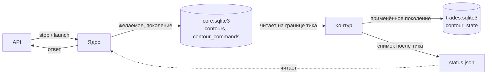
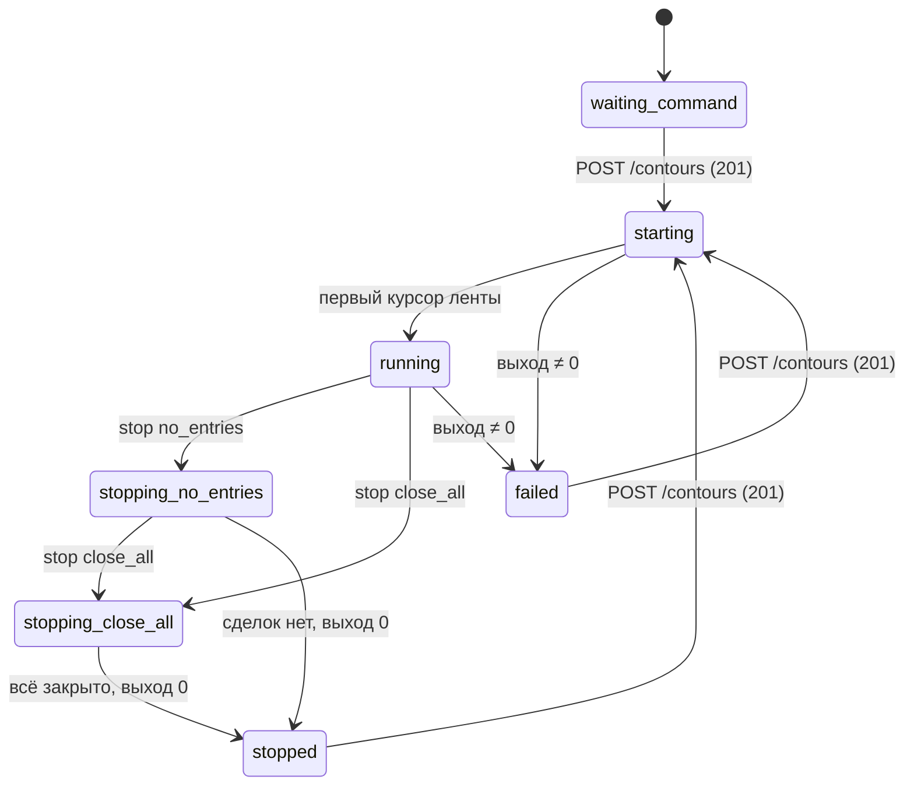
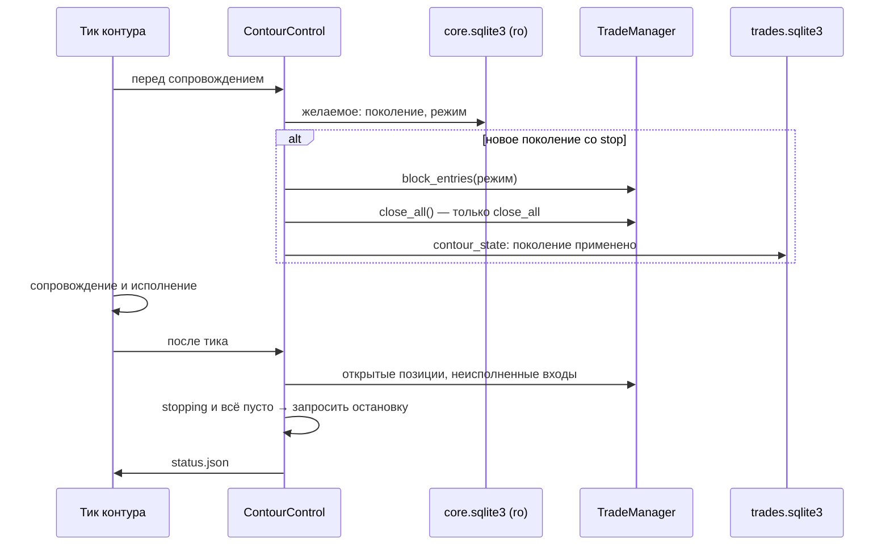
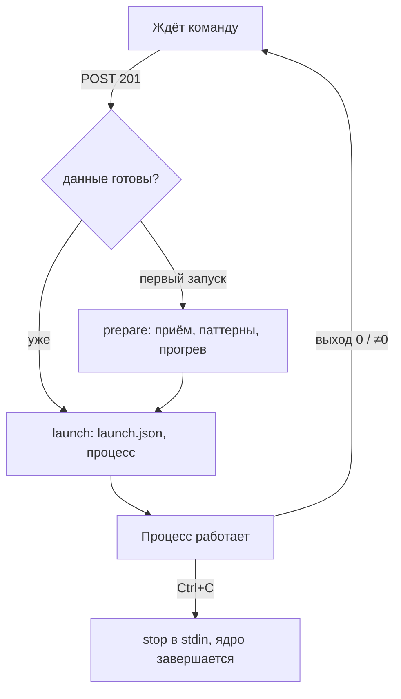

## Context

После П3.2:

- **Ядро.** Один процесс `run.py` держит рыночные данные и локальный API.
  `LiveCore.run_contour` один раз прогревает данные, пишет `launch.json` и
  запускает процесс контура (`ContourProcess`).
- **Контур.** Процесс `run.py --contour emulation` торгует на ленте ядра.
  Канал stdin служит признаком жизни ядра: строка `stop` — остановка после
  тика, конец потока — ядро завершилось.
- **Состояние для API.** `LaunchControl` держит его в памяти ядра:
  `waiting_command`, `starting`, `running`, `stopped`, `failed`.
- **После выхода контура** главный поток ядра крутится до Ctrl+C, и новая
  команда запуска не принимается.

## Goals / Non-Goals

**Goals:**

- Остановка контура командой в двух режимах без остановки ядра.
- Повторный запуск эмуляции после остановки или падения тем же ядром.
- Желаемое состояние и журнал команд переживают рестарт ядра.
- Команда подтверждается применённым поколением, а не фактом записи в базу.

**Non-Goals:**

- `add`/`remove` привязок — П5.
- Автоподъём, подхват процесса той же версии, пульс ядра,
  `GET /api/v1/core` — П6.
- История через API — П7.
- Уведомления об остановке в Telegram.

## Decisions

### 1. Кто что пишет



| Факт | Где | Пишет | Читает |
| --- | --- | --- | --- |
| должен ли работать, режим остановки, поколение, состав | `core.sqlite3` · `contours` | ядро | контур, API |
| журнал команд | `core.sqlite3` · `contour_commands` | ядро | API |
| применённое поколение, фактическое состояние | `trades.sqlite3` · `contour_state` | контур | контур (после рестарта) |
| снимок для API | `contours/emulation/status.json` | контур | ядро |
| процесс: pid, код выхода | память ядра (`ContourProcess`) | ядро | API |

Контур открывает `core.sqlite3` только на чтение (`mode=ro`), ядро не
открывает базу контура. `contour_state` лежит в `trades.sqlite3`: применение
остановки и её торговые действия сохраняются одной базой, а повтор после
сбоя идемпотентен.

### 2. Схема `core.sqlite3`

```sql
CREATE TABLE metadata (key TEXT PRIMARY KEY, value TEXT NOT NULL);   -- schema_version
CREATE TABLE contours (
  contour_id TEXT PRIMARY KEY, kind TEXT NOT NULL,
  desired TEXT NOT NULL CHECK(desired IN ('running','stopped')),
  stop_mode TEXT CHECK(stop_mode IN ('no_entries','close_all')),
  generation INTEGER NOT NULL,
  instruments_json TEXT NOT NULL, source TEXT, command TEXT,
  updated_at TEXT NOT NULL);
CREATE TABLE contour_commands (
  command_id INTEGER PRIMARY KEY AUTOINCREMENT,
  contour_id TEXT NOT NULL, received_at TEXT NOT NULL,
  action TEXT NOT NULL,                -- launch / stop
  payload_json TEXT NOT NULL, generation INTEGER,
  outcome TEXT NOT NULL,               -- accepted / rejected / conflict / ignored
  message TEXT);
```

- Запуск пишет `desired='running'`, `stop_mode=NULL`, поколение +1, состав.
- Остановка пишет `desired='stopped'` и режим, поколение +1.
- Повтор той же остановки поколение не меняет, исход `ignored`.
- Схема создаётся при первом открытии. Поле `schema_version` в `metadata`
  нужно П6 для проверки версий.

### 3. Состояния контура



Общее состояние в API собирается из трёх источников по порядку:

1. **Процесс.** Процесса нет или он завершился — `stopped` при коде 0,
   `failed` при другом коде. Если в этом запуске ядра процесс ещё не
   создавался — `waiting_command`.
2. **Желаемое.** `desired='stopped'` при живом процессе даёт
   `stopping_<режим>`.
3. **Курсор ленты.** Пока контур в этом запуске ни разу не подтвердил
   курсор, состояние `starting`, после — `running`.

### 4. Сторона контура: `ContourControl`

Новый объект в процессе контура, `src/assembly/contour_control.py`.



- Хук «перед сопровождением» — начало `post_tick` в `_run_bot`, до
  `runtime.post_tick`. Действия закрытия исполняются в том же тике.
- `no_entries`:
  - менеджер отклоняет новые входы с причиной `contour-stopping`;
  - неисполненные входы снимаются (`CancelEntry` с причиной `contour-stop`):
    «больше не входить» значит и не дать исполниться старой лимитке;
  - открытые позиции сопровождаются как обычно.
- `close_all`:
  - то же, что `no_entries`;
  - каждая открытая позиция закрывается (`CloseTrade` с причиной
    `contour-stop`), симулятор исполняет это на открытии следующего бара;
  - если заявка закрытия уже в пути, второй не создаётся (`_open_order`).
- **Завершение.** Остановка применена, открытых позиций и неисполненных
  входов нет. Тогда контур записывает `contour_state.state='stopped'` и ставит
  флаг остановки `StoppableRunSession`. Процесс выходит с кодом 0.
- **Старт процесса контура.** Блок входов хранится в памяти менеджера,
  поэтому при старте контур применяет текущее желаемое всегда, а не только
  новое поколение. Запуск после остановки пишет `desired='running'` новым
  поколением, и прежняя остановка снимается.
- **Флаг остановки.** `StdinStop` и `ContourControl` ставят один и тот же
  флаг, причина пишется в лог.

### 5. Сторона ядра: повторный запуск

`LiveCore.run_contour` разделяется на две части:

- `prepare(instruments)` — один раз: `serve(demand)`, опрос потребностей,
  кластерный поток, ожидание прогрева;
- `launch(instruments)` — на каждый запуск: переезд журнала (идемпотентен),
  карточки контрактов, `launch.json`, процесс. При повторном запуске ядро
  добавляет в сторож паттернов (`PatternTrigger.set_pairs`) и в опрос
  обязательств новые инструменты.



Главный поток ядра становится циклом команд. Пока процесс жив, ядро следит
за курсором ленты. Когда процесс завершился, ядро снова принимает
`POST /api/v1/contours`. Без ключа управления ядро после выхода контура, как
сейчас, ждёт Ctrl+C.

Пары прежнего состава после повторного запуска с другим набором не снимаются
с обслуживания: состав на ходу меняет П5.

### 6. API

| Маршрут | Ответы |
| --- | --- |
| `GET /api/v1/contours` | 200: список (один контур `emulation`) |
| `GET /api/v1/contours/{id}` | 200; 404 — неизвестный id |
| `POST /api/v1/contours` | 201 / 202 / 400 / 409 / 422 как в П1; теперь 201 и после `stopped`/`failed` |
| `POST /api/v1/contours/{id}/stop` `{"mode"}` | 202 `{generation, contour}`; 200 — повтор той же команды, поколение прежнее; 400 — неверный режим; 404; 409 — нечего останавливать (`waiting_command`, `stopped`, `failed`) или попытка `close_all` → `no_entries` |
| `GET /api/v1/contours/{id}/log?tail=N` | 200 `text/plain; charset=utf-8`; 400 — `tail` не число 1…1000; 404 |

- **Ответ остановки** — `202`: команда записана, применится на ближайшей
  границе тика. Выполнение видно, когда в `GET` поле
  `actual.applied_generation` догонит `desired.generation`.
- **Повтор POST /contours.** Конфликт при работающем или доживающем контуре
  возвращает `409` с кодом `ALREADY_RUNNING` или `STOPPING`. Тело — текущее
  состояние.
- **Ключ и доступ** — как у остальных маршрутов управления: `ControlToken`,
  проверка `Host`, без CORS.

### 7. `status.json`

```json
{"schema_version": 1, "contour_id": "emulation", "state": "stopping_no_entries",
 "applied_generation": 4, "stop_mode": "no_entries", "open_positions": 1,
 "pending_entries": 0, "last_tick_at": "2026-10-24T10:15:00Z",
 "version": "7.0.0", "pid": 12345, "updated_at": "2026-10-24T10:15:02Z"}
```

- Пишется атомарно: временный файл, затем `os.replace`, после каждого тика
  и при выходе.
- Ядро читает файл на каждый `GET`. Битый или отсутствующий файл даёт
  `actual: null`, это не ошибка.

## Risks / Trade-offs

- **Остановка ждёт тика.** Применение ждёт следующей границы тика, базовый
  поток 1m даёт её не реже раза в минуту. В закрытый рынок тики идут, а
  `close_all` исполняется на открытии сессии. → Ответ `202`, а не `200`;
  ожидание видно по поколениям.
- **`no_entries` может длиться днями.** Контур живёт, пока жива последняя
  сделка. → `close_all` поверх `no_entries` разрешён.
- **Пары прежнего состава остаются у ядра.** После повторного запуска с
  другим набором старые пары продолжают обслуживаться и тратят лимиты. →
  Принято до П5.
- **Повторный запуск при живых обязательствах.** Строки `contour_obligations`
  остановленного контура удерживают целостность, как в П3.2. Новый контур
  того же вида перезаписывает их своими.

## Migration Plan

- `core.sqlite3` создаётся при первом старте, старых данных нет.
- Таблица `contour_state` создаётся контуром в его `trades.sqlite3`
  (`CREATE TABLE IF NOT EXISTS`).
- Откат на версию без П4: старая версия не знает новых файлов и таблиц и
  работает как раньше.

## Open Questions

Нет. Решения владельца:

- после рестарта ядро ждёт команду, автоподъём — в П6;
- `POST` во время дожития `no_entries` получает `409`.
