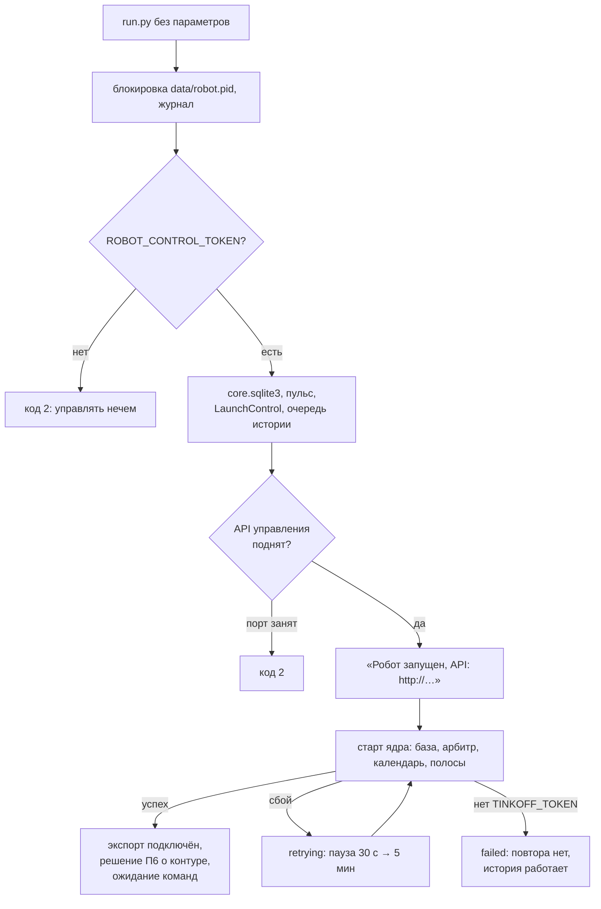
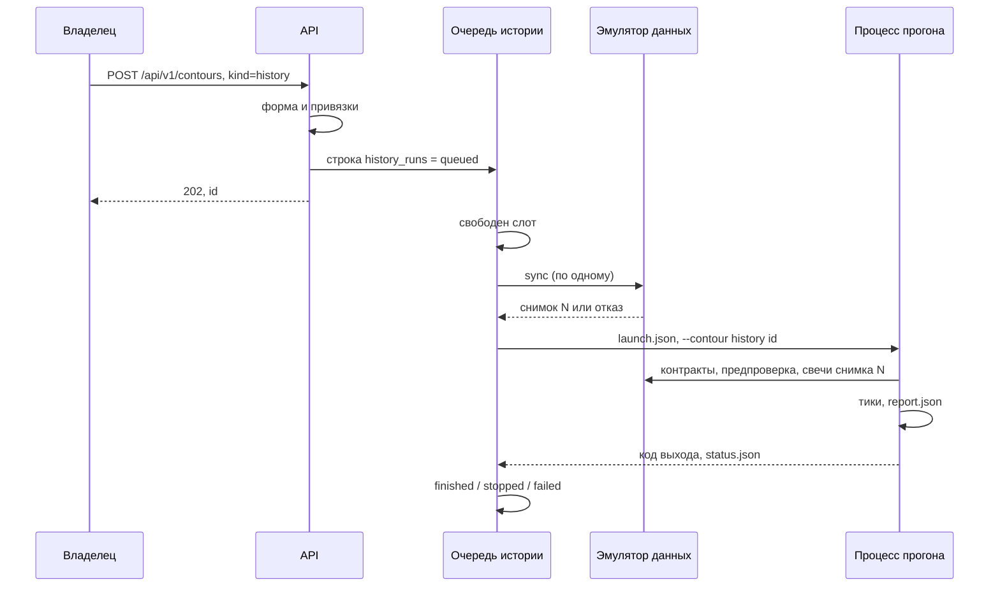
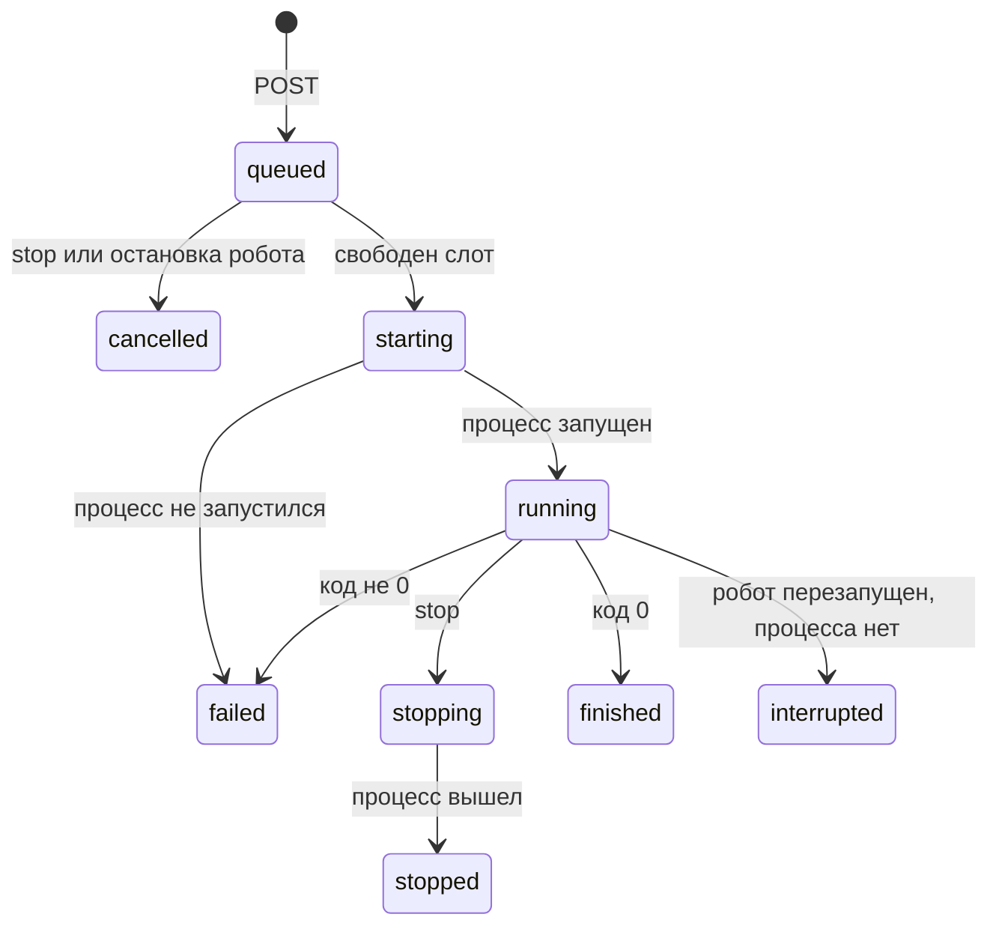

## Context

**Старт сейчас** (`run.py`, `_launch`):

1. `main` разбирает `--mode`, `--instruments`, `--wait-command` или
   показывает меню (`ask_mode`, `ask_emulation_source`,
   `select_instruments`);
2. блокировка `data/robot.pid`, журнал, `core.sqlite3`, пульс;
3. `LiveCore.start_early()` — рыночная база, арбитр, календарь, полосы
   брокера. Исключение здесь роняет весь процесс;
4. `core.start_api(control)` — один HTTP-сервер на экспорт, отчёт
   кластеров и управление. Он поднимается, только если есть рыночная база,
   `export_enabled = true` и `independent_lanes = true`;
5. решение П6 о контуре, ожидание команды или явный запуск.

**История сейчас** — отдельный путь:

1. `_run_history` сверяет импорт в эмуляторе (`prepare_snapshot`), затем
   до двух раз вызывает `_launch(history=True)`: второй раз — если
   предпроверка сдвинула начало (код 3);
2. `_launch(history=True)` без ядра: выбор контрактов, контрактная
   цепочка, календарь снимка, предпроверка, `HistoricalMarketServices` и
   `TradingContour`, отчёт `report.txt` и `report.json`;
3. каталог — `HIST/<запуск>-<начало>-<конец>/`.

Свечи истории идут из эмулятора данных (`historical_api_url`), а не из
ядра. Эмулятор импортирует свечи из экспорта ядра. Поэтому сверка
импорта проходит, только когда экспорт ядра работает. Без него прогон
идёт без снимка по действующему правилу.

## Goals / Non-Goals

**Goals:**

- Робот стартует без вопросов и параметров; управление только через API.
- API управления и история не зависят от того, стартовало ли ядро.
- Ядро после сбоя старта поднимается само.
- История идёт отдельными процессами, параллельно эмуляции или без неё,
  не больше `max_history_runs` сразу.
- Прогон через API даёт те же сделки, что прежний `--mode history` на том
  же диапазоне, инструментах и снимке.

**Non-Goals:**

- Возобновление очереди и прерванных прогонов после рестарта.
- Удаление кода интерактивного выбора инструментов.
- Очистка старых папок прогонов, перенос `HIST/`.
- История на ленте ядра: эмулятор данных остаётся источником истории.

## Decisions

### 1. Порядок старта



- **API управления до ядра.** Сервер стартует сразу после `core.sqlite3`.
  Он не зависит от рыночной базы и не смотрит на `export_enabled` и
  `independent_lanes`. Адрес — прежний `[market_data] export_host` и
  `export_port`.
- **Экспорт подключается позже.** Когда ядро открыло рыночную базу, оно
  передаёт серверу базу и отчёт кластеров. До этого маршруты экспорта и
  отчёта кластеров отвечают `503 MARKET_DATA_NOT_READY`. При
  `export_enabled = false` они отвечают `404`. Ключ экспорта нужен, как
  прежде.
- **Без ключа управления робот не запускается.** Без меню и параметров
  иначе роботом не управлять: печатается причина, код `2`. Это же
  правило — при занятом порте API.
- **Блокировка `data/robot.pid`** занята — код `1`, как прежде: второй
  робот на тех же данных не запускается.

### 2. Старт ядра с повтором

Главный поток после подъёма API пытается стартовать ядро:

| Состояние | Когда | Что видно |
| --- | --- | --- |
| `starting` | идёт попытка | `GET /api/v1/core`: `state = starting`, `attempts` |
| `ready` | база открыта, полосы запущены | прежние поля ядра |
| `retrying` | попытка упала | `error` — тип и текст без секретов, `next_retry_at` |
| `failed` | нет `TINKOFF_TOKEN` | `error`, повтора нет |

- Паузы между попытками: 30 с, 60 с, 120 с, 240 с, затем 300 с.
- Перед повтором ядро закрывает всё, что успело открыть в неудачной
  попытке: полосы, поток, базу.
- Ctrl+C прерывает паузу: робот останавливается штатно.
- Сеть, пропавшая после успешного старта, — не сбой старта. Её, как и
  прежде, переживают полосы и правила опоздания свечей.
- При `independent_lanes = false` ядро считается готовым, когда открыта
  рыночная база. Полосы, как и прежде, стартуют после выбора
  инструментов.

**Пока ядро не готово:**

- `POST /api/v1/contours` — `409 CORE_NOT_READY` с состоянием ядра.
- Желаемое «работает» из `core.sqlite3` ждёт: автоподъём П6 выполняется
  после перехода в `ready`.
- История работает. Сверка импорта не проходит, если экспорт ещё не
  поднят, и прогон идёт без снимка с отметкой в отчёте.

### 3. Решение о контуре без явного запуска

Явного запуска из командной строки больше нет, поэтому старт ядра всегда
идёт «в ожидании команды» в смысле П6:

- живой контур той же версии — подхват; другой версии — ожидание выхода;
- желаемое «работает» или незавершённая остановка — автоподъём, если
  `autostart = true`;
- иначе — ожидание команды.

**Папка контура занята неподтверждённым процессом** (`BLOCKED` в П6).
Раньше робот завершался с кодом `2`. Теперь он продолжает работать:
история и API доступны. Эмуляция не запускается: консоль называет pid, а
`POST /api/v1/contours` отвечает `409 CONTOUR_DIR_BUSY`. Каждая команда
заново проверяет папку: когда процесс исчезнет, запуск пройдёт.

**Эквивалентная команда** — тело запроса:

```text
Повторить запуск: POST /api/v1/contours {"kind": "emulation", "instruments": ["NG-12.26", "SBER"]}
```

Поле `command` в состоянии контура содержит это тело.

### 4. Путь прогона истории



- **Форма на `POST`.** Проверка в потоке HTTP, без сети:
  - `from` и `to` — `parse_moment`, `from < to`;
  - `pause` — число не меньше 0, по умолчанию `HISTORY_DEFAULT_PAUSE`;
  - `instruments` — `parse_instrument_tokens` и `classify_tokens`:
    токены без привязок и конфликт семейства с контрактом дают `422`.

  Каталог, контракты на начало прогона и покрытие проверяет процесс
  прогона: для этого нужен эмулятор данных.
- **Сверка импорта — в очереди.** Поток очереди вызывает
  `EmulatorClientProvider.prepare_snapshot()` перед каждым стартом, по
  одному прогону за раз. Итог — `MarketDataSync` и номер снимка — идёт в
  `launch.json`. Процесс создаёт провайдер с этим номером и `sync` не
  вызывает. Повтор после сдвига начала идёт на том же снимке, как
  сегодня.
- **Имя прогона.** Папка — `ГГГГММДД-ЧЧММСС` по времени приёма, `id`
  контура — `history-` и имя папки, например `history-20261024-101500`.
  Регулярное выражение `id` в API уже допускает такое имя. При совпадении
  к имени добавляется `-2`, `-3`. Диапазон виден в `request`, а не в
  имени.

### 5. Процесс прогона

`run.py --contour history <id>`:

1. `acquire_runtime_lock(data/contours/history/<имя>)`;
2. лог `bot_debug.log` с порогом и окном `[historical.logging]`, секреты
   — в `secrets=`, как у других процессов;
3. `read_launch` → диапазон, пауза, токены, `MarketDataSync`, номер
   снимка;
4. прежний цикл `_run_history` без `sync`: `_launch(history=True)` с
   `LaunchRequest(MODE_HISTORY, SOURCE_API, токены)`. При сдвиге начала
   (код 3) папка не меняется: удаляются файлы журнала и выбора,
   остаются `launch.json`, `status.json`, логи и `robot.pid`;
5. `status.json` (`schema_version = 1`):

   | Поле | Значение |
   | --- | --- |
   | `pid`, `version`, `alive_at` | процесс и признак жизни, как у эмуляции |
   | `phase` | `checking` — контракты и предпроверка, `running` — тики, `finishing` — отчёт |
   | `start`, `end` | диапазон с учётом сдвига начала |
   | `market_now`, `ticks` | ход по рыночному времени |
   | `rejections` | отказы разрешения инструментов |
   | `exited_at`, `exit_reason` | итог выхода |

**Вывод и коды выхода.**

- Вывод процесса в консоль (`print` пути истории) идёт в `console.log`
  папки прогона. Консоль робота печатает по строке на старт и на итог
  прогона.
- Коды выхода:
  - `0` — отчёт записан;
  - `2` — прогон отклонён до первого тика: контракты, предпроверка,
    цепочка;
  - другой — сбой. Отчёт при сбое пишется, как сегодня
    (`contour.finish`).

**Остановка.** Процесс прогона останавливается после тика с отчётом
«остановлено оператором». Причины:

- строка `stop` в stdin;
- Ctrl+C;
- пульс `stopped`;
- флаг `stop_requested` своей строки `history_runs`.

Флаг и пульс раз в `heartbeat_secs` читает один поток, только на чтение.
Потеря пульса и пульс другой версии прогон не останавливают: деньгами
прогон не рискует, данные робота ему не нужны.

### 6. Состояния прогона



- Состояние пишет робот в `history_runs`: при постановке, старте, стопе
  и выходе процесса.
- **Итог по выходу:**
  - код 0 и был стоп — `stopped`;
  - код 0 без стопа — `finished`;
  - иначе — `failed`, причина из `status.json` (`exit_reason`,
    `rejections`).
- `reason` — одна строка для API: причина отказа, отмены или сбоя.

### 7. Кто что пишет

| Где | Что | Пишет | Читает |
| --- | --- | --- | --- |
| `core.sqlite3` · `history_runs` | запрос, состояние, времена, pid, код выхода, причина, `stop_requested`, сверка импорта | робот | API, процесс прогона (свой флаг) |
| `history/<имя>/launch.json` | диапазон, пауза, токены, сверка импорта, номер снимка, pid и версия робота | робот | процесс прогона |
| `history/<имя>/status.json` | фаза, ход, отказы, признак жизни, итог | процесс прогона | робот, API |
| `history/<имя>/report.json` | отчёт прогона, как сегодня | процесс прогона | API (`result`) |

### 8. Очередь истории

`HistoryRuns` (`src/assembly/history_runs.py`) создаётся до API. У неё
свой поток, независимый от главного: главный поток в это время стартует
ядро, ждёт команду эмуляции или надзирает за ней.

- `submit` (поток HTTP): строка `queued`, будит поток очереди.
- Поток очереди: пока идущих меньше `max_history_runs` и есть `queued` —
  сверка, `launch.json`, `ContourProcess` с `--contour history <id>`.
- Выход процесса будит поток очереди: в освободившийся слот встаёт
  следующий прогон.
- `stop(id)`:
  - прогон в очереди — `cancelled`;
  - идущий — `stop_requested = 1` и `stop` в stdin своего процесса;
  - уже завершённый — `409 NOT_RUNNING`.
- `close()` при остановке робота:
  1. очередь — `cancelled` с причиной «робот остановлен»;
  2. идущие получают `stop`, робот ждёт их вместе с эмуляцией до 30 с;
  3. не вышедшие завершаются принудительно.

### 9. Рестарт робота

До подъёма API робот сверяет `history_runs` с папками:

- `queued` и `starting` — `cancelled`, причина «робот перезапущен»;
- `running` и `stopping`:
  - pid из `robot.pid` жив, `status.json` называет тот же pid, `alive_at`
    свежий — прогон дожил после аварийной смерти робота (`kill -9`).
    Робот следит за ним по pid (`AdoptedProcess`), прогон занимает слот,
    стоп идёт через `stop_requested`;
  - иначе — `interrupted`.

Итог подхваченного прогона робот берёт из `status.json`: кода выхода у
чужого процесса нет.

### 10. API

| Запрос | Ответ |
| --- | --- |
| `POST /api/v1/contours` `kind = history` | `202` — прогон; `400` — форма; `401`/`403` — доступ; `422` — отказы токенов |
| `POST /api/v1/contours` `kind = emulation` | новые `409 CORE_NOT_READY` и `409 CONTOUR_DIR_BUSY` |
| `GET /api/v1/contours` | эмуляция, все прогоны в очереди и в работе, 20 последних завершённых; `?kind=`, `?limit=` (1–200); `limits`: `max_history_runs`, `running`, `queued` |
| `GET /api/v1/contours/{id}` | прогон или `404` |
| `POST /api/v1/contours/{id}/stop` | для прогона тело может быть пустым, `mode` не применяется; `200`; `409 NOT_RUNNING` |
| `GET /api/v1/contours/{id}/log?tail=` | `text/plain` из `bot_debug.log` прогона, как у контура |
| `POST /api/v1/contours/{id}/instruments` | для прогона — `409 NOT_SUPPORTED` |
| `GET /api/v1/core` | новые `state`, `error`, `attempts`, `next_retry_at`; `market_data` и `quotas` — `null`/пусто до `ready` |

**Поля прогона:**

- **запрос:** `id`, `kind = history`, `state`, `request` (`from`, `to`, `pause`,
  `instruments`);
- **времена:** `accepted_at`, `started_at`, `finished_at`;
- **очередь и процесс:** `queue_position` (только у `queued`), `pid`,
  `exit_code`, `reason`;
- **сверка импорта:** `market_data_sync` — `status`,
  `snapshot_generation`;
- **ход:** `actual` из `status.json` — `phase`, `start`, `end`,
  `market_now`, `ticks`, `progress` от 0 до 1;
- **итог:** `result` из `report.json` — `covered`, `stop_reason`, `trades`,
  `net_pnl`, `fees`, `balance`, `open_positions`;
- **папка:** `dir`, относительно папки данных.

Маршруты истории подчиняются общему требованию «Доступ к управлению»:
ключ, `Host`, без CORS.

### 11. Командная строка

- Робот запускается без параметров.
- `--mode`, `--instruments`, `--wait-command`, `--no-prompt`, `--from`,
  `--to`, `--pause` и любой другой незнакомый параметр — код `2` и текст:
  «Робот запускается без параметров. Эмуляция и история запускаются
  командой POST /api/v1/contours».
- Служебные `--contour`, `--version`, `--config-smoke`,
  `--telegram-chart-smoke`, `--telegram-*` не меняются.
- Удаляются `ask_mode`, `ask_emulation_source`, `ask_history_range`,
  `describe_scale`, `_menu_request`, `state_dir_for`, `HIST_DIR`, вызов
  `select_instruments` из `run.py` и разбор параметров режима в
  `parse_launch_args`. Код выбора инструментов в `src/instruments/`
  остаётся до отдельного change.

## Risks / Trade-offs

- **[Скрипты и привычка запускать с параметрами]** → Любой прежний
  параметр даёт код `2` с подсказкой. README и CHANGELOG описывают
  переход и примеры `curl`.
- **[Без ключа управления робот не стартует]** → Раньше эмуляцию можно
  было запустить меню без ключа. Без меню управлять иначе нечем. Ключ
  уже нужен для П4–П6.
- **[Повтор старта ядра держит ресурсы]** → Неудачная попытка закрывает
  всё, что открыла. Тест повторяет сбой три раза и проверяет, что потоки
  и соединения не копятся.
- **[Нагрузка]** → Два прогона с паузой 0 и эмуляция делят процессор.
  Ограничение — `max_history_runs`, по умолчанию 2.
- **[Долгая сверка держит очередь]** → `sync` до 300 с. Сверки идут по
  одной, второй прогон ждёт: это и есть цель решения.
- **[Сдвиг начала в той же папке]** → Очистка по списку файлов. Тест
  сравнивает папку после сдвига с прогоном, начатым сразу с нового
  начала.

## Migration Plan

1. Новая версия создаёт `history_runs` и `data/contours/history/` при
   первом прогоне. Старые прогоны в `HIST/` не трогаются.
2. Эмуляция, работавшая перед обновлением, поднимается автоподъёмом П6.
3. Откат на прежнюю версию: таблица и папка ей не мешают, запуск снова с
   параметрами или меню.

## Open Questions

Нет.
