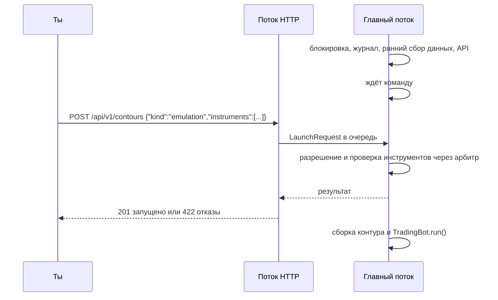

## Context

`run.py` спрашивает режим (`ask_mode`), для истории — начало, конец и паузу (`ask_history_range`), затем `_launch` вызывает интерактивный `select_instruments`. В эмуляции выбор идёт после `_start_early_market_data` через арбитр лимитов (полоса `interactive`), в истории — через клиента эмулятора и возвращает `HistorySelection` с семействами и фиксированными контрактами. Флаг `--no-prompt` пропускает только вопрос о режиме.

Локальный HTTP-сервер (`MarketDataExportServer`, стандартный `http.server`) отдаёт экспорт свечей, отчёт кластерного фильтра, `docs/openapi.yaml` и Swagger UI. Он поднимается в `_launch` после выбора инструментов и только при заданном `MARKET_DATA_EXPORT_TOKEN`.

Привязки стратегий адресуются инструментом: акции — тикером (`[strategies.share.SBER]`), фьючерсы — кодом семейства (`[strategies.future.NG]`). `instrument_assignments` находит привязки инструмента по этим ключам, у инструмента без привязок остаётся только минутная защита.

Этот change — этап П1 из `docs/architecture/core-contours.md`. Процесс пока один: ядра отдельно от контуров ещё нет.

## Goals / Non-Goals

**Goals:**
- Робот стартует, греет данные и ждёт команды API, какими контрактами торговать в эмуляции.
- Запуск эмуляции и истории параметрами командной строки, без единого `input()`.
- Один путь запуска: командная строка, меню и API дают одни и те же параметры.
- Путь и поля API совпадают с целевой схемой, чтобы следующие этапы их не ломали.

**Non-Goals:**
- Второй запуск, остановка и смена состава через API: процесс торгует одним набором до Ctrl+C (П4–П5).
- История через API: ей нужен отдельный процесс (П7).
- `core.sqlite3`, поколения, процессы контуров (П3–П4).
- Выбор отдельных привязок инструмента (П5): выбранный инструмент, как и сейчас, включает все свои привязки.
- Смена контракта на ходу в эмуляции.

## Decisions

### Параметры запуска — один объект

`LaunchRequest(mode, start, end, pause, instruments, source)`, где `instruments` — кортеж токенов или признак `all`, `source` — `cli`, `menu` или `api`. Его строят разбор командной строки, меню и обработчик API. Разрешение токенов отделено от разбора и одно для всех трёх источников.

### Командная строка

```text
robot --mode emulation [--instruments all|SBER,NG,NG-12.26]
robot --mode emulation --wait-command
robot --mode history --from "2026-09-01 10:00" --to "2026-09-08 10:00" [--pause 1] [--instruments ...]
robot --no-prompt          # = --mode emulation, инструменты по умолчанию
robot                      # меню
```

Разбор — `argparse`: он уже используется для команд восстановления Telegram и при ошибке сам завершается с кодом `2`. Даты проверяются прежними `parse_moment` и `validate_range`. `--wait-command` допустим только с `--mode emulation` и несовместим с `--instruments`. Служебные команды (`--version`, `--config-smoke`, команды Telegram) обрабатываются раньше и не меняются.

**Имя режима — `emulation`.** Сегодняшний «боевой» режим торгует на живых данных через `JournalBroker`, это эмуляция в терминах целевой архитектуры. Внутренние `MODE_LIVE` и `LiveRunSession` не переименовываются: они описывают источник данных. Меняется только то, что видит пользователь.

### Ожидание команды и запуск по API



- Главный поток стоит там же, где сейчас стоит интерактивный выбор, поэтому порядок «ранний сбор → выбор → сборка» не меняется. Полосы данных в это время работают.
- Обработчик HTTP не собирает торговлю сам: он кладёт `LaunchRequest` в очередь и ждёт ответ главного потока. Сборка, чтение финансовой базы и запуск остаются в главном потоке.
- Ответ ждёт разрешения не дольше 60 секунд. Если проверка у брокера дольше (ограничение лимитов), ответ `202 Accepted` со ссылкой на `GET /api/v1/contours`, где виден итог.
- Пока ждёт команды, робот печатает адрес: `Робот ждёт команду запуска: POST http://127.0.0.1:8101/api/v1/contours`. Ключ не печатается.
- Без `ROBOT_CONTROL_TOKEN` ждать команды нельзя: запуск с `--wait-command` завершается с кодом `2` и причиной.

**Ответы `POST /api/v1/contours`:**

| Код | Когда | Тело |
| --- | --- | --- |
| `201` | инструменты разрешены, торговля запускается | состояние контура: выбранные контракты, эквивалентная команда |
| `202` | проверка у брокера ещё идёт | состояние `starting`, ссылка на `GET` |
| `400` | тело не JSON, лишние или неверные поля, `kind` не `emulation` | `ApiError` |
| `401` | нет или неверный ключ управления | `ApiError` |
| `409` | торговля уже запущена (командой, параметрами или меню) | `ApiError` и текущее состояние |
| `422` | есть отклонённые токены, ничего не запущено | список отказов `[{token, reason}]` |

Отказ строгий, как в командной строке: торговать подмножеством того, что просили, нельзя. После `422` можно отправить исправленную команду.

**`GET /api/v1/contours`** отдаёт список из одного контура `emulation` (или пустой список в историческом режиме, где сервер не работает): `state` (`waiting_command`, `starting`, `running`), источник запуска, выбранные контракты коротким именем с днями до экспирации, время запуска, эквивалентная команда. Поле `id` уже есть и пока всегда равно `emulation`.

**Совместимость с целевой схемой.** Путь `/api/v1/contours`, поле `kind` и форма ответа совпадают с `docs/architecture/core-contours.md`. Поле `instruments` останется рядом с будущим `assignments` (П5), а повторный запуск, остановка и поколения добавятся на П4 без изменения этих двух маршрутов.

### Доступ к управлению

- Отдельный ключ `ROBOT_CONTROL_TOKEN`, схема `ControlToken`. Экспортный ключ управлять не может, ключ управления не читает экспорт: у эмулятора истории и у человека разные права.
- Ключ только в заголовке `Authorization: Bearer`, сравнение через `hmac.compare_digest`, как у экспорта.
- Маршруты управления проверяют заголовок `Host`: допустимы только `127.0.0.1`, `localhost` и `[::1]` с портом сервера. Так страница в браузере не сможет отправить команду через подмену DNS. Заголовков CORS сервер не отдаёт.
- `ROBOT_CONTROL_TOKEN` добавляется в `secrets` у `setup_logging`, ни в консоли, ни в журнале, ни в ответах не печатается.

### Когда поднимается сервер

В эмуляции — сразу после `_start_early_market_data`, до выбора инструментов, если `export_enabled = true` и задан хотя бы один ключ. Маршрутам без своего ключа он отвечает `401`. Для каждого незаданного ключа печатается, какая часть API недоступна. Отчёт кластерного фильтра читает базу сделок по пути, поэтому ему не нужен собранный торговый контур. В истории сервер, как и прежде, не поднимается.

### Токены инструментов

Одни для командной строки, меню и API. Регистр не важен.

| Токен | Эмуляция | История |
| --- | --- | --- |
| `all` или не задано | все акции из `[strategies.share.*]` и все семейства из `[strategies.future.*]` | то же |
| тикер акции `SBER` | акция | фиксированная акция |
| код или префикс семейства `NG`, `RTS`/`RI`, `SBRF`/`SR` | ближайший подходящий контракт | автоматическая цепочка |
| контракт `NG-12.26` или тикер `NGZ6` | этот контракт | фиксированный контракт |

Токен без привязок в конфигурации отклоняется. Семейство и его же контракт вместе отклоняются как конфликт, как в `HistorySelection.planned`.

**Контракт семейства в эмуляции.** Из `fetch_active_futures` (стандартные контракты, без мини и микро, экспирация в ближайшие 183 дня) берётся ближайший по экспирации, до экспирации которого больше `contract_expiry_block_days` суток. Это та же граница, что запрещает входы перед экспирацией, и та же календарная политика, что строит цепочку в истории. Выбор печатается коротким именем: `NG → NG-12.26, до экспирации 52 дня`.

**Проверка один раз.** Разрешение проверяет каждый инструмент через `find_working_instrument_with_name`, как сейчас меню. В эмуляции — через арбитр с полосой `interactive`, в истории — через клиента эмулятора.

**Строгость.** Командная строка и API строгие: любой отказ — ничего не запускается (код `2` или ответ `422`). Меню мягкое, как сегодня: `✗` и пропуск, пустой итог возвращает к выбору. Отметки `✓`/`✗` в меню появляются один раз после завершения выбора.

### Меню

Вопросы меню прежние, с двумя изменениями. Пункт «Боевая торговля (реальный брокер…)» называется «Эмуляция (живые данные, симулятор исполнения)». После выбора эмуляции меню спрашивает: «Инструменты: выбрать сейчас — 1, ждать команду API — 2». Второй вариант равен `--wait-command`.

### Эквивалентная команда

После разрешения робот печатает и пишет в журнал `Повторить запуск: --mode emulation --instruments NG-12.26,SBER`. Для запуска по API строка тоже печатается и возвращается в ответе. Контракты в ней записаны коротким именем, а не биржевым тикером: строка — пользовательский вывод.

### Прочее

- `--no-prompt` = `--mode emulation` с инструментами по умолчанию. Несовместимое изменение записывается в `CHANGELOG.md`.
- Повтор прогона истории при сдвиге начала передаёт уже разрешённую выборку без повторного разрешения и вопросов.

## Risks / Trade-offs

- [Команда запуска по ошибке из другой программы на этом компьютере] → отдельный ключ управления, проверка `Host`, только loopback. Реальных денег на этом этапе нет, торгует симулятор.
- [Главный поток ждёт команды бесконечно] → это намеренно: робот в это время греет данные. Ожидание видно в консоли и в `GET /api/v1/contours`.
- [Правило ближайшего контракта не совпадает с выбором человека] → контракт можно указать явно, выбранный контракт виден в ответе, консоли и журнале.
- [Сценарии автозапуска полагались на `--no-prompt` с ручным выбором] → такой сценарий и так требовал человека. Изменение описано в `CHANGELOG.md` и `README.txt`.
- [Долгая проверка у брокера держит HTTP-запрос] → ответ не дольше 60 секунд, дальше `202` и итог в `GET`.
