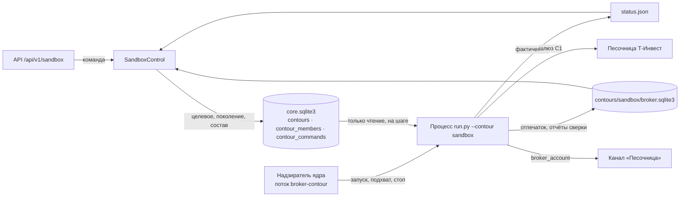
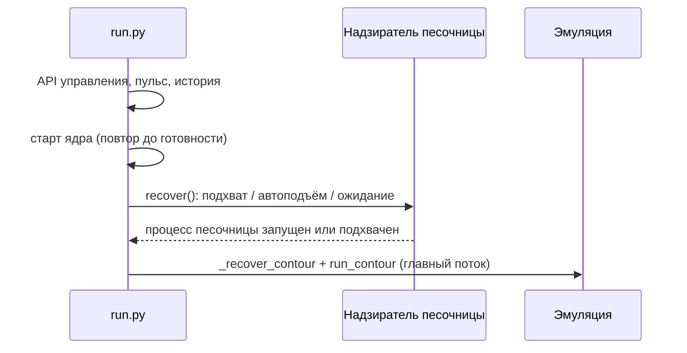
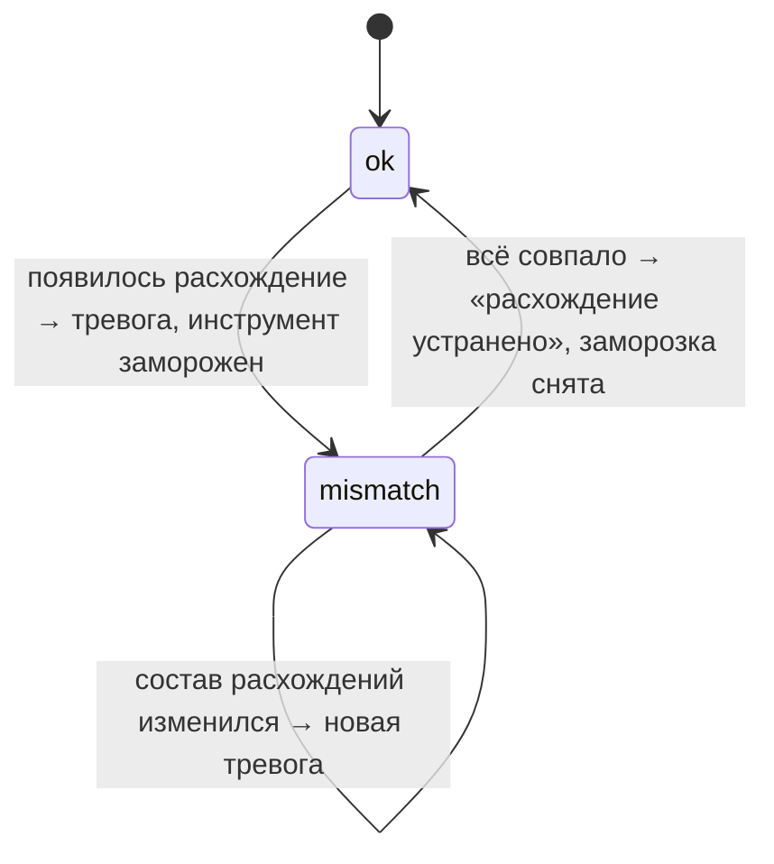

## Context

- **Ядро.** `run.py` без параметров поднимает API управления, очередь истории (`HistoryRuns`, свой поток) и ядро с повтором старта. Когда ядро готово, `_serve_emulation` решает судьбу эмуляции (подхват, автоподъём или ожидание команды), и `LiveCore.run_contour` надзирает за её процессом в главном потоке до Ctrl+C.
- **Желаемое и фактическое.** Ядро пишет целевое состояние, поколение и состав (`contour_members`) в `core.sqlite3`. Процесс контура читает его только на чтение и пишет фактическое в `status.json` своей папки. Подхват и автоподъём решает `plan_recovery` по `robot.pid`, `status.json` и желаемому.
- **Пульс.** Ядро пишет `heartbeat`, контур читает его через `CorePulse`. «Остановлено» или чужая версия — контур выходит.
- **Песочница после С1.** `src/sandbox` даёт шлюз `SandboxGateway` (только песочница, повтор `RESOURCE_EXHAUSTED`) и правило счёта робота `robot_account` (`My_roBot`). Разведка подтвердила, что песочница торгует фьючерсами и исполняет стоп-заявки.
- **Telegram.** `TelegramChannel` доставляет события шины: каталог типов закрыт, доставка с сохранением и досылкой в `telegram_delivery.sqlite3`.

## Goals / Non-Goals

**Goals:**

- Контур «Песочница» отдельным процессом рядом с эмуляцией, со своим целевым состоянием, составом, API и подъёмом после рестарта раньше эмуляции.
- Правда о счёте: капитал, позиции, заявки, стоп-заявки — в API и в канале.
- Сверщик, который замечает любое расхождение счёта с журналом и замораживает инструмент.
- Отпечаток счёта: журнал одного счёта не продолжится на другом.
- Код контура, который на Р1 станет и контуром «Счёт» сменой шлюза.

**Non-Goals:**

- Заявки, `TInvestBroker`, outbox, допуск по капиталу — С3.
- Свечи, стратегии, сигналы, спрос в ленте ядра — С3. В С2 привязки только хранятся и показываются.
- Стоп и цели у брокера — С4; команды остановки по правилам счёта — С5; предохранители — С6.
- Контур «Счёт» и боевой шлюз — Р1.
- Перенос настроек в базу (`feature/experiment`).

## Decisions

### 1. Кто чем владеет



У каждого факта один владелец:

- целевое состояние и состав пишет ядро;
- фактическое (`status.json`) пишет процесс контура;
- отпечаток счёта и отчёты сверки (`broker.sqlite3`) пишет процесс контура;
- ресурс API читает `status.json` и `broker.sqlite3` только на чтение.

### 2. Надзиратель — отдельный поток, а не второй `run_contour`

`LiveCore.run_contour` построен под один контур: прогрев рыночных данных, спрос в ленте, повторный запуск после команды, главный поток до Ctrl+C. Контуру «Песочница» в С2 рыночные данные не нужны, а жить он должен рядом с эмуляцией. Поэтому у него свой надзиратель `BrokerContourSupervisor` в своём потоке, по образцу `HistoryRuns`.

Надзиратель:

1. при старте ядра решает судьбу контура через тот же `plan_recovery` по папке `contours/sandbox/` — подхват, замена версии, автоподъём, ожидание команды;
2. по команде запуска пишет `launch.json` и стартует `ContourProcess("sandbox")`;
3. следит за процессом и отмечает выход;
4. на Ctrl+C отдаёт процессу `stop`.

Повторный запуск после выхода — только командой, как у эмуляции.

Альтернативу «научить `run_contour` нескольким контурам» отклоняем: это переделка главного цикла эмуляции ради контура, которому пока не нужны свечи. На С3 песочнице понадобится лента. Спрос на неё контур пишет строками `contour_demand` под своим `contour_id`, и ядро опрашивает их уже сейчас (П3.2). Надзиратель от этого не меняется.

### 3. Порядок старта



Надзиратель стартует после готовности ядра — на С3 песочнице понадобится лента, и порядок уже будет правильным — и раньше `_serve_emulation`. Пока ядро не готово, команды песочницы отвечают `409 CORE_NOT_READY`, как у эмуляции.

### 4. Шаг контура вместо тика

Тика по закрытой свече у контура С2 нет. Процесс работает шагами `step_secs = 10`. На каждом шаге он:

1. читает пульс ядра: «остановлено» или чужая версия — выход;
2. читает целевое состояние: новое поколение применяется сразу;
3. по расписанию сверяет счёт — при старте, затем раз в `reconcile_every_min`;
4. пишет `status.json` с `alive_at`, применённым поколением, капиталом и заморозками.

Остановка (`no_entries` или `close_all`) в С2 означает выход на ближайшем шаге: своих сделок у контура нет. `close_all` чужие позиции НЕ закрывает — их владелец человек.

На С3 шаг станет тиком торгового цикла. Порядок «пульс → целевое → работа → `status.json`» сохранится.

### 5. Состав — привязки в существующей `contour_members`

Ключ участника — `id` привязки (`share-sber-macd-4h-triple`). `instrument_json` — карточка привязки: `id`, инструмент, стратегия, управление, фильтр, таймфрейм. Схема `core.sqlite3` не меняется, `read_desired` и поколения работают как есть.

Неизвестный `id` отклоняет всю команду (`422 BINDINGS_REJECTED`) — как неизвестный инструмент у эмуляции.

Стартовый состав в `robot.toml` не задаётся: только команда API, как у эмуляции. Это отклонение от примера в документе 2 v12, который нужно поправить.

### 6. Допуск к старту

| Проверка | Отказ |
|---|---|
| `TINKOFF_SANDBOX_TOKEN` задан | «Не задан TINKOFF_SANDBOX_TOKEN» |
| бот и канал из `[contours.sandbox]` заданы в окружении | «Не задан TELEGRAM_ACCOUNT_BOT_TOKEN» / имя переменной канала |
| счёт `My_roBot` найден или открыт, он один | список последних четырёх символов номеров |
| отпечаток счёта совпадает или записывается впервые | «Журнал контура принадлежит другому счёту …a1b2» |

Отказ — процесс выходит с кодом 2 и пишет причину в `status.json` (`state = failed`, `exit_reason`). Ресурс API показывает её в `current.reason`. Без канала контур не стартует: сделки без уведомлений недопустимы, и правило действует уже с С2.

### 7. Отпечаток счёта

`broker.sqlite3` в папке контура хранит одну строку `account`:

- `broker` (`sandbox`);
- `account_hash` — sha256 номера счёта;
- `account_tail` — последние четыре символа номера;
- `created_at`.

Полный номер не хранится. Отпечаток пишется при первом успешном допуске. При следующем старте отпечаток сравнивается с найденным счётом, расхождение — отказ из таблицы выше.

### 8. Сверщик

На каждом инструменте, где у счёта или у журнала что-то есть, сравниваются три вещи:

| Что | Счёт | Журнал контура |
|---|---|---|
| позиция, лоты | `GetPortfolio.quantity_lots` | открытые сделки контура |
| активные заявки | `GetOrders` | заявки контура в работе |
| активные стоп-заявки | `GetStopOrders` | защитные заявки контура |

В С2 журнал пуст: любая позиция, заявка или стоп-заявка на счёте — расхождение «чужое на счёте». Инструмент с расхождением попадает в заморозку. В С2 заморозка — запись и отметка в API, входов всё равно нет. На С3 она начнёт запрещать входы.

Состояние сверщика меняется только на переходах:



Одинаковые подряд отчёты в канал не повторяются. Каждый отчёт хранится в `broker.sqlite3` (последние 100), последний отдаётся `GET /api/v1/sandbox/reconcile`. `reconcile_every_min` по умолчанию 1: песочнице это 4 запроса в минуту при лимите 200, а ручная проверка не ждёт по пять минут.

### 9. Капитал

Отложенный вопрос документа 2 решается для песочницы так:

- `current.capital.rub` — рубли из `GetPositions`;
- `current.capital.liquid_portfolio` показывается рядом.

Песочница списывает полную цену фьючерса при покупке, а `liquid_portfolio` выходит больше денег на счёте. Какое из чисел станет капиталом допуска, окончательно решает С3.

### 10. Уведомления — событие шины `broker_account`

Сообщения контура идут через шину и обычный `TelegramChannel` — с сохранением и досылкой. Новый тип события `broker_account` со своим `payload.kind`:

| `kind` | Когда |
|---|---|
| `started` | допуск пройден: счёт, капитал, позиций, состав |
| `reconcile_alarm` | переход в расхождение или новый состав расхождений |
| `reconcile_cleared` | расхождений больше нет |
| `stopped` | штатный выход: причина |

Канал контура подписан только на `broker_account`. Бот — `TELEGRAM_ACCOUNT_BOT_TOKEN`, канал — переменная из `telegram_channel_env`. Файл доставки — `contours/sandbox/telegram_delivery.sqlite3`. Каналы эмуляции этот тип не получают.

### 11. Где код

```
src/broker_contour/
  process.py     цикл процесса: допуск, шаг, выход
  admission.py   проверки до первого шага
  fingerprint.py отпечаток счёта
  reconcile.py   сверщик и его состояния
  store.py       broker.sqlite3
  notify.py      события broker_account
src/assembly/broker_supervisor.py   надзиратель ядра
src/bot/sandbox_control.py          ресурс API песочницы
```

Пакет не знает, что это песочница: шлюз и правило счёта передаются при сборке. На Р1 контур «Счёт» соберётся из того же пакета с боевым шлюзом.

## Risks / Trade-offs

- **[Второй надзиратель рядом с главным циклом]** → он трогает только свою папку и свою строку `contours`. Общие вещи — `core.sqlite3` с атомарными записями `CoreStateStore` и пульс — уже рассчитаны на несколько писателей (история).
- **[Ручные действия в песочнице во время работы контура]** → это и есть сценарий проверки: сверщик должен их видеть. `reset` команды С1 честно предупреждает.
- **[Песочница недоступна на старте]** → допуск не пройден, `failed` с причиной. Автоподъём при следующем старте ядра попробует снова. Бесконечных повторов внутри одного запуска нет.
- **[Песочница недоступна во время работы]** → шаг пропускает сверку с предупреждением в лог, `status.json` показывает `account_link = lost`. Тревогу в канал даёт только третий подряд пропуск, чтобы не шуметь от одного сбоя сети.
- **[Состав в API, а не в конфиге]** → после рестарта состав берётся из `core.sqlite3`, как у эмуляции. Документ 2 нужно поправить.
