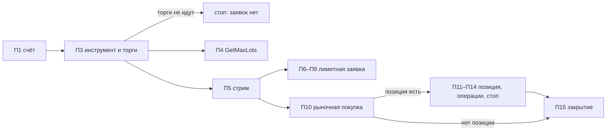

## Context

- Робот после П8 стартует без параметров и управляется через API `/api/v1`. Контура на брокере пока нет: эмуляция торгует `JournalBroker`.
- SDK `t-tech-investments 1.49.3` даёт `SandboxClient`: те же сервисы (`users`, `orders`, `operations`, `stop_orders`, `orders_stream`, `market_data`, `instruments`) на адресе `sandbox-invest-public-api.tbank.ru` и отдельный `sandbox` (`open_sandbox_account`, `sandbox_pay_in`). Часть методов `SandboxService` помечена устаревшими в пользу общих сервисов.
- В `.env` после С0 есть `TINKOFF_SANDBOX_TOKEN`. Боевой `TINKOFF_TOKEN` читает котировки ядра и в песочницу не нужен.
- Документ 2 v11: песочница и счёт — два вида контура из одного кода. Разведка — первый код, который ходит к брокеру за заявками.

## Goals / Non-Goals

**Goals:**

- Ответить на открытые вопросы о песочнице фактом, а не предположением.
- Дать владельцу ручные действия в песочнице для проверок С2–С6.
- Записать настоящие ответы API для будущего фейкового шлюза.
- Задать правило «какой счёт песочницы наш», общее с контуром С2.

**Non-Goals:**

- Контур «Песочница», `TInvestBroker`, сверщик, outbox — С2 и С3.
- Команды робота в API и Swagger: команда песочницы не часть робота.
- Telegram: команда пишет только в консоль и файлы.
- Запуск из собранного дистрибутива.
- Перенос записанных ответов в `tests/` — это сделает С3, когда появится фейковый шлюз.

## Decisions

### 1. Отдельная команда, а не API робота

Ручные действия нужны и тогда, когда робот не запущен или упал, а разведке не нужны ядро и свечи. Поэтому команда — `python -m src.sandbox`, своим процессом. Робот о ней не знает, базы робота она не открывает.

Альтернатива — маршруты `/api/v1/sandbox/...` в роботе — отклонена. Ручная покупка через API контура смешала бы действия человека с действиями контура, а сверщик на С2 должен видеть ручную сделку как чужую.

### 2. Шлюз — единственная точка входа в SDK

`src/sandbox/gateway.py` открывает `SandboxClient` с `TINKOFF_SANDBOX_TOKEN` на адресе песочницы, ставит срок каждого запроса (`RpcDeadline`, как в `src/api`) и пишет каждый запрос и ответ в журнал записей разведки. Действия и разведка вызывают только шлюз. Другого адреса у шлюза нет, поэтому боевой счёт недостижим по построению.

Шлюз — заготовка для `TInvestBroker` (С3): тот получит такой же шлюз с адресом боевого API для контура «Счёт».

### 3. Наш счёт песочницы — по имени

`users.get_accounts` в песочнице возвращает все счета песочницы этого токена. Наш счёт — открытый счёт с именем `My_roBot`. Нет такого — команда открывает его (`open_sandbox_account(name="My_roBot")`). Больше одного — отказ со списком последних четырёх символов номеров: какой закрыть, решает человек. Отпечаток счёта (С2) строится на этом же номере.

### 4. Разведка идёт по шагам и не падает на первом «нет»

Каждая проверка возвращает итог `да`, `нет`, `не проверено` или `ошибка` с подробностью. Ответ «нет» — это результат разведки, а не сбой: разведка продолжает остальные шаги, если они не зависят от проваленного. Зависимости:

Если торги по инструменту не идут, разведка не ставит ни одной заявки и заканчивается отчётом с причиной. Закрытие (П15) выполняется всегда, даже после ошибки на середине, чтобы песочница осталась без позиций и заявок.

### 5. Стоп-заявка проверяется ожиданием цены

Мгновенно заставить стоп сработать нельзя: биржевые правила не дают поставить стоп по «уже пройденной» цене. Поэтому разведка ставит `STOP_LOSS` на продажу 1 лота на `--stop-ticks` шагов ниже последней цены (по умолчанию 2) и ждёт до `--stop-wait` минут (по умолчанию 10), опрашивая `GetStopOrders`, позиции и последнюю цену раз в 10 секунд:

- стоп-заявка исполнена или позиция закрылась — `да`;
- последняя цена была на уровне стопа или ниже, а стоп-заявка всё ещё активна через минуту после этого — `нет`;
- цена до стопа не дошла — `не проверено`, с минимальной ценой за ожидание.

### 6. Записи для фикстур

`responses.jsonl`: одна строка на вызов — время, метод, запрос, ответ или код ошибки gRPC, длительность. Номер счёта заменяется на `sandbox-account`, метаданные запроса (токен) не пишутся вовсе. Отчёт `report.md` — та же таблица, что в консоли.

### 7. Имена инструментов

Как в эмуляции: тикер акции или короткое имя контракта (`NG-12.26`). Для удобства ручных действий код семейства (`NG`) разрешается в ближайший контракт по правилу ближайшего контракта, и команда печатает, какой выбран. Биржевой тикер фьючерса пользователю не показывается и на вход не принимается.

## Risks / Trade-offs

- [Разведка торгует в песочнице] → только 1 лот, закрытие в конце в любом случае, `reset` для ручной уборки.
- [Песочница может отличаться от боевого API в мелочах] → разведка отвечает только на вопросы о песочнице. Поведение боевого счёта проверяется на Р1–Р2.
- [Стоп не проверится за время ожидания] → итог `не проверено` честно говорит об этом; разведку можно повторить с большим `--stop-wait`, на волатильном инструменте или во время активных торгов.
- [Устаревшие методы `SandboxService` в SDK] → использовать общие сервисы `SandboxClient` там, где SDK это советует; `sandbox_pay_in` и `open_sandbox_account` замены не имеют.
