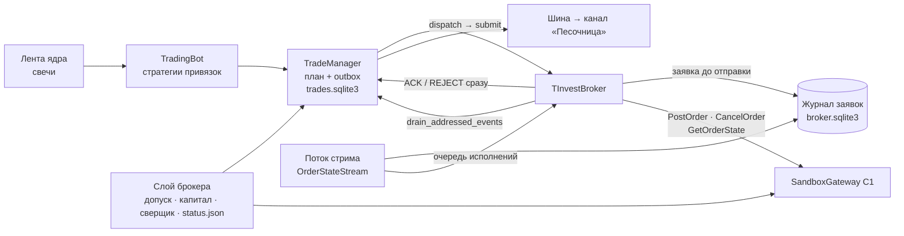
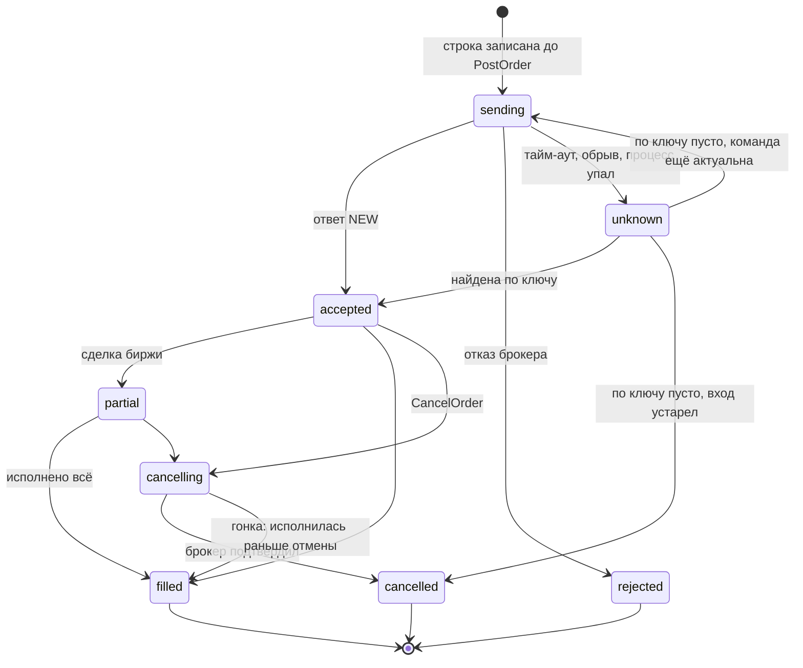

## Context

- **Контур «Песочница» после С2** — процесс `run.py --contour sandbox` под надзором ядра. Он проходит допуск (токен, бот и канал, счёт `My_roBot`, отпечаток), затем раз в 10 с читает желаемое из `core.sqlite3`, сверяет счёт с пустым журналом и пишет `status.json`. Привязки состава только хранятся.
- **Торговая часть эмуляции** собирается в `src/assembly/contour.py`:
  - `TradingContour` и `_build_runtime` поднимают `Storage` (`trades.sqlite3`), `JournalBroker` и `TradeManager`;
  - `TradingBot` работает на свечах из ленты ядра (`FeedMarketServices`);
  - `TradeManager` пишет план и команду одной транзакцией в outbox, `dispatch` отдаёт команду в `broker.submit` и сразу вызывает `consume`;
  - на каждой закрытой минутной свече `on_bar` зовёт `broker.track_bar`, забирает исполнения `drain_addressed_events` и проводит их через `consume`.
- **`JournalBroker` — симулятор.** Вход лимитом ждёт касания на свечах, TTL снимает вход, стоп и цели срабатывают по high/low закрытой минуты. Защитное закрытие приходит событием с `command_id` вида `<trade>:pv:stop:<bar>` или `<trade>:pv:tp:<target>:<bar>`; reducer сам создаёт для него заявку.
- **Шлюз С1** `SandboxGateway` даёт `call`, `stream` и повтор `RESOURCE_EXHAUSTED` (до трёх раз). Ошибки брокера становятся `BrokerCallError(method, code, details, message)`.
- **Разведка С1 (29.10)** и ответы API из `data/sandbox/probe-…/responses.jsonl`:
  - лимитные и рыночные заявки по фьючерсу NG принимаются и исполняются;
  - `PostOrder` принимает цену в пунктах (2.811), а суммы заявки в ответе и стриме — в рублях за контракт (22 731,55 ₽); цена сделки биржи в `trades` стрима — в пунктах (2.963);
  - стрим сначала шлёт событие с временным `order_id`, поэтому сопоставлять нужно по `order_request_id`; событие «исполнена» песочница может прислать без `order_request_id` — тогда по постоянному номеру заявки;
  - `GetOrderState` с `ORDER_ID_TYPE_REQUEST` находит заявку по нашему ключу;
  - повтор того же ключа даёт ошибку 30057 «дубликат», а не прежнюю заявку;
  - рыночная заявка может вернуться из `PostOrder` уже исполненной;
  - `GetFuturesMargin` даёт ГО и стоимость шага, `GetMaxLots` для фьючерса бесполезен;
  - покупка фьючерса списывает со счёта полную цену контракта.
- **SDK 1.49.3:**
  - у `OrderStateStreamOrderState` есть `order_request_id`, `lots_executed` и `trades` (`trade_id`, `price`, `quantity`, `date_time`);
  - у `OrderState` есть `stages` с теми же номерами сделок биржи.

## Goals / Non-Goals

**Goals:**

- Контур «Песочница» торгует привязками своего состава настоящими заявками тем же торговым кодом, что эмуляция.
- Ни одна заявка не теряется и не уходит дважды: ни после потерянного ответа, ни после падения процесса, ни после обрыва стрима.
- Журнал сделок контура сходится со счётом: сверщик не находит необъяснённых расхождений неделю.
- Цены, лоты и ГО строятся верно, и ошибки построения ловятся в песочнице.
- Код, который на Р1 станет контуром «Счёт» сменой шлюза и вида.

**Non-Goals:**

- Стоп-заявки у брокера, срабатывание по `GetStopOrders`, пересоздание стопа после цели — С4. До С4 условие стопа проверяет процесс контура.
- Стоп-заявки у брокера (`STOP_LIMIT`) — С4. На С3 условие стопа проверяет контур, а заявки целей уже стоят у брокера.
- Предохранители (дневной убыток, отказы подряд) — С6.
- Настоящие комиссии из операций и `FeeAdjustment`, отчёт против эмуляции — С7. На С3 комиссия — оценка из плана.
- Автоматическое выравнивание счёта сверщиком: на С3 он замораживает инструмент и шлёт тревогу.
- Переход привязки на следующий контракт фьючерса без команды. Как у эмуляции: привязку снимают и добавляют снова.
- Стрим портфеля. Капитал обновляется по расписанию и после своих исполнений.
- Контур «Счёт» и боевой шлюз — Р1.

## Decisions

### 1. Контур песочницы = торговая часть эмуляции + слой брокера

В процессе контура работает `TradingContour` из `src/assembly/contour.py` с тремя подстановками:

- **набор стратегий** — словари `share_strategies` и `future_strategies` только из привязок состава;
- **брокер** — фабрика вместо `create_addressable_journal_broker`;
- **капитал** — источник для `TradeManager` вместо `initial_deposit`.

У эмуляции и истории подстановок нет, они работают как раньше.

Слой брокера из С2 (`BrokerContour`) остаётся хозяином процесса. Он проходит допуск, затем строит торговую часть и отдаёт ей главный поток. Свою периодическую работу (желаемое, капитал, сверка, `status.json`) он делает на границах тика, как `ContourControl` у эмуляции. Шаг 10 с из С2 остаётся только в режиме `orders = false`.

**Почему не отдельный торговый код для брокера.** Стратегии, фильтры, допуск, outbox, reducer и карточки уже отлажены на эмуляции. На С7 нужно сравнить песочницу с эмуляцией на одних и тех же сигналах, а это честно только при одном коде до брокера.

### 2. Состав по привязкам

- **Ядро.** При запуске и при `POST /api/v1/sandbox/bindings` ядро определяет инструмент привязки по правилам `PUT /api/v1/emulation/target`: акция — по тикеру, фьючерс — ближайший контракт семейства с запасом до экспирации. Участник в `contour_members` получает `instrument` (карточка контракта), `contract` (шаг, стоимость шага, ГО по данным ядра) и `chosen` — карточку привязки. Если инструмент определить нельзя, это отказ `422 BINDINGS_REJECTED` с причиной, как у эмуляции. `launch.json` песочницы несёт привязки, их инструменты и карточки контрактов.
- **Контур.** Привязка `active` попадает в словарь стратегий бота. Если её инструмента ещё нет в составе, он прогревается и допускается тем же путём, что новый инструмент эмуляции. Спрос свечей контур заявляет в ленте ядра под `contour_id = sandbox`, поэтому ядро грузит инструмент, даже если эмуляция им не торгует.
- **Снятие привязки:**
  - `no_entries` — её стратегия больше не открывает входов и доборов, неисполненные входы снимаются, открытые сделки сопровождаются до закрытия;
  - `close_all` — то же, плюс каждая её открытая сделка закрывается выходом по решению 6.
  
  Когда у привязки не осталось сделок и заявок, она уходит из словаря стратегий. Последняя привязка инструмента уводит и инструмент. Для этого `TradeManager` получает остановку по привязке (`assignment_id`) рядом с остановкой по инструменту.

### 3. `TInvestBroker` под `BrokerPort`

`TInvestBroker` (`src/broker_contour/broker.py`) повторяет для `TradeManager` и сборки поверхность `JournalBroker`:

- `submit`;
- `register_trade`, `resume_trade`, `trade_state`, `has_recovery_guard_close` (всегда `False`);
- `set_contracts`, `set_names`;
- `track_bar`, `drain_addressed_events`, `drain_events`.

Ответ на `submit` синхронный, но не исполнение:

| Команда | Что делает | Ответ `submit` |
|---|---|---|
| `OpenTrade`, `AddToTrade` (только `LIMIT`) | `PostOrder` лимит, ключ из `command_id` | `ACK` (принята или неизвестно) или `REJECT` |
| `CloseTrade`, `ReduceTrade` без цели | цикл выхода из решения 6: лимит с запасом, перевыставление, аварийный рынок | `ACK` или `REJECT` |
| `MoveStop` | стоп меняется в представлении брокера (до С4 стоп держит контур) | `ACK` «стоп действует» |
| `CancelEntry` | `CancelOrder` по каждому неисполненному входу сделки | `ACK` «снимается» |
| `OpenTrade`, `AddToTrade` с `MARKET` | ничего | `REJECT limit-entry-required` |

Исполнения, подтверждённые снятия и отказы, пришедшие позже, ложатся в очередь. Тик забирает их через `drain_addressed_events` и проводит через `consume`. Повторный `submit` той же команды (рестарт между отправкой и отметкой outbox `SENT`) заявку заново не ставит: брокер находит её в журнале заявок по ключу и отвечает текущим состоянием.

Представление сделки у брокера — план, подтверждённый стоп, цели, исполненный объём, средняя — строится из `register_trade` и `resume_trade` и обновляется только по настоящим исполнениям. Цели после входа пересчитываются от средней тем же `rebase_on_average`, что у симулятора.

### 4. Журнал заявок брокера в `broker.sqlite3`

Таблица `broker_orders` — одна строка на заявку у брокера:

- `key` — ключ идемпотентности, UUID5 от `command_id` в постоянном пространстве имён. API требует UID длиной до 36 символов, а `command_id` бывает длиннее;
- `command_id`, `trade_id`, `kind` — `entry`, `add`, `target`, `stop`, `exit`, `emergency`;
- инструмент (UID), направление, тип (`limit` или `market`), лоты, цена в пунктах;
- `state`, номер заявки брокера, исполнено лотов, средняя в пунктах;
- `reason`, число отправок, время создания, отправки и последнего изменения.

Таблица `broker_executions` — одна строка на сделку биржи:

- `execution_id = tinvest:<trade_id сделки биржи>`;
- ключ заявки, лоты, цена в пунктах и в рублях, время;
- отметка «проведено через `consume`».

Номер счёта в этих таблицах не хранится.

**Состояния заявки:**

**Отклонение от документа 2.** Там «отправлена», «неизвестно» и «снимается» хранит outbox `TradeManager`. Здесь outbox по-прежнему отвечает за доставку команды до `submit` (`PENDING` → `CLAIMED` → `SENT`), а журнал заявок — за жизнь заявки у брокера. Так `TradeManager`, outbox и эмуляция не меняются, а данные брокера лежат в базе контура рядом с отпечатком и сверкой. Атомарность сохраняется: строка журнала заявок пишется до `PostOrder`, исполнение пишется в `broker_executions` до `consume`, а `consume` идемпотентен по `execution_id`.

### 5. Вход лимитом и его снятие

- Цена входа — `limit_price` команды, округлённая до шага цены в безопасную сторону: покупка вниз, продажа вверх. В `PostOrder` она уходит в пунктах (разведка подтвердила). Количество — лоты. Количество в `TradeManager` для акций уже считается в лотах (`step_cost = шаг × лот`).
- Срок жизни входа ведёт `TradeManager` прежним правилом TTL по таймфрейму: по истечении он выпускает `CancelEntry` с `entry-timeout`. Своего TTL у `TInvestBroker` нет.
- `CANCEL` для команды входа приходит только после подтверждения брокера. Если до подтверждения пришла сделка биржи, она проводится обычным исполнением: отмена не гарантирует нулевого исполнения. После частичного исполнения снимается остаток, сделка живёт с исполненным объёмом — reducer это уже умеет: отмена при ненулевой позиции фазу сделки не трогает.
- Отказ брокера на вход — `REJECT` с причиной `broker:<код>`. Отказ отменяет план и освобождает резерв, повторов нет.

### 6. Выходы до С4: цели — лимит заранее, стоп — стоп-лимит контуром

Эмуляция исполняет цель ровно по её цене, а стоп — по цене стопа (при гэпе по открытию). Чтобы песочница вела себя так же, выходы идут лимитными заявками. Рыночная заявка от контура — только аварийная, как в документе 2.

**Цели — лимитные заявки у брокера.**

- После каждого исполнения входа или добора контур выставляет лимитную заявку на каждую цель: по цене цели (после пересчёта от средней `rebase_on_average`), на объём цели по прежнему распределению, в сторону выхода.
- Если добор или пересчёт от средней изменил объём или цену цели, её заявка перевыставляется: сначала снимается старая, потом ставится новая.
- Исполнения цели приходят из стрима. Каждая сделка биржи по заявке цели проводится отдельным защитным исполнением с `command_id` вида `<trade>:pv:tp:<target>:<номер сделки биржи>`. Reducer создаёт заявку защитного закрытия по объёму события, поэтому частичные исполнения не сводятся: каждое сразу уменьшает позицию.
- Касание цели по свечам контур не проверяет.
- Обычная лимитная заявка у Т-Инвест дневная (`TIME_IN_FORCE_DAY`): брокер снимает её в конце торгового дня. «Снята» без исполнения по заявке цели не значит, что цель отменена. После открытия торгов контур ставит заново заявку каждой неисполненной цели открытой сделки, новым ключом `<command_id>:day:<дата>`.

**Стоп — стоп-лимит, условие держит контур.** Лимит на стоп заранее поставить нельзя: на продажу ниже рынка он исполнится сразу. Поэтому контур проверяет стоп по закрытой минутной свече ядра теми же правилами, что симулятор: стоп важнее целей, гэп через стоп на открытии. При срабатывании контур:

1. снимает заявки целей этой сделки;
2. ставит лимитную заявку на остаток, не занятый живыми заявками целей, по цене стопа с запасом `exit_offset_steps` шагов в сторону исполнения: продажа — стоп минус запас, покупка — стоп плюс запас. Когда снятие целей подтверждено, следующее перевыставление берёт уже весь остаток;
3. если заявка не исполнилась целиком за `exit_requote_secs`, снимает её и ставит новую на весь текущий остаток — по последней цене (`GetLastPrices`) с тем же запасом. Ключ новой заявки — `<command_id>:requote:<n>`;
4. после `exit_requote_attempts` перевыставлений выходит рыночной заявкой на остаток и шлёт тревогу. Это единственный рыночный выход контура.

Сделки биржи по заявке стопа проводятся отдельными защитными исполнениями с `command_id` вида `<trade>:pv:stop:<момент срабатывания>:<номер сделки биржи>`. На С4 условие переезжает к брокеру как `STOP_LIMIT` с тем же запасом, а цикл перевыставления остаётся у контура.

**Сигнальные выходы и закрытие** — `CloseTrade` и `ReduceTrade` без цели: сигнал стратегии, сессионная защита, экспирация, `close_all`. Они идут тем же циклом: лимит от последней цены с запасом, перевыставление, аварийный рынок.

- Перед `CloseTrade` снимаются заявки целей.
- `ReduceTrade` берёт сначала лоты, не занятые заявками целей. Если их не хватает, уменьшается заявка самой дальней цели.

Так закрыт и вопрос документа 2 «чем выходить по команде „закрыть всё“»: С5 его уже не решает.

**Объём выходов не больше позиции.** Сумма лотов живых выходных заявок сделки (цели плюс стоп или выход) никогда не больше её остатка. Кроме заявок целей, у сделки не больше одной выходной заявки в работе. Сигнальный выход, пришедший при незавершённом стопе, ждёт его. Если после завершения остаток ноль, сигнальный выход получает `REJECT trade-not-open`.

**Отказ брокера на выход** (торги закрыты, коридор) не снимает намерение. Выход повторяется не чаще раза в минуту новым ключом `<command_id>:retry:<n>`, пока не пройдёт или пока остаток не станет нулевым. Первый отказ уходит в канал тревогой. Отказ заявки цели повторяется так же.

**Риск.** Пока процесс контура не работает, условие стопа никто не проверяет: позиция в песочнице защищена только заявками целей. На С3 это принято, стоп у брокера — задача С4.

### 7. Стрим исполнений и сопоставление

- Отдельный поток держит `OrderStateStream` по счёту робота. Каждое событие сопоставляется со строкой журнала заявок по `order_request_id`, а без него — по постоянному номеру заявки брокера, который пришёл раньше. Временный `order_id` первого события (`created_at` — эпоха) номером заявки не становится.
- Новые сделки биржи из `trades` (по `trade_id`, которых ещё нет в `broker_executions`) пишутся в журнал и кладутся в очередь исполнений. Статус заявки обновляется по `execution_report_status` и `lots_executed`.
- Событие без нашего ключа (чужая заявка) в очередь не попадает: его увидит сверщик.
- Обрыв стрима: переподключение с паузой 1, 2, 4… до 30 с. После переподключения каждая незавершённая строка журнала досверяется через `GetOrderState` по ключу. Пропущенные сделки берутся из `stages`, с тем же `execution_id`.
- Поток стрима не трогает `trades.sqlite3`: он пишет только журнал заявок и очередь. `consume` вызывает главный поток. Поэтому `TradingBot` получает хук опроса: очередь разбирается не реже раза в `tick_poll_secs`, а не только на новой свече.

### 8. «Неизвестно» и рестарт

- **Когда заявка становится «неизвестной»:**
  - `PostOrder` закончился тайм-аутом, `UNAVAILABLE`, `DEADLINE_EXCEEDED`, `INTERNAL` или обрывом;
  - при старте найдена строка `sending` — процесс упал во время вызова.
  
  `submit` в этом случае отвечает `ACK` с причиной `broker-unknown`, а в канал уходит строка «неизвестно».
- **Разбор** — на ближайшей границе тика и до первого тика после старта. `GetOrderState` по ключу:
  - найдена — состояние и сделки из ответа, строка «найдена по ключу»;
  - не найдена, а команда ещё актуальна — `PostOrder` тем же ключом. Вход актуален, если сделка в `ENTRY_PENDING` и TTL не истёк; выход актуален всегда, пока есть остаток;
  - не найдена и вход устарел — `CANCEL` с `entry-undelivered`.
- **Ошибка 30057 «дубликат»** на `PostOrder` — значит, заявка у брокера есть: сразу поиск по ключу.
- **`RESOURCE_EXHAUSTED`** шлюз повторяет тем же ключом до трёх раз. Если и это не помогло, заявка не принята: вход получает `REJECT rate-limited`, выход повторяется на следующем шаге по правилу решения 6.
- **Перед первым тиком** контур разбирает все незавершённые строки журнала заявок и проводит через `consume` все непроведённые исполнения из `broker_executions`. Только потом идут сверка и торговля.

### 9. Цены и лоты

Источник шага и его стоимости — `GetFuturesMargin`: `min_price_increment` и `min_price_increment_amount`. Контур читает его для каждого фьючерса при допуске инструмента и раз в сутки.

- Цена сделки стрима уже в пунктах. В рублях приходят суммы заявки и `GetOrderState.stages` (у них тип `MoneyValue`) — их контур переводит: `пункты = рубли × min_price_increment / min_price_increment_amount`, с округлением до шага. Проверка на ответах разведки: 22 731,55 ₽ → 2.811.
- Ключ инструмента у торговой части — как у эмуляции (тикер). UID для заявок брокер один раз находит через `GetInstrumentBy` и хранит в журнале заявок; по UID сопоставляются стрим и сверка.
- У акций рубли за бумагу и есть пункты.
- Если `trades.quantity` пришёл в штуках, а не в лотах (проверяется фикстурой акции), он делится на размер лота.
- Перед отправкой цена проверяется на коридор `GetOrderBook`/`limit_up`/`limit_down`. Цена вне коридора — отказ `price-out-of-band` до отправки, без запроса к брокеру.

### 10. Капитал и ГО

- **Капитал песочницы — рубли на счёте из `GetPositions`** (`rub` снимка). Так закрыт открытый вопрос документа 2. Песочница при покупке фьючерса списывает полную цену контракта, поэтому `liquid_portfolio` выходит больше денег на счёте. Рубли — оценка снизу и для риска безопасна. `liquid_portfolio` остаётся в `status.json`, API и сообщении о старте. Для настоящего счёта поле выбирается заново на Р1.
- `TradeManager` получает источник капитала. Если он задан, база бюджета — последний снимок капитала, а не счёт журнала с `initial_deposit`. Пустой снимок (счёт не прочитан) — входы и доборы отклоняются с причиной «счёт недоступен», выходы работают. У эмуляции источника нет.
- **Когда обновляется:** при старте, после каждого своего исполнения (на следующей границе тика) и при каждой сверке. Один снимок на тик: кандидаты тика допускаются по одному капиталу.
- **ГО на контракт** — `initial_margin_on_buy` или `initial_margin_on_sell` из `GetFuturesMargin`. Оно заменяет ГО карточки ядра в `ContractMeta` контура.
- **Допуск по ГО:** лоты × ГО ≤ рубли − ГО неисполненных входов контура. Отказ — прежнее событие ограничения бюджета с причиной «не хватает ГО».

### 11. Сверщик с журналом

`JournalView` строится из журнала:

- позиция по инструменту — сумма знаковых остатков открытых сделок;
- заявки — незавершённые строки журнала заявок с номером брокера;
- стоп-заявки — до С4 журнал их не ставит, любая стоп-заявка на счёте — расхождение.

**«В пути».** Инструмент, у которого есть заявка в `sending`, `unknown` или `cancelling` или непроведённое исполнение, в этой сверке не сравнивается и попадает в отчёт отметкой `in_flight`. Перед сверкой разбирается очередь исполнений. Так сверка не ловит гонку «брокер уже исполнил, журнал ещё не провёл».

**Заморозка** работает через новый блок входов `TradeManager` по инструменту: входы и доборы отклоняются с причиной «инструмент заморожен сверкой», выходы, сокращения и стоп работают. Снимается заморозка прежним правилом С2 — сверкой без расхождений.

### 12. Остановка контура с открытыми сделками

- **Весь контур:**
  - `no_entries` — `TradeManager.stop_contour`: входы снимаются у брокера, открытые сделки ведутся до выхода;
  - `close_all` — то же, плюс выход из каждой сделки по решению 6.
  
  Процесс завершается сам, когда не осталось сделок и незавершённых заявок. Затем `status.json` получает `stopped`.
- **Ctrl+C, конец stdin, пульс «остановлено»** — штатный выход после тика, как у эмуляции. Открытые позиции остаются на счёте с заявками целей, но условие стопа никто не проверяет (решение 6, риск до С4). Заявки входа и целей у брокера не снимаются: после подъёма их найдёт разбор журнала заявок. В канал уходит `stopped` с числом открытых позиций.
- **Подъём после рестарта** проходит допуск, затем разбор журнала заявок (решение 8), сверку и только потом первый тик.

### 13. Уведомления

- Канал «Песочница» получает торговые события своего контура:
  - девять lifecycle-типов (`signal`, `trade_opened`, …, `order_rejected`);
  - `order_accepted` («принято брокером, заявка …7f3a»);
  - новый `broker_order`;
  - `broker_account` из С2.
  
  Списки `[notifier.telegram] events` эмуляции на канал песочницы не влияют.
- **`broker_order`** — то, чего у эмуляции нет: `sent` (отправлено, лимит с ценой, лоты), `unknown`, `found`, `resent`, `cancelling`, `requoted` (перевыставлена, новая цена), `exit_rejected` и `emergency_market` (тревоги). Поля: `trade_id`, инструмент коротким именем, вид заявки, лоты, цена, последние четыре символа номера заявки брокера, причина. Номер счёта и ключ целиком не публикуются.
- Строки заявки дописываются в корневую карточку сделки тем же механизмом правки, что этапы сделки (`telegram-trade-cards`). Заголовок карточки песочницы помечен «ПЕСОЧНИЦА».

### 14. Секреты

Новых секретов нет. Номер счёта по-прежнему маскируется. В `broker_orders`, `broker_executions`, событиях и логе номер заявки брокера и ключ — не секрет, но в канал они идут последними четырьмя символами, чтобы сообщение читалось.

## Risks / Trade-offs

- **[Позиция без стопа, пока контур не работает]** → До С4 стоп живёт в процессе. Это песочница, денег нет. Сообщение `stopped` называет число открытых позиций, С4 переносит стоп к брокеру.
- **[Стоп по закрытой минуте опаздывает]** → Условие стопа видно только после закрытия минуты, а стоп-лимит с запасом может не исполниться на быстром рынке. Перевыставление от последней цены и аварийный рынок не оставляют позицию без выхода. Расхождение с эмуляцией попадёт в отчёт С7. На С4 условие переезжает к брокеру.
- **[Запас стоп-лимита]** → `exit_offset_steps` по умолчанию 5 шагов — догадка. Неделя песочницы покажет, сколько перевыставлений и аварийных выходов он даёт. Значение меняется настройкой без кода.
- **[Песочница исполняет не как биржа]** → Цены, частичные исполнения и комиссии песочницы могут отличаться от биржи. На Р1–Р2 правила проверяются заново, ради этого журнал привязан к отпечатку счёта.
- **[Гонка сверки с исполнением]** → Отметка `in_flight` и разбор очереди перед сверкой. Если ложные тревоги всё-таки появятся, расхождение по позиции будет требовать двух сверок подряд. Это решение отложено до данных недели проверки.
- **[Капитал = рубли занижен в песочнице]** → Безопасно для риска. Цифры в карточке «риск 0,6% капитала» будут от рублей. На Р1 поле выбирается по приложению.
- **[Поверхность `JournalBroker` неявная]** → `TradeManager` зовёт `register_trade` и `resume_trade` через `getattr`. Тест сборки проверяет, что `TInvestBroker` реализует всё, что зовут `TradeManager` и `on_bar`.
- **[Свечи песочницы идут через ленту ядра]** → Ядро ведёт рыночные данные, пока надзирает за эмуляцией. Если эмуляция не запущена, песочница свечей не получает: новых сигналов нет, условие стопа не проверяется. На С3 эмуляция работает рядом всегда; вынос ленты ядра из надзора за эмуляцией — отдельная задача.
- **[Ключ UUID5 от `command_id`]** → Детерминирован: тот же `command_id` после рестарта даёт тот же ключ. Повтор выхода после отказа берёт новый `command_id:retry:<n>`, чтобы не получить 30057 на отклонённую заявку.

## Migration Plan

1. Обновлённый робот поднимает песочницу с `orders = true` по умолчанию. `trades.sqlite3` контура создаётся при первом старте торговой части, `broker.sqlite3` получает новые таблицы миграцией схемы. Отпечаток и отчёты С2 сохраняются.
2. Привязки, добавленные на С2, не несут инструмента контракта. При запуске командой `PUT /api/v1/sandbox/target` ядро определяет его заново. При автоподъёме такая привязка помечается `rejected` с причиной в `GET /api/v1/sandbox`, остальные торгуют; её снимают и добавляют снова.
3. Откат: `[contours.sandbox] orders = false` возвращает поведение С2. Журнал сделок и журнал заявок остаются для следующего включения. Если на счёте остались позиции, сверщик покажет их тревогой.

## Open Questions

- Нужна ли расхождению по позиции вторая сверка подряд до тревоги — решим по неделе проверки.
- Даёт ли песочница `trades` в стриме для рыночной заявки, исполненной прямо в ответе `PostOrder`: по записям разведки С1 — да (одна сделка с номером и ценой в пунктах). Если нет, сделку добирает `GetOrderState.stages`, а без stages — средняя цена заявки (решение 7). Разведка П16 проверяет это каждый раз.
- В лотах или в штуках `trades.quantity` у акции — разведка на акции (`python -m src.sandbox probe SBER`); контур поддерживает оба варианта.
