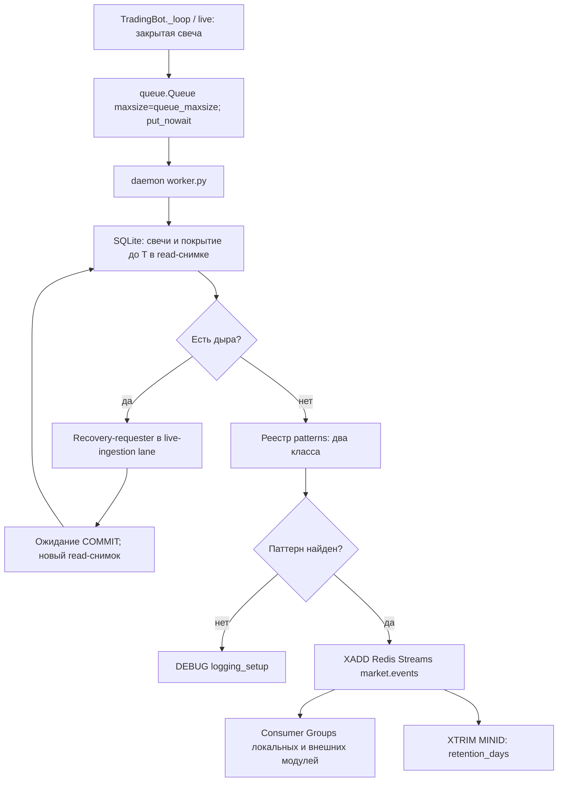
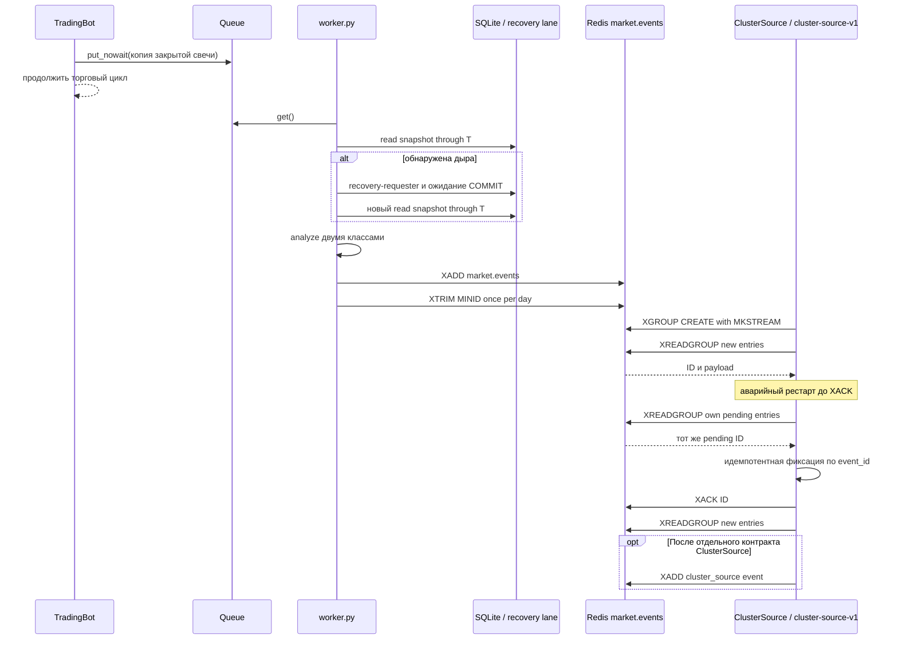

## Why

Два свечных поглощения дают внешним аналитическим модулям воспроизводимый сигнал по уже закрытому бару. Синхронный торговый цикл не должен ждать чтения SQLite, восстановления истории или Redis. Поэтому детекция выполняется в отдельном потоке, а существующий `events.bus.EventBus` сохраняет роль внутрипроцессной шины. Redis Streams нужен для внешнего Pub/Sub с сохранением сообщений и независимым чтением после рестарта через Consumer Groups. Ритм «один тик = закрытая свеча активного таймфрейма» и торговые решения ядра не меняются.

## What Changes

Новая capability: `market-structure-patterns`, нормативная дельта в `specs/market-structure-patterns/spec.md`.

### ADDED Requirements

#### Requirement: Изолированная структура и контракт детекторов

Нормативный уровень: MUST.
Новый компонент свечных паттернов MUST состоять из `src/market_structure/patterns/base.py`, `bullish_engulfing.py`, `bearish_engulfing.py`, `patterns/__init__.py` и координатора `src/market_structure/worker.py`. Существующие модули `src/market_structure` не входят в его область изменения. `BasePattern.analyze(candles) -> Optional[PatternResult]` MUST принимать упорядоченные закрытые свечи и возвращать результат либо `None`; реестр MUST содержать ровно два класса. Бычье поглощение MUST означать медвежье тело предыдущей свечи и бычье тело текущей, полностью покрывающее предыдущее; медвежье — зеркально. Равные границы тела считаются покрытием; doji с нулевым телом не является поглощением. `body_overlap_ratio` MUST быть долей тела предыдущей свечи, покрытой телом текущей, в интервале `[0, 1]`.

##### Scenario: Обнаружение бычьего поглощения
- **GIVEN** две подряд закрытые свечи одного тикера и таймфрейма с медвежьим и бычьим телами
- **WHEN** тело второй свечи покрывает тело первой по включительным границам
- **THEN** `bullish_engulfing` возвращает `PatternResult` с направлением `long`, а `bearish_engulfing` возвращает `None`

##### Scenario: Обнаружение медвежьего поглощения
- **GIVEN** две подряд закрытые свечи с бычьим и медвежьим телами
- **WHEN** тело второй свечи покрывает тело первой по включительным границам
- **THEN** `bearish_engulfing` возвращает `PatternResult` с направлением `short`, а `bullish_engulfing` возвращает `None`

#### Requirement: Конфигурация публикации паттернов

Нормативный уровень: MUST.
Параметры контура MUST читаться из секции `[market_structure]` внешнего `robot.toml`, который имеет приоритет над `default.toml`: `patterns_enabled`, `redis_host`, `redis_port`, `redis_db`, `queue_maxsize` и `retention_days`. Значения по умолчанию: `patterns_enabled=false`, `redis_host="127.0.0.1"`, `redis_port=6379`, `redis_db=0`, `queue_maxsize=1024`, `retention_days=90`. `redis_host` MUST быть непустой строкой; `redis_port` — целым числом от 1 до 65535; `redis_db` — целым числом не меньше 0; `queue_maxsize` и `retention_days` — целыми числами больше 0. Пароль Redis MUST читаться только из `MARKET_STRUCTURE_REDIS_PASSWORD` окружения. `run.py` MUST создавать Redis-клиент из этих значений и запускать worker только в live-режиме при `patterns_enabled=true`.

##### Scenario: Локальный конфиг включает публикацию
- **GIVEN** в `robot.toml` задано `[market_structure] patterns_enabled=true`
- **WHEN** робот запускается в live-режиме
- **THEN** worker использует host, port, db, лимит очереди и retention из этой секции

#### Requirement: Ограниченная неблокирующая очередь

Нормативный уровень: MUST.
Воркер MUST работать в собственном daemon-потоке с `queue.Queue(maxsize=queue_maxsize)`, где дефолт `queue_maxsize=1024`. Основной поток MUST передавать неизменяемую копию закрытой свечи через `put_nowait`; при заполнении MUST отбрасывать **новую** задачу, фиксировать предупреждение с тикером, таймфреймом и временем и продолжать торговый цикл. Блокирующее ожидание свободного места, SQLite, recovery-requester и Redis в пути постановки запрещены. Потерянная задача не выдаётся за обработанную; восстановление пропущенного анализа относится к Out of Scope.

##### Scenario: Очередь доступна
- **GIVEN** в очереди меньше `queue_maxsize` задач
- **WHEN** `_loop()` получает закрытую свечу
- **THEN** её копия ставится без ожидания обработки и торговый цикл продолжается

##### Scenario: Очередь заполнена
- **GIVEN** в очереди `queue_maxsize` задач
- **WHEN** поступает следующая закрытая свеча
- **THEN** новая задача отбрасывается с предупреждением, а торговый цикл не ждёт воркер

#### Requirement: Согласованный контекст из SQLite и устранение пробелов

Нормативный уровень: MUST.
Воркер MUST читать ровно две последние закрытые свечи одного тикера и таймфрейма до `T` включительно из SQLite, в хронологическом порядке. Контракт чтения MUST предоставляться непосредственно через существующий `data.market_store.MarketDataStore` (`market-data.sqlite3`), без участия `trade_journal.storage` и без копирования свечей в торговый журнал. Поскольку текущие `current_frame()` и `coverage_state()` открывают разные соединения, в `MarketDataStore` MUST появиться ограниченный по `T` метод чтения двух свечей и покрытия в одном снимке. Чтение свечей и состояний покрытия MUST выполняться в одной read-транзакции SQLite `BEGIN` в WAL-режиме, с верхней границей закрытия `open_time + timeframe <= T`; сетевой запрос внутри этой транзакции запрещён. Отсутствие ожидаемой торговой свечи по календарю либо состояние `pending/unresolved` MUST считаться дырой. Состояния доказанного закрытия/отсутствия торгов MUST учитываться как разрешённые интервалы, без выдумывания свечи. При дыре воркер MUST передать `(uid, timeframe, missing_open_time)` через инъецированный recovery-requester существующего live-ingestion: он ставит потребность в `IngestionWorker.note_loss()` и соответствующей Evidence/Completeness lane. Этот вызов возвращает сразу и не вызывает брокера, `data.loader.load_candles` или приватный `MarketDataCache._load`. Воркер откладывает задачу до следующей проверки покрытия, после фиксации результата полосой открывает **новую** read-транзакцию и проверяет контекст повторно. Пока дыра не разрешена, детекторы и публикация MUST не вызываться.

##### Scenario: Дыра обнаружена
- **GIVEN** между предыдущей свечой и `T` есть ожидаемый торговый интервал со статусом `pending`
- **WHEN** воркер читает контекст и покрытие одним SQLite-снимком
- **THEN** он не передаёт неполный массив паттернам и передаёт запрос recovery-requester

##### Scenario: Дыра дозаполнена и данные перечитаны
- **GIVEN** полоса восстановления записала отсутствующую свечу и подтвердила транзакцию
- **WHEN** воркер заново открывает read-транзакцию до `T`
- **THEN** он передаёт детекторам только полный хронологический массив закрытых свечей

##### Scenario: Дыра остаётся неразрешённой
- **GIVEN** источник вернул пустой ответ без доказательства отсутствия торгов
- **WHEN** повторное чтение всё ещё видит `unresolved`
- **THEN** задача остаётся без результата и события, откладывается для следующей проверки покрытия и не задерживает основной поток

#### Requirement: Результат без паттерна

Нормативный уровень: MUST.
Если оба детектора вернули `None` для полного контекста, воркер MUST записать через `logging_setup` запись уровня DEBUG строго `Свеча [timestamp] по [ticker] проанализирована модулем market_structure, паттернов не обнаружено`, где квадратные скобки содержат фактические значения UTC ISO 8601 и тикера. Он MUST не публиковать событие паттерна.

##### Scenario: Паттернов нет
- **GIVEN** полный контекст закрытых свечей и два результата `None`
- **WHEN** анализ завершён
- **THEN** появляется ровно одна DEBUG-запись указанного формата и нет `XADD`

#### Requirement: Публикация паттерна и схема события

Нормативный уровень: MUST.
Воркер `market_structure` MUST быть единственным издателем паттернов в Redis Stream `market.events` через `XADD`. `market.events` MUST содержать только неизменяемые факты о рынке; команды роботу и управляющие сообщения в него публиковать запрещено. Каждое сообщение MUST соответствовать Appendix A: обязательные `schema_version=1`, `event_id`, `ticker`, `timeframe`, `timestamp` в UTC ISO 8601 (время закрытия), `published_at` в UTC ISO 8601, `source='candle_patterns'`, `event_type`, `direction` и `payload`. `source` обозначает модуль-издатель, `event_type` — вид факта. `event_id` MUST детерминированно идентифицировать `(source, schema_version, ticker, timeframe, timestamp, event_type)` для устранения повторной обработки. `timestamp` задаёт предметное время события. `published_at` MUST браться из `Redis TIME` непосредственно перед попыткой `XADD` и входить только в успешно записанное сообщение; при повторной попытке его значение может измениться, а `event_id` остаётся постоянным. Redis Stream ID не является временем рынка. Payload MUST включать `body_overlap_ratio` и OHLC обеих свечей. До `XADD` в устойчивый outbox существующей SQLite БД `market-data.sqlite3` MUST сохраняться каноническая часть события без `published_at` с уникальным `event_id`; после успешного ответа `XADD` outbox-запись MUST помечаться доставленной. При рестарте воркер MUST повторять недоставленные записи с тем же `event_id`. После ошибки Redis outbox-запись MUST получить следующую попытку не ранее чем через одну секунду. Сетевые задержки, повтор и `XADD` MUST оставаться в фоне. Redis MUST использовать AOF `appendfsync always`; подтверждение публикации возможно только после успешного ответа `XADD`.

##### Scenario: Паттерн опубликован
- **GIVEN** `bullish_engulfing` вернул валидный `PatternResult`
- **WHEN** воркер сериализует результат и Redis подтверждает `XADD`
- **THEN** `market.events` содержит сообщение с `schema_version=1`, `event_type=bullish_engulfing`, `direction=long`, предметным `timestamp`, временем записи `published_at`, валидным `payload` и постоянным `event_id`

##### Scenario: Redis временно недоступен
- **GIVEN** детектор нашёл паттерн, а Redis не отвечает
- **WHEN** фоновая публикация получает ошибку
- **THEN** воркер сохраняет задачу публикации для повторной попытки, не вызывает Redis из основного потока и не объявляет событие доставленным

#### Requirement: Consumer Groups и семантика восстановления

Нормативный уровень: MUST.
Транспорт MUST использовать Redis Streams с Consumer Groups: каждый независимый потребитель интеграционных событий — внешний сервис либо внутрипроцессное расширение, которому нужна сохранённая доставка, — MUST иметь собственную Consumer Group; экземпляры одного потребителя распределяют сообщения внутри одной группы. Например, ClusterSource использует группу `cluster-source-v1`, а экземпляр — стабильное в пределах своего развёртывания имя consumer `cluster-source-main`; другой локальный модуль создаёт отдельную группу. Группа создаётся при старте через `XGROUP CREATE market.events <group> 0-0 MKSTREAM` с допустимым `BUSYGROUP`. Потребитель MUST сначала перечитать **свои** pending entries через `XREADGROUP ... STREAMS market.events 0`, затем читать новые через `XREADGROUP ... STREAMS market.events >`, применять обработку идемпотентно по `event_id` и вызывать `XACK` только после её успешной фиксации. `NOACK` MUST не применяться. Автоматический захват pending entries другого consumer через `XPENDING`/`XCLAIM` остаётся вне MVP; поэтому имя consumer MUST сохраняться между рестартами.

##### Scenario: Новые сообщения
- **GIVEN** группа существует и consumer восстановил свои pending entries
- **WHEN** в `market.events` появляется новый ID
- **THEN** `XREADGROUP` с `>` выдаёт сообщение этой группе, а подтверждение происходит после успешной обработки

##### Scenario: Перечитывание после аварийного рестарта
- **GIVEN** consumer получил сообщение, но остановился до `XACK`
- **WHEN** он перезапускается с тем же именем и читает ID `0`
- **THEN** pending сообщение возвращается, повторная бизнес-обработка подавляется по `event_id`, после чего выполняется `XACK`

#### Requirement: Эволюция контракта и предотвращение циклов

Нормативный уровень: MUST.
`market.events` является общим журналом интеграционных событий нескольких издателей и не заменяет SQLite как источник истины для свечей либо `EventBus` в синхронном ядре. В MVP писать в него MUST только `candle_patterns`; `ClusterSource` или другой издатель MUST до первой публикации добавить через отдельное OpenSpec-изменение типизированное AsyncAPI-сообщение и версию своей схемы в тот же канал. Неизвестный `source` или `event_type` MUST не приниматься потребителем как известный факт. Модуль, который и читает, и публикует события, MUST явно ограничить входные `source` и `event_type`; он MUST не обрабатывать события, опубликованные им самим, если такое поведение явно не описано его контрактом.

##### Scenario: ClusterSource добавляет свой факт
- **GIVEN** ClusterSource должен публиковать результат кластеризации
- **WHEN** его команда расширяет контракт
- **THEN** она добавляет отдельную типизированную схему и операцию AsyncAPI для `source=cluster_source`, не изменяя контракт свечного поглощения

##### Scenario: Предотвращение цикла
- **GIVEN** ClusterSource читает свечные паттерны и публикует собственные факты в `market.events`
- **WHEN** он получает сообщение с `source=cluster_source`
- **THEN** он не использует его как вход своего конвейера и подтверждает его согласно своей Consumer Group

#### Requirement: Срок хранения Redis Stream

Нормативный уровень: MUST.
`market.events` MUST сохранять записи срок `retention_days` из `[market_structure]` по Redis Stream ID; дефолтный срок — 90 суток. Фоновый `worker.py` MUST не чаще одного раза в сутки выполнять точное `XTRIM market.events MINID <redis_now_minus_retention_days_ms>-0`; `MAXLEN` для этой задачи применять запрещено. Выполнение retention MUST оставаться вне торгового потока. Архивация удаляемых сообщений в отдельную БД в MVP не выполняется. Каждый потребитель MUST обработать и подтвердить pending entries до истечения настроенного срока: сообщения старше срока не гарантируются, включая pending entries.

##### Scenario: Удаление по сроку хранения
- **GIVEN** в stream есть запись старше 90 суток и запись моложе 90 суток
- **WHEN** фоновый воркер выполняет ежедневный retention
- **THEN** запись старше порогового Stream ID удаляется, а более новая остаётся доступной Consumer Groups

##### Scenario: Отстающий consumer
- **GIVEN** pending запись consumer старше 90 суток
- **WHEN** retention удаляет её из stream
- **THEN** потребитель не может рассчитывать на повторную доставку payload и фиксирует отставание как операционный сбой

### MODIFIED Requirements

#### Requirement: Подключение к существующему циклу

Нормативный уровень: MUST.
Было: `TradingBot._loop()` и live-ветка обрабатывают закрытые бары в торговом цикле без паттерн-воркера. Стало: точка, которая в текущей ветке подтверждает новый закрытый бар активного таймфрейма, MUST однократно отправлять его копию в очередь воркера через необязательную зависимость, сохраняя текущий порядок и результат торговой обработки. Если `_loop()` и live-ветка проходят один и тот же бар, постановку выполняет только общий путь подтверждения нового бара. Повторные тики по тому же бару MUST не создавать повторных задач. При отсутствии воркера поведение MUST оставаться прежним.

##### Scenario: Закрытый бар в штатном цикле
- **GIVEN** воркер подключён и бар закрыт
- **WHEN** `_loop()` или его live-ветка обрабатывает бар
- **THEN** задача однократно ставится в очередь, а торговые этапы выполняются как прежде

#### Requirement: Композиция и жизненный цикл

Нормативный уровень: MUST.
Было: `run.py` собирает `TradingBot` без pattern worker. Стало: `run.py` MUST создавать и внедрять воркер через конструктор, запускать его после регистрации локальных подписчиков и останавливать при завершении робота с ограниченным ожиданием; медленное завершение фонового daemon-потока MUST не удерживать основной процесс. В режиме без live-данных воркер MUST оставаться отключённым, чтобы не запускать реплей истории.

##### Scenario: Запуск и остановка
- **GIVEN** live-режим и собранные зависимости
- **WHEN** `run.py` запускает и затем останавливает робота
- **THEN** воркер получает внедрённые SQLite, recovery-requester live-ingestion и Redis-зависимости и завершает ожидание в заданный ограниченный срок

#### Requirement: Маршрутизация внутренней шины

Нормативный уровень: MUST.
Было: `events.bus.EventBus` синхронно доставляет внутренние события подписчикам. Стало: он MUST продолжать доставлять существующие торговые, системные и рыночные события и не пересылать их в Redis. Событие паттерна MUST публиковаться только в `market.events`; локальный модуль, которому нужен паттерн, MUST читать его через собственную Redis Consumer Group наравне с внешним модулем. Робот в MVP MUST не читать `market.events`, пока паттерны не участвуют в его правилах. Redis-сообщение MUST не возвращаться в EventBus; одна логическая обработка MUST иметь ровно один транспорт доставки.

##### Scenario: Один транспорт для паттерна
- **GIVEN** воркер нашёл поглощение и локальный аналитический модуль подписан на Redis
- **WHEN** воркер публикует результат
- **THEN** `market.events` получает одно сообщение, локальный модуль читает его в своей Consumer Group, а EventBus не получает и не возвращает это событие

## Impact

- `src/market_structure/patterns/` и `src/market_structure/worker.py`: новый изолированный контур и retention; `src/bot/trading_bot.py` (`TradingBot._loop()` и live-ветка) и `run.py`: минимальная точка подключения; `src/data/market_store.py`: атомарное чтение контекста и покрытия, устойчивый outbox. `src/config.py`, `src/config_loader.py` и `default.toml`: секция `[market_structure]` с host, port, db, включением, лимитом очереди и retention; пароль Redis остаётся в окружении. `src/events` для паттернов не меняется.
- Свечи и состояния покрытия уже хранятся в `src/data/market_store.py` (`market-data.sqlite3`): `record_candles()` фиксирует завершённые свечи, `current_frame()` читает свечи, `coverage_state()` — покрытие. Эти два метода сейчас открывают разные SQLite-соединения, поэтому воркеру нужен новый ограниченный метод чтения в одном снимке в **том же** `MarketDataStore`; `trade_journal.storage` не меняется.
- Риски: переполнение `queue_maxsize` задач и потеря анализа новой свечи; долгая или неуспешная дозагрузка; дублирующий `XADD` после неопределённого ответа Redis; pending entries при смене имени consumer и отставание дольше `retention_days`. Устойчивый outbox в `market-data.sqlite3` и идемпотентность по `event_id` ограничивают потери и повторную обработку; повторный `XADD` с тем же ключом возможен.
- При старте Consumer Group создаётся с `MKSTREAM`; `BUSYGROUP` трактуется как штатное состояние. Redis конфигурируется с AOF `appendfsync always`; фоновый воркер выполняет точный retention `retention_days` по `MINID` (по умолчанию 90 суток). До отдельного изменения с архивной БД операционная проверка свободного места, размера stream и возраста pending entries обязательна.

## Out of Scope

Исторический реплей свечей, отдельный backfill-режим, метрики и алерты, автоматический `XPENDING`/`XCLAIM` для чужих consumer, архивирование сообщений старше 90 суток в отдельную БД, дополнительные паттерны, контракт событий ClusterSource, замена `events.bus`, торговые решения по этим паттернам, автоматическое восстановление отброшенных задач очереди.

## Acceptance Criteria

1. На типовой сборке `put_nowait` для 10 000 закрытых баров имеет p99 не более 5 мс; заполнение очереди не вызывает ожидания или сетевого вызова в торговом потоке.
2. Тест с дырой в SQLite доказывает: до её разрешения детекторы не вызываются; worker передаёт пропуск recovery-requester без сетевого вызова, а после записи полосой восстановления выполняет новое чтение и передаёт только непрерывный контекст.
3. После рестарта того же consumer `XREADGROUP` с `0` возвращает неподтверждённые записи, `XACK` выполняется после фиксации обработки, а последующее `>` читает новые сообщения.
4. Для полного контекста без поглощения DEBUG-запись через `logging_setup` в точности соответствует заданному формату; Redis-события нет.
5. При поглощении `market.events` содержит сообщение, прошедшее валидацию схемы Appendix A, с правильными `source`, `event_type`, направлением, OHLC и `event_id`.
6. Паттерн публикуется только в `market.events`; внутренний `EventBus` не получает это событие, а каждый локальный или внешний потребитель читает его из собственной Consumer Group.
7. Сообщение моложе 90 суток доступно в stream; фоновый retention удаляет записи старше порогового Stream ID без архивации.

## Alternatives Considered

Kafka даёт сильный потоковый стек, но требует более тяжёлой инфраструктуры для двух паттернов. RabbitMQ обеспечивает очереди и подтверждения, но требует отдельной модели хранения истории; Redis Streams прямо поддерживает replay групп. Только внутренний bus не переживает рестарт внешнего потребителя. `asyncio` требует внедрения цикла событий в синхронное ядро. `multiprocessing` усложняет передачу свечей, SQLite-соединений и завершение процесса; отдельный поток достаточен для I/O-bound работы.

## Appendix A: AsyncAPI 3.0.0 (YAML)

`timestamp` — предметное время события: для паттерна это момент закрытия текущей свечи в UTC ISO 8601. `published_at` берётся из `Redis TIME` непосредственно перед той попыткой `XADD`, которая успешно создала данную stream-запись; поэтому повтор с тем же `event_id` может иметь иное `published_at`. Каноническая outbox-запись его не содержит. Поля Redis Stream являются строками; `payload` передаётся как JSON-строка и валидируется как объект после декодирования. В версии 1 `source` — издатель `candle_patterns`, `event_type` — тип факта. По `event_type` направление фиксировано: `bullish_engulfing → long`, `bearish_engulfing → short`. Будущий издатель, включая ClusterSource, добавляет собственное типизированное сообщение и операцию в этот канал отдельным изменением, а не публикует произвольный payload.

```yaml
asyncapi: 3.0.0
info:
  title: My_roBot market events
  version: 1.0.0
  description: Неизменяемые интеграционные события о рынке. Версия 1 содержит свечные поглощения.
servers:
  redis:
    host: '{redis_host}'
    protocol: redis
    description: Redis Streams с AOF appendfsync always и retention по умолчанию 90 суток.
    variables:
      redis_host:
        default: localhost:6379
channels:
  marketEvents:
    address: market.events
    messages:
      patternDetected:
        $ref: '#/components/messages/PatternDetected'
operations:
  publishPattern:
    action: send
    channel:
      $ref: '#/channels/marketEvents'
    messages:
      - $ref: '#/channels/marketEvents/messages/patternDetected'
  consumePattern:
    action: receive
    channel:
      $ref: '#/channels/marketEvents'
    messages:
      - $ref: '#/channels/marketEvents/messages/patternDetected'
components:
  messages:
    PatternDetected:
      name: PatternDetected
      title: Найденное свечное поглощение
      contentType: application/json
      payload:
        $ref: '#/components/schemas/PatternEvent'
  schemas:
    PatternEvent:
      type: object
      additionalProperties: false
      oneOf:
        - properties:
            event_type: {const: bullish_engulfing}
            direction: {const: long}
        - properties:
            event_type: {const: bearish_engulfing}
            direction: {const: short}
      required: [schema_version, event_id, ticker, timeframe, timestamp, published_at, source, event_type, direction, payload]
      properties:
        schema_version:
          type: integer
          const: 1
        event_id:
          type: string
          minLength: 1
          description: Постоянный ключ source/schema_version/ticker/timeframe/timestamp/event_type для дедупликации.
        ticker:
          type: string
          minLength: 1
        timeframe:
          type: string
          minLength: 1
        timestamp:
          type: string
          format: date-time
          description: "Предметное время: закрытие текущей свечи, UTC ISO 8601."
        published_at:
          type: string
          format: date-time
          description: Время Redis TIME непосредственно перед успешной попыткой XADD, UTC ISO 8601.
        source:
          type: string
          const: candle_patterns
        event_type:
          type: string
          enum: [bullish_engulfing, bearish_engulfing]
        direction:
          type: string
          enum: [long, short]
        payload:
          type: object
          additionalProperties: true
          required: [body_overlap_ratio, previous_candle, current_candle]
          properties:
            body_overlap_ratio:
              type: number
              minimum: 0
              maximum: 1
            previous_candle:
              $ref: '#/components/schemas/Ohlc'
            current_candle:
              $ref: '#/components/schemas/Ohlc'
    Ohlc:
      type: object
      additionalProperties: false
      required: [open, high, low, close]
      properties:
        open: {type: number}
        high: {type: number}
        low: {type: number}
        close: {type: number}
```

## Appendix B: Redis Streams — команды и семантика Consumer Group

Команды ниже исполняются в указанном порядке. `XADD` выполняет только фоновый издатель. Уникальный `event_id` сохраняется при повторной попытке; Redis Stream ID назначает сервер и не служит ключом бизнес-дедупликации или временем рынка. `timestamp` описывает предметное время, а `published_at` берётся из `Redis TIME` непосредственно перед успешной попыткой `XADD`.

```redis
XADD market.events * schema_version 1 event_id candle_patterns/1/SBER/1m/2026-10-13T10:01:00Z/bullish_engulfing ticker SBER timeframe 1m timestamp 2026-10-13T10:01:00Z published_at 2026-10-13T10:01:03Z source candle_patterns event_type bullish_engulfing direction long payload '{\"body_overlap_ratio\":1.0,\"previous_candle\":{\"open\":100.0,\"high\":101.0,\"low\":98.0,\"close\":99.0},\"current_candle\":{\"open\":98.5,\"high\":102.0,\"low\":98.0,\"close\":101.5}}'
XGROUP CREATE market.events cluster-source-v1 0-0 MKSTREAM
XREADGROUP GROUP cluster-source-v1 cluster-source-main COUNT 100 BLOCK 5000 STREAMS market.events 0
XREADGROUP GROUP cluster-source-v1 cluster-source-main COUNT 100 BLOCK 5000 STREAMS market.events >
XACK market.events cluster-source-v1 1700000000000-0
XTRIM market.events MINID 1791800000000-0
```

`XGROUP CREATE` исполняется при старте каждого логического потребителя; `BUSYGROUP` означает, что группа уже существует, а остальные ошибки являются ошибками запуска. ID `0` читает только pending entries **того же consumer**; после исчерпания этой истории используется `>` для новых записей. `BLOCK 5000` ограничивает ожидание новых записей пятью секундами, а при чтении pending с `0` не действует. `COUNT 100` ограничивает пакет, `NOACK` опущен намеренно: подтверждение через `XACK` следует только после успешной фиксации обработки. ID для `XACK` берётся из ответа `XREADGROUP`, показанное значение — пример. Другой независимый подписчик создаёт собственную группу с `0-0`. `XPENDING` и `XCLAIM` нужны для передачи записей другого consumer при потере его имени, но автоматизация этих операций вне MVP.

`XTRIM` запускает фоновый воркер не чаще одного раза в сутки. `<cutoff-id>` строится из времени Redis `TIME` минус `retention_days` в миллисекундах, суффикс `-0`; показанный ID — пример. Используется точный `MINID` без `~`, поэтому запись с ID не ниже порога не удаляется. `MAXLEN` не используется. После удаления payload старого pending entry больше не доступен, поэтому любой consumer обязан обработать свою очередь за настроенный срок. Архивирование удаляемых записей появится в отдельном изменении.

## Appendix C: Диаграммы Mermaid




