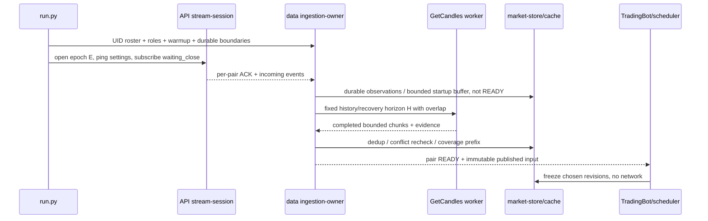
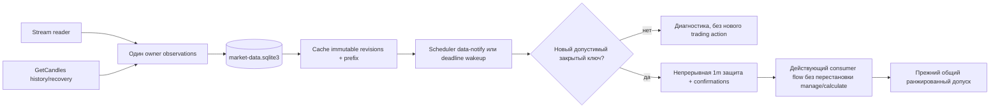

## Context

Мотивация — `proposal.md`; исходные факты, ссылки, матрица и ответы на десять вопросов — `research.md`. Решение опирается на **актуальное рабочее дерево**, а не на старые номера строк или прежнее описание poller. OpenSpec CLI 1.9.0 создаёт proposal/specs/design/tasks; research — вспомогательное исходное исследование внутри change. Согласованная ревизия 2026-10-12 заменяет его предложение выравнивать торговые фазы: исправление `_manage`/`_calculate` вынесено из этого change. Новые проверки timeout/защиты и расчёты ниже относятся к ревизии.

Существуют две независимые истины: **market-data.sqlite3** (свечи, версии, coverage, ingestion/analysis cursors) и **trades.sqlite3** (сделки, ордера, fills, позиции, outbox, финансовый аудит). Stream изменяет первую и источник входа, а не способ исполнения. В live используется JournalBroker или NotifyOnly, автоматическая цепочка RolloverLifecycle сейчас историческая. Меню/ARCHITECTURE.md не доказывают наличие exchange-executor.

Уточнения к архитектурным инвариантам:

| Инвариант | Фактическое состояние | Решение |
|---|---|---|
| тик закрытого активного бара, MultiTimeframeScheduler | сетки сохраняются, но `_loop_live` делает polling wakeup; служебный tick_started бывает без нового бара | distinguish wakeup и logical trade tick; заменить источник пробуждения, не математику баров |
| base 1m всегда | `_timeframes` добавляет 1m, `_assigned_timeframes` тоже; on_bar использует её | обязательная stream/RPC-пара для защиты и strict prefix |
| защита → manage → compute/decide → общий допуск | legacy `_process` соответствует; LiveAnalysis.step рассчитывает решение до manage | отдельное предсуществующее расхождение ARCH/OpenSpec/code; транспортный MVP не переставляет `_manage`/`_calculate` и не объявляет расхождение исправленным |
| сеть вне синхронного тика | network вынесен из lock кэша, но step.refresh_live/frame_for и HtfFrameProvider.prepare_live_history могут инициировать RPC | readiness сначала; live-read APIs тика только читают заранее подготовленный срез |
| UID-адресация | durable market PK — UID; memory/financial legacy адрес может быть ticker | resolve UID до stream; явный alias-map без переписывания старых trade IDs; ambiguity=hold |
| lifecycle | live ConstantLifecycle, auto history RolloverLifecycle | roster уважает существующие роли/обязательства, новый auto-live rollover не добавляется |
| версии | candle_versions уже есть, но source/profile/closure evidence и pin consumed revision ограничены | reuse market versions + минимальное market-only operational state; не строить новый полный архив |

`ARCHITECTURE.md` также перечисляет устаревший каталог событий/неполный набор data-модулей. Сейчас это только исследовательская запись; рабочая документация вне OpenSpec не исправляется этим запуском.

## Goals / Non-Goals

**Goals:** транспортно-независимый закрытый вход; отсутствие race history/stream; полный range recovery; доказательный per-UID barrier; exactly-once **локальная обработка ключа**, а не обещание exactly-once брокера; bounded concurrency и проверяемая причинность.

**Non-Goals:** исправление `_manage`/`_calculate` и переработка стратегий, исполнения или риска; другие вендоры, агрегация всех ТФ из 1m, изменение UTC-сеток/биржевого дня, алгоритмов/числового DataFrame стратегии, денежных таблиц/CSV/outbox, реальных заявок, UI, автоматического live-rollover и backtest-движка. Полный новый raw-packet архив/историческая версионная платформа откладываются; существующие версии и snapshots сохраняются.

## Decisions

### 1. Два транспорта одного брокера, нативные ТФ

Основной оперативный источник в режиме `stream` — bidi MarketDataStream с `SubscribeCandlesRequest(waiting_close=true)`; GetCandles обслуживает warmup, bounded reconciliation, recovery, unsupported/failed пары при разрешённом fallback. MVP выбирает прямые нативные 1m/5m/15m/1h и требуемые старшие ТФ из пересечения потребностей и подтверждённых возможностей.

SDK 1.49.3 и документы подтверждают **наличие** 15m/1h/30m/4h/1d/1w/1M enum. ACK конкретного UID обязателен. Helper `candle_interval_to_subscription_interval` неполон (1m/5m); использовать проверенную именованную таблицу, не helper/числовой cast. Для неподдержанного нативного ТФ — RPC fallback, не новая скрытая агрегация.

Source в ACK SDK optional: отсутствие echo не означает EXCHANGE. Совместимый UNSPECIFIED может подтверждаться документированным default вместе с неизменным запросом acknowledged epoch; иной явно запрошенный профиль без достаточного подтверждения остаётся неготовым/fallback. Это отдельный contract-test, не generic getattr/default для всех полей. Ошибки stream должны перехватываться при итерации responses, а не только создании iterator — сам iterator не подтверждает работающий RPC.

Альтернатива «подписать только 1m и собрать всё»: ошибка/поздняя 1m распространяется на все ТФ; нужно отдельно согласовать non-trade, session edges, native corrections, дневные/недельные правила. Документированный календарный день Т-Банка отличается от торгового дня биржевого фьючерса. Поэтому агрегация не минимальное изменение семантики и не входит в MVP.

Оба запроса имеют согласованный `candle_source_type`. MVP явно сохраняет **UNSPECIFIED** текущего поведения; имя существующего source `tbank_exchange` — legacy-идентификатор, не доказательство EXCHANGE-only. Actual reply source сохраняется отдельно; incompatible profile/source=conflict. Переключение на EXCHANGE-only не должно молча смешивать новую политику со старой базой — это отдельное согласование/пространство данных. Finam/MOEX ISS не подключаются.

### 2. Минимальные точки интеграции и владелец

| Зона | Будущая интеграция |
|---|---|
| `api/client.py` | узкая optional stream-session factory поверх текущего ClientProvider, удерживающая client/channel, send iterator, responses, cancel/close; исторический ClientProvider остаётся unary |
| `api/deadline.py` / `api/retry.py` | unary deadline 30 с не применяется к stream lifetime; классификация stream ошибок отдельная, unary ограничение/metadata переиспользуются |
| `data/poller.py` | расширение существующего фонового ingestion/supervisor: выбор транспорта, reader, maintenance/recovery, ограниченные очереди и health |
| `data/cache.py` / `market_store.py` | один логический owner accept/normalize/reconcile/publish, единый ключ/версии, immutable read snapshots и качество; short locks без сети |
| `data/loader.py` / `request_budget.py` | явные чанки/перекрытие/limit/profile, checkpoints и fair RPC-бюджет всех страниц; pacing=False не означает отсутствие лимита брокера |
| `data/reconciliation.py` | expected sequence + trailing gaps + applicable calendar + parked retries, а не только между соседними timestamps |
| `scheduler/timing.py` | notification/condition wakeup совместно с time-grid/deadlines; ready event не новая календарная сетка |
| `bot/trading_bot.py` / `live_analysis.py` | чтение read-only snapshot/readiness, фазы без gRPC; overview остаётся информационным |
| `run.py::_launch/_build_runtime/on_bar/_OutboxExecutor` | composition/start/stop; publish immutable roster/ledger потребностей; pin input references, прежний sequential protective commit и обязательный dispatch eligibility-порт |
| `trade_management/manager.py::dispatch`, `trade_journal/storage.py::claim_outbox` | узкий допуск по типу/причине/подтверждённым фактам и актуальности до claim; без изменения финансовой схемы, формул и вычислений исполнения |
| `history/contract_lifecycle.py` | прежние роли/барьеры как read-only вход для roster; денежные переходы не меняются |

Не нужны новые framework/EventBus для сырых пакетов или множество сервисных классов. Достаточны **optional API stream-session adapter** и расширенный **существующий data-ingestion owner/supervisor**; небольшие state/observation структуры переиспользуют LivePairState/StatusCadence. Reader и unary maintenance могут работать в отдельных фоновых lanes. «Один владелец» означает единую сериализованную процедуру принятия, не требование одной гигантской сетевой/торговой thread.

Обоснование минимальности MVP:

| Компонент | Необходимость | Минимальный объём |
|---|---|---|
| optional stream-session adapter | у unary provider нет owned bidi lifetime/ACK/cancel | узкий адаптер в существующем API-слое; отдельный файл только если lifetime/модели невозможно ясно отделить внутри существующего модуля |
| ingestion owner/supervisor | два транспорта не должны конкурировать за канонический вход | расширить poller/cache; не создавать второй data pipeline |
| market-store/state | restart, consumed revision и незавершённый gap нельзя держать только в RAM | использовать версии, coverage, cursors и совместимые market-only факты |
| reconciliation/loader/request budget | trailing absence, многочасовой outage, квоты каждой страницы | расширить существующие range/checkpoint/retry механизмы |
| readiness/scheduler/read snapshot | событие сети не равно допустимому торговому ключу | узкий read/readiness-порт и пробуждение, без перестройки торговых фаз |
| диагностика | состояние ACTIVE не доказывает полноту данных | расширить existing status/log/heartbeat; отдельная telemetry-платформа не нужна |

Новый модуль допускается только с указанием конкретного отсутствующего контракта; разделение на дополнительные сервисы, новый DI/framework или новый финансовый журнал не является условием MVP. Периодическая сверка всего членства не обязана происходить на каждом тике: GetMySubscriptions используется при сомнении/проверке handoff, с настраиваемой cadence.

Reader не вызывает TradingBot, trade_manager, broker.track_bar или финансовую SQLite. Roster формирует main/run из подтверждённых lifecycle/ledger фактов; фоновые worker не читают persistent `Storage.connection` из чужой thread. Оба транспорта возвращают нормализованные наблюдения одному owner; trade thread читает копию/замороженный срез. Закрытие stream обязано отменять blocking RPC/channel, не только ставить SDK stop-event. Встроенный SDK-manager с unbounded queue/авто-resubscribe не принимается как готовая гарантия.

### 3. Непрерывный запуск и fence

Для пары хранится `epoch`, desired/sent/ack status, стартовая lower boundary, фиксированный upper horizon H и buffer sequence. После UID-lookup сначала открывается подписка; события принимаются до/во время истории, но не дают торговую готовность без ACK/evidence. ACK и RPC-history не считаются абсолютно атомарным snapshot источника.

Lower определяется потребностью прогрева и **самым ранним необходимым необработанным исполнением**. Для нового запуска без обязательств warmup не проигрывается как защитная торговля; новая live-обработка начинается с согласованного cutover текущего периода. При сохранённых открытых/ожидающих сделках нельзя сбросить lower на «последний доступный бар»: используется existing execution boundary и pending-order activation/submission.

H — зафиксированная завершённая граница начала согласования; пока она восстанавливается, более новые события не сдвигают цель бесконечно. Сначала разрешается нужный prefix до H, затем согласуется backlog после H. Пары открываются независимо; healthy ACK ещё не означает READY. Недостаток истории/отказ ACK остаётся видимым. Reconnect или переполнение в фазе старта отменяют прежнюю готовность handoff и требуют нового согласования, сохраняя уже durable chunks.

Альтернатива «history потом subscribe»: остаётся незаметный промежуток между to и ACK. Альтернатива «сначала любое событие stream значит готово»: теряются прогрев, старые обязательства и внутренние дырки.

### 4. Нормализованная свеча и раздельные временные факты

Ключ owner: `(source_profile, UID, native_TF, open_time_utc)`. Наблюдение несёт OHLCV, requested/actual source, origin transport, epoch/receipt sequence, received_at (UTC) и published/input_ready_at; market revision назначается локально. `last_trade_ts` не close, receipt или server version. Для RPC используется is_complete; для stream — подтверждённый waiting-close epoch + UID/TF/profile + наступивший grid-close. Unknown/ранний packet не нормализуется default-True.

Стратегия продолжает получать `datetime/open/high/low/close/volume` и existing closed status, без required SDK-атрибутов. Side metadata и revision refs принадлежат market-input snapshot. Все aware timestamps сначала приводятся к UTC; только потом к внутреннему UTC-naive. Не применять `to_naive(+03:00)` как единственную конвертацию.

`bar_time=grid.bar_close(open)` сохраняется. `effective_available_at=max(raw_strategy_available_at или close, input_ready_at выбранных work/HTF revisions)`; фактическая постановка ордера по-прежнему происходит не раньше этой доступности и по существующему времени runtime. Raw origin/idea reference хранится отдельно до presentation-замены bar_time: поздний delivery не делает pre-activation сигнал новым.

Исторический эмулятор продолжает свой виртуальный input-time, без подмешивания сегодняшних receipt/ping. Будущий replay live-входа должен фиксировать выбранные market revision refs и data snapshot; воспроизводимость не обещается при чтении изменяемого candle_current без версии. Existing snapshot_generation/candle_versions сохраняются, новый полный архив не внедряется.

### 5. Детерминированное согласование дублей и коррекций

Все канонические изменения проходят одной процедурой owner под short lock/transaction. Network GetCandles и расчёт индикаторов выполняются вне этих lock-ов. Идентичный нормализованный OHLCV/profile/closed evidence не создаёт новую revision или повтор обработки ключа. New time за пределом prefix сохраняется, но не делает prefix непрерывным.

Политика разных значений:

1. Изменение source/profile либо конфликт history/buffer в overlap → записать provenance/diff, закрыть affected readiness, запросить **согласующую** завершённую RPC-выборку после зафиксированной границы наблюдений. Старый warmup response и более старый buffer не применяются слепо «последний пришёл — прав».
2. Stream-коррекция до употребления бара → сохранить observation/revision, bounded recheck при неоднозначности порядка; в торговлю публиковать согласованный current revision. Временный конфликт не превращается в бесконечный tight retry.
3. Исправление уже проанализированной 15m/1h → сохранить расхождение, invalidation будущего indicator context; обработанный бар/signal не проигрывается заново.
4. Исправление уже **исполненной** 1m либо появление реальной старой минуты ниже уже пройденного неподтверждённого участка → сохраняемый `integrity_hold` UID. Не откатывать fills/PnL/cursors, не исполнять компенсирующий ордер, не объявлять прошедшую защиту доказанной по новой версии. Raw-приём/проверка продолжаются; зависящая от конфликтного входа новая свечная/индикаторная обработка UID удерживается, но подтверждённое состояние и существующие независимые подтверждения не замораживаются глобально (границы — раздел 9). Reconnect, polling-switch и restart не снимают hold автоматически. Автоматическая «починка прошлого»/UI разблокировки вне MVP; расследование и новый отдельный исторический прогон используют сохранённый snapshot.

Нельзя вывести server-newer из last_trade_ts, recv-order или ждать фиксированные N секунд и назвать bar «окончательным». Документация не даёт предела коррекций. MVP предпочитает наблюдаемую задержку/hold сомнительной достоверности. Это политика **свечной симуляции**, не управление реальными серверными стоп-ордерами, которых этот runtime не создаёт.

### 6. Frozen tick snapshot и перезапуск без новой финансовой схемы

Срез тика фиксирует UID/TF/open/revision и evidence для каждого используемого бара до применения. Market-store сохраняет input-reference начатого пакета; trade callback использует этот immutable срез, не перечитывает candle_current посреди минуты. Короткие операции market-store допустимы, ожидание RPC — нет.

Три границы не подменяются:

- `received_through` — high-water, может быть за дырой;
- `resolved/coverage_through` — вычисленный последовательный доказательный prefix от meaningful lower;
- `processed_through` — подтверждённый external commit симуляции; analysis cursor отдельный.

Сейчас resolved двигается вместе с processed: для ingestion нужна отдельная поддержка coverage progression в market-store. Дополнительные epoch/range/incident/pinned-revision факты допускаются как минимальное market-only operational state (existing metadata/совместимое расширение), не новый финансовый журнал.

Две SQLite не становятся общей транзакцией. При падении после financial commit до market-marker recovery использует **existing storage.execution_bar_boundaries и pinned input-reference**. Уже завершённая минута не переигрывается по исправленной текущей версии. Если необходимо завершить pending-minute observation, используется ранее выбранный вход и существующая идемпотентность execution_id. Невозможность подтвердить вход создаёт hold, а не guessing-version.

Альтернатива «просто две threads пишут candle_current» обеспечивает SQL-атомарность, но не защищает историю→buffer downgrade, source conflict или replay версии, которую симулятор не использовал.

### 7. Expected sequence и полный gap recovery

Детектор сверяет не только соседние полученные timestamps, но **всю необходимую область от meaningful lower до фиксированного horizon**, включая trailing absence без следующего события. Использует native UTC grids, applicable SessionCalendar, торговую роль UID, first-trade/доступную историю, cutoff/activation и потребности открытых обязательств. Missing work/HTF window и critical execution 1m различаются, но один max timestamp не разрешает ни один барьер.

| Состояние | Что известно | Переход |
|---|---|---|
| waiting/delayed | завершённый ожидаемый интервал ещё не получен; deadline не скользит | bounded reconciliation/recovery |
| temporary_unavailable | transport/RPC ошибся или quota | shared reset/backoff; сохранение попытки |
| scheduled_closed | применимый календарь подтверждает внесессионный интервал | разрешить без OHLCV, прекратить false recovery |
| confirmed_no_trade | достаточное свидетельство полноты источника подтверждает отсутствие сделок | записать evidence, без synthetic candle |
| unresolved / parked | пустая выборка/неизвестный календарь/исчерпание попыток | low-frequency recheck/data-hold; не объявлять потерю/полноту |
| detected_delivery_loss | overflow/реальный discontinuity либо known expected missing sequence | range recovery, readiness закрыт |
| recovered | реальные необходимые свечи/доказательства согласованы | продвижение prefix; ещё не исполненные минуты один раз |
| integrity_hold | вход уже применён, а причинность новой версии конфликтует с подтверждённым прошлым | не replay; сохраняемое расследование |

В MVP отсутствие no-trade-доказательства остаётся unresolved. GetLastTrades гарантирует только последний час; пустой GetCandles и голый trading_status не подтверждают многочасовой no-trade. После ограниченного числа попыток область паркуется; это устраняет бесконечный ложный быстрый цикл, **не обещает** восстановление любой минуты и не синтезирует OHLCV. При доказанном no-trade возможен existing coverage state без свечи; источник доказательства должен быть проверен, не выдуман.

Recovery объединяет contiguous ranges и сохраняет lower/upper/checkpoint. Нельзя использовать max(last_loaded, now−3600) для ограничения полного outage. Восстанавливаются сначала причинно нужная base 1m/контракты сопровождения, затем work/HTF readiness, затем прочие old holes с fairness; обслуживание свежих входящих событий не прекращается. Длительный gap не ограничивается историческим семисуточным поиском: тот сохраняется только в history/replay.

### 7a. Publication deadline, per-TF gap и предел активного recovery

Проверены все рабочие использования `tick.timeout_secs`/`TICK_TIMEOUT_SECS`:

| Место | Текущая семантика |
|---|---|
| `config_loader.py::_SECTIONS/_EXPECTED_TYPES`, `config.py` | `[tick].timeout_secs` → integer `TICK_TIMEOUT_SECS`; кодовый fallback 65 с, поставляемый TOML 300 с |
| `run.py::_run_bot`, `TradingBot.__init__/_loop/_bootstrap` | передача в scheduler; предел блокирующего ожидания готового бара legacy-такта/bootstrap, не срок всей торговой обработки |
| `CandleScheduler/MultiTimeframeScheduler.wait_until_bar_published` | monotonic deadline опроса после границы; виртуальный режим проверяет готовность однократно без real-time ожидания |
| `TradingBot._loop_live`, `MultiTimeframeScheduler.wait_live_poll` | live не использует блокирующее окно scheduler: короткий polling wakeup задаётся `poll_secs` |
| `LiveAnalysis.publish_status`, `LivePairState.observe` | диагностический publication deadline от первого ожидаемого close; текущий high-water может сбросить его через внутреннюю дыру |
| `LiveAnalysis.__init__` | повтор статуса не чаще `max(60, tick.timeout_secs)` |
| `run.py::_launch`, `MarketDataCache.__init__/_service_auxiliary/_recover_oldest_gap` | recovery cooldown `max(data_refresh_min_interval, tick.timeout_secs)`, next_attempt/auxiliary pacing |

Один параметр уже объединяет разные назначения и **не является измеренной допустимой задержкой API или решения**. Поэтому будущий live-ingestion получает отдельные `market_data.candle_publication_timeout_secs`, `recovery_round_timeout_secs`, `recovery_recheck_interval_secs` и `status_repeat_interval_secs`, без автоматического наследования от `tick.timeout_secs`. Существующий scheduler-timeout/исторический virtual-clock сохраняются. Значения 65/300 с — факты существующего поведения, не окончательные новые publication defaults. Числовой профиль публикации проверяется на fake clocks и затем по реальной задержке API/актуальности решений перед stream-rollout; увеличение deadline не расширяет торговое окно актуальности.

Для каждого первого необходимого отсутствующего закрытого интервала фиксируется `expected_close + candle_publication_timeout_secs`. Более новый high-water, очередной опрос или торговый перерыв не сдвигают его и не разрешают внутреннюю дыру. Существующая модель статусов расширяется минимально этим доказательным условием.

| ТФ | Ожидание / начало recovery | Барьер | Поздняя свеча |
|---|---|---|---|
| критическая 1m | readiness закрыт сразу при отсутствии необходимой минуты; если потеря не установлена, waiting → delayed после publication deadline и range check; known disconnect/overflow начинает recovery без ожидания deadline | нельзя передавать следующие зависимые минуты симулятору или принимать решения/индикаторные изменения по неполному execution prefix UID | ещё не исполненные минуты после согласования обрабатываются по времени один раз, только для тогда активных ордеров; изменение исполненной 1m → integrity-hold |
| рабочая 15m | до deadline отсутствующая свеча waiting, затем delayed/unresolved и bounded GetCandles check; известный outage проверяется сразу | удерживаются рабочая пара и потребители её неполной истории, но пригодная 1m защита продолжается | существующие `current`/CATCH_UP_BARS, latest-bar, session, lifecycle и risk проверки сохраняются; устаревший бар — исторический контекст без ретро-входа |
| рабочая 1h | та же политика с нативными часовыми границами, не общий таймер ожидания всех ТФ | удерживаются зависимые часовые действия, не готовые независимые 15m/1m | та же existing freshness policy; коррекция использованного бара обновляет будущий контекст, не старое решение |
| HTF dependency | отсутствие/неполнота необходимого as-of кадра запускает фоновую подготовку/проверку | удерживаются только потребители этого кадра; подписка сама не добавляет активный торговый ТФ | согласованный кадр используется в будущем допустимом срезе без изменения native grid |

`delayed` означает, что ожидание превысило локальный deadline; **не** доказанную потерю и **не** отсутствие сделок. `scheduled_closed` требует применимого календаря, `confirmed_no_trade` — достаточного проверенного свидетельства источника. Пустой GetCandles, живой ping, число повторов или timeout такими свидетельствами не являются. Источник исторического no-trade-доказательства пока не установлен: MVP оставляет такую область unresolved, не обещая её автоматическое разрешение.

Активный recovery-раунд имеет конечные число попыток и wall-clock срок `recovery_round_timeout_secs`; предварительный профиль **900 с (15 минут)** согласован как инженерная гипотеза. Срок отсчитывается от начала раунда, не обновляется каждым чанком/новой свечой и включает ожидание бюджета/backoff; network attempt ограничен собственным unary deadline. По достижении временного предела либо числа попыток прекращается выдача новых интенсивных попыток; результат уже начатого RPC можно сохранить, но он не продлевает раунд. Частичные успешные чанки/checkpoints сохраняются, **сам gap не считается восстановленным**.

После раунда область — `parked/unresolved`, с сохраняемым `next_retry_at`, настраиваемыми периодическими rechecks и shared reset. На cadence выполняется одна bounded проверка, а не безусловный запуск нового интенсивного раунда каждые несколько секунд; новый раунд допускается по значимому reconnect/новому evidence и общему fair budget. При restart время/попытки незавершённого раунда не сбрасываются для обхода предела. Возраст unresolved-gap может быть неограниченным: нет доказанной верхней границы публикации/коррекции или гарантии доступности данных. Настраиваемый recovery срок ограничивает интенсивную работу, не duration hold. Префикс открывается только по согласованным данным/доказательствам, остальные пары продолжают работу.

### 7b. Граница запуска и расписание прошлого (по итогам пробы 8.5)

Проба показала: `TradingSchedules` отклоняет `from` раньше текущей даты (`INVALID_ARGUMENT 30003`). Расписание прошедших дат получить нельзя, доказательство прошлого — только ранее сохранённые наблюдения. Запросы теперь начинаются с текущего момента, для прошлых дат RPC не планируется.

Решение владельца (вариант «б»): для пары без сохранённых обязательств непрерывность доказывается от cutover — последнего бара ТФ, закрытого к запуску. Неподтверждённые пробелы прогрева до cutover не блокируют расчёт и считаются в диагностике (`pre_cutover_gaps`); после cutover — строго. Минутный префикс UID с сохранённой границей исполнения остаётся строгим от этой границы. Поиск пропусков, recovery и handoff не уходят раньше границы; область recovery прошлого запуска обрезается по ней. Решение по бару, закрывшемуся до cutover, не требует доказательства минут до запуска. Старые пробелы вне префикса по-прежнему обслуживает отдельный ограниченный бюджет.

### 8. GetCandles: пределы, перекрытие, источник, backoff

Для live history/recovery нужен явный chunk plan, а не предположение о границах SDK get_intervals. Для 1m использовать RPC span ≤1 дня, для 15m MVP консервативно ≤1 дня, для 1h ≤7 дней; нормы D1/SDK сверяются перед реализацией. Overlap до/после целевого диапазона учитывается **внутри** максимального span. Для 1m/15m/1h `limit=2400` на момент исследованного контракта; это потолок ответа, не guarantee completeness. Остальные ТФ — таблица документированных пределов и календарная математика, не month=30days. Дневные запросы расширяются по датам с локальным фильтром, так как API игнорирует время суток.

Соседние чанки перекрываются минимум одним нативным периодом; locally trim к `[wanted_start,wanted_end)` и дедуп по ключу. Предусмотреть оба from/to-edge варианта: текущие материалы не подтверждают единое включение минутного верхнего края. Если ответ достигает limit или полнота чанка сомнительна, сократить span/запросить недостающий участок; неполноту не маскирует отсутствие total/cursor. Каждый успешный чанк сохраняется, сбой третьего не теряет два уже записанных.

Все фактические unary RPC, включая страницы с pace=False, входят в service/account/IP-aware бюджет. Сохраняется shared retry-after; вне trading thread. Retry применим к transient UNAVAILABLE/DEADLINE_EXCEEDED и RESOURCE_EXHAUSTED с reset; invalid/auth/source ошибки не крутятся как временная пустота. Есть конечные попытки одного range-attempt и периодический parked recheck. HistoricalClient остаётся со своим next_cursor/limit/snapshot_generation; не добавлять ему фиктивный gRPC cursor или stream.

### 9. Readiness, логический тик и порядок

Connection-state: DISCONNECTED → CONNECTING → SUBSCRIBING → ACTIVE либо BACKOFF/FAILED/STOPPING. Data-state **отдельно**: BOOTSTRAPPING → RECONCILING → READY, GAP_HOLD/CONFLICT_HOLD/INTEGRITY_HOLD. Серверный ping может быть ACTIVE при GAP_HOLD.

Consumer готов, когда ACK/profile установлен (для stream), закрытый бар есть, нужный work/HTF prefix пригоден, required base 1m исполнения продвинута/применяется до его cutoff, lifecycle разрешает роль. Для 1m protection проверяется meaningful execution prefix. Data-ready notification будит scheduler, но сама не является тиком; math/grid/clock остаются MultiTimeframeScheduler. Timeout ожидания ограничивает блокировку/диагностику, не полноту. Дополнительная HTF-подписка не меняет набор входных привязок.

В live `frame_for`/HTF-read на тике не инициируют сеть: недостающая зависимость закрывает readiness и регистрируется фоновому worker. Bootstrap и recovery готовят их заранее. Обнаруженная инверсия `_calculate` перед `_manage` — отдельная предсуществующая проблема. Этот change не разделяет/переставляет фазы ради её исправления, не меняет формулы, priority, OHLC-правила или смысл действующих решений. Проверка транспортной интеграции не должна выдавать сохранение baseline за исправление нормативного расхождения.

Обработка каждого `(UID,TF,open)` идемпотентна; готовые ключи одного close могут объединяться. Base batches идут по исходным временам с прежним order activation, STOP-before-TP и commit-before-next-minute. При delayed backfill ранее **не исполненные** минуты обрабатываются один раз для ордеров, активных в те моменты; новые входы не получают ретроактивное исполнение. При missing critical 1m этого UID индикаторные действия/увеличения не используют только boolean `post_tick=True` — нужен собственный barrier. Healthy пары продолжают данные/защиту; existing общий risk policy сохраняет право запретить увеличения при неизвестной портфельной оценке, без нового расчёта денег.

Граница hold определяется зависимостью операции от отсутствующего входа:

- Свечная симуляция неизвестной и следующих зависимых минут запрещена: не выдумывать OHLC, STOP/TP, holding observation, mark-to-market или processed cursor. Пригодный префикс до gap может быть завершён.
- Новые входы/доборы/сигнальные действия и индикаторное сопровождение, которым нужен неполный ряд или его execution outcome, удерживаются для UID/зависимой пары.
- Подтверждённые позиции, quantity, ордера, reservations, stops и outbox сохраняются в финансовой истине. Уже полученные подтверждения и pending commit на закреплённом входе продолжают существующий идемпотентный путь; hold не удаляет состояние, не отменяет автоматически защиту и не создаёт emergency-close по timeout.
- Независимые от отсутствующих данных операции допускаются только по существующим предусловиям/причинности, в финансовой thread, без прямых команд reader. `TradeManager.restore/consume/dispatch` умеют обрабатывать сохранённое состояние/подтверждения; это не обещание независимого фонового сервиса исполнения. У `manage` имеются календарные/TTL ветви (`drain_contract`, `_close_expiring`, `_cancel_stale_entries`), но их вызов встроен в existing consumer flow: новый bypass, новые сроки/правила закрытия или перенос на другой lifecycle этим change не вводятся. Нельзя блокировать реально существующий независимый путь лишь общей проверкой UID, а барозависимое действие нельзя объявить независимым по имени «защита».
- В данном runtime `JournalBroker.track_bar/_track_addressed_bars` моделируют STOP/TP по OHLC, а `on_bar/commit_bar` наблюдения и оценку — по подготовленным минутам. Независимых серверных STOP/TP/exchange-executor нет. Сохранённый confirmed stop не доказывает срабатывание в неизвестном интервале. NotifyOnly не получает выдуманное состояние исполнения.
- Healthy UID продолжают ingestion, готовый анализ и допустимую защиту. Existing портфельная unknown-risk policy может отказать увеличению других UID; это не глобальная остановка ingestion/сопровождения и не новая политика риска.

### 9a. Согласованное расширение: eligibility общего outbox

Исследованы `TradeAction`/`action_from_payload`, `TradeManager.submit_action/dispatch/consume/_cancel_stale_entries/_enforce_entry_slippage_guard`, `Storage.claim_outbox/requeue_claimed_outbox` и `JournalBroker.submit/_execute_action/_execute_scheduled`. Общий dispatch сейчас claim-ит любую PENDING-команду; вызов по здоровому UID может тем самым доставить зависимую команду удерживаемого UID. Допуск должен действовать **до claim** во всех путях, включая прямой `dispatch()` и lifecycle, а не только в `_OutboxExecutor`.

| Категория | Фактическое поведение / зависимость | Консервативный допуск |
|---|---|---|
| `OpenTrade`, `AddToTrade` | новые увеличения; источник решения/цены и актуальность обязательны, исполнение через будущий допустимый бар | удерживать при неполноте требуемого входа; после gap нужны действующие revision/phase и положительная проверка актуальности, не только healthy UID |
| обычное сопровождение: `MoveStop`, сигнальные `CloseTrade`/`ReduceTrade` | причина может быть индикаторной/ценовой; отсутствие OHLC-параметра у submit не доказывает независимость | проверять исходный тип/причину/связь с данными; неизвестная или свечная причина остаётся зависимой |
| защита по подтверждённым финансовым фактам | известный случай `CloseTrade(reason=gap-entry)` создаётся существующим slippage guard по подтверждённому FILL; delivery только ставит выход на будущий бар | не удерживать исключительно из-за UID hold при доказанном происхождении из этого guard и пригодном фактическом остатке; не считать ACK исполнением, старые минуты не используют новый выход |
| сокращение по `target_id` | JournalBroker уменьшает количество/пишет fill сразу по цене плана | при неизвестном предыдущем execution-prefix безопасность не доказана: удерживать; слово «защитное» или наличие target не дают исключения |
| отмены `CancelEntry` | отмена увеличений немедленная; может удалить заявку, которая была активна в ещё не восстановленной прошлой минуте | critical execution-gap удерживает новую доставку отмены; при полном execution-prefix подтверждённый TTL/cutoff cancellation может быть независим от отсутствующего рабочего/HTF кадра, но требует существующих phase/revision/причины |
| технические / recovery | отдельного технического TradeAction нет; есть повтор command_id, восстановление CLAIMED и подтверждённые события | reconciliation уже подтверждённой доставки по durable событию не создаёт нового broker.submit и не зависит от свечей; неизвестное/unconfirmed redelivery заново проходит eligibility |

**Причина — необходимая часть классификации, не доказательство сама по себе.** Нельзя сделать whitelist всех `CloseTrade` или строк `protective`/`gap-entry`. Для guard-close проверяются durable подтверждённый вход, принадлежность command_id исходной команде, существующий guard trace/состояние и фактический остаток. Для остальных недоказанных случаев — PENDING с диагностируемым основанием, без предположений о безопасности. `MoveStop` и accepted-v2 команды имеют особые проверки при исполнении: общий новый revision/phase тест не должен переписывать эти бизнес-условия.

У slippage guard существует важная последовательность: сначала ставится `CloseTrade` с текущей revision, затем сделка становится REJECTED и revision увеличивается. Наивное `payload.state_revision == trades.state_revision` либо «терминальная фаза всегда запрет» заблокировало бы существующий защитный выход с живым остатком. Допуск обязан учитывать **проверяемую существующую причину** этого перехода, а не изменять guard/фазы/расчёты.

Атомарность:

- Composition устанавливает один обязательный stored eligibility-порт финансового контура; generic dispatch не принимает флаг обхода. Проверка выполняется на main/financial thread и использует read-only market evidence, без gRPC и финансового SQL из reader.
- Data-evidence guard/fence фиксирует согласованный срез качества; financial transaction использует BEGIN IMMEDIATE, проверяет актуальные trade/order и predicate **до** PENDING→CLAIMED. Skip не меняет статус/резервы/command_id. Выборка ищет eligible команды за удержанными, не расходуя весь limit на UID A и не останавливая UID B.
- Между claim и отправкой не допускается необнаруженная смена data evidence: guard удерживается до локального broker.submit либо выполняется эквивалентная повторная проверка с безопасным возвратом недоставленной CLAIMED-команды в PENDING. Один-at-a-time claim позволяет не держать claim всего batch на устаревшем срезе. Observer/уведомления/сеть выполняются вне market lock.
- Уже полученные `ExecutionEvent`/`FeeAdjustment`, commit ранее закреплённого пакета и existing idempotent reducer не проходят фильтр **новой** доставки. Подтверждённые события не задерживаются и не отменяются из-за hold.

Актуальность после recovery:

- Проверять существующие state_revision, допустимую фазу/остаток/статус заказа, фактический подтверждённый результат того же command_id и применимый TTL. Hold release не является отдельным основанием доставки.
- `_entry_ttl_seconds`/`_cancel_stale_entries` считают срок **от ACK**, а брокер для limit-entry — от submitted_at. До первой доставки/ACK общего TTL команды в outbox нет; `TradePlan` не содержит `valid_until` или универсального времени исходного сигнала. Нельзя незаметно считать enqueue_at началом нового TTL либо подставлять 900 с recovery/таймаут тика.
- Для данных-зависимого ранее удержанного намерения требуется положительное доказательство его актуальности по existing input/origin и прежним правилам. При недостатке информации оно остаётся PENDING с `freshness_unconfirmed`/подобной причиной; не становится автоматически допустимым и не получает новый финансовый REJECT/CANCEL или перерасчёт. Введение нового pre-ACK TTL, списание/перегенерация старой команды или другая бизнес-семантика — отдельное согласование.
- Существующие command_id, execution_id, SENT/CLAIMED recovery, reservations и финансовые факты сохраняются. Новые столбцы/таблицы/статусы в trades.sqlite3 не вводятся; market-only diagnostic/revalidation facts используют существующую metadata.

Обязательная отдельная приёмка расширения: (1) A hold/B eligible, (2) A dependent остаётся PENDING, (3) прямой общий dispatch не обходит правило, (4) доказанная независимая защита разрешена при недоказанной удержанной, (5) stale после восстановления не отправлена, (6) повтор dispatch не повторяет исполнения, (7) cancellation не меняет историю активной заявки до backfill, (8) подтверждённые broker events проходят независимо от hold. Если необходимы новые сроки/правила фаз/расчёты исполнения, остановить реализацию для конкретного решения владельца.

**Согласованное узкое решение recovery:** после подтверждённого плохого входа guard-close остаётся PENDING с revision N, сделка имеет REJECTED/revision N+1 и ненулевую позицию. Обычный `Storage.load_trades`/`TradeManager.restore` по-прежнему исключает REJECTED. Однако `TradeManager.restore` дополнительно восстанавливает **только** snapshot с `REJECTED`, фактическим остатком и pending `CloseTrade(reason=gap-entry)`, если durable fill исходной команды, command-id lineage, trace `execution.slippage_guard`, order state и N→N+1 переход доказаны. Такой snapshot не возвращается как ordinary active trade и не меняет схему/phase/payload/command_id/TTL. `JournalBroker` получает одноразовый recovery-marker для этого конкретного command: он разрешает revision N при восстановленном snapshot N+1 лишь для ACK и исполнения на следующем баре; marker снимается после попытки. Произвольный REJECTED, произвольный stale CloseTrade и command с одним совпадающим именем marker не получают. `test_existing_guard_restart_restores_only_proven_close_at_prior_revision` и `test_rejected_position_without_proven_guard_is_not_recovered` фиксируют границу. Это согласованное изменение recovery/revision guard-close; перепостановка с новым command_id, общий возврат REJECTED в active recovery и изменение риска/исполнения остаются вне scope.

### 10. Подписки, rollover, режимы и fallback

Desired roster строится по выбранным UID, привязкам и `binding_requirements`, сохранённым ТФ сопровождения/обязательствам и existing lifecycle. Subscribe ACK старого/нового UID не является финансовой активацией. Старый 1m сохраняется до confirmed flat + terminal orders, следующий получает собственный warmup; incoming origin/bar до activation не используется после неё. Удаление привязки не отменяет сопровождение уже открытой сделки.

Stream идентичность — только UID. Existing legacy ticker financial-key не переписывается: composition/cache ведёт явный read-only mapping UID↔Instrument/financial address. Если тот же alias неоднозначен, READY не открывается; автоматическая миграция trade IDs не входит в MVP. Исторические RolloverLifecycle/cutoff правила и fixed selection сохраняются; live-auto chain этим change не включается.

Начальный выбор: `live_transport=polling` по умолчанию для совместимого rollout, оператор явно включает `stream`. Текущая симуляция и NotifyOnly имеют одинаковый ingestion; исторический режим игнорирует настройку live транспорта. Stream factory optional, HistoricalClient его не обязан иметь.

Fallback не две независимые системы. Supervisor меняет роль источника внутри того же owner, закрывает handoff affected пары, сохраняет epoch/boundaries/incidents и восстанавливает полный нужный диапазон. Polling использует прежнее bounded fresh-window как fast path плюс полное range-recovery; готовность не обнуляется в «успешный максимум». При возвращении stream вновь ACK+overlap+barrier. Автоматический fallback допустим для временного transport/ACK отказа согласно настройке, но не снимает integrity-hold или меняет source-profile; auth/неверная конфигурация видимы, не скрываются автоматическим новым токеном/вендором.

### 11. Пределы и диагностика MVP

#### 11a. Подтверждённые ограничения источника и конфигурационный roster

Повторная проверка D1/D2/D3/D6 2026-10-12 подтверждает: 300 candle/orderbook/trade подписок суммарно на соединение, 100 subscription requests/мин, 32 соединения котировок и 600 unary RPC/мин сервиса котировок; лимит распространяется на счета пользователя. Для ping settings диапазон 5000–180000 мс. Это ограничения источника, **не настраиваемые инженерные гипотезы и не свободная личная квота**. IP-ограничения/другие приложения и metadata/reset также учитываются. Консервативные chunk spans из раздела 8 — настраиваемая политика в пределах проверенного API/SDK-контракта, не универсальная гарантия полноты ответа.

Расчёт из прочитанного `default.toml` и каскада `_to_assignments`: inline `tf` → ticker `timeframe` → global 1h. `binding_requirements` добавляет HTF только для triple_screen; одинаковые пары разных привязок дедуплицируются. При multiplier=5 существующий `tf_hierarchy` выбирает строго больший ТФ: 15m→4h/1d, 5m→30m/4h, 1h→1d/1w.

| Группа | Предпосылка выбора | Уникальные ТФ одного UID | Пар |
|---|---|---|---:|
| SBER, GAZP, LKOH, GMKN, ROSN, NVTK, YDEX, TCSG, VTBR, MTSS, PHOR, ALRS, MOEX, PLZL, TATN | все 15 акций, по одному UID | 1m, 15m, 1h | 45 |
| NG | один выбранный контракт семейства | 1m, 15m, 1h, 4h, 1d | 5 |
| BR | один выбранный контракт | 1m, 5m, 15m, 1h | 4 |
| RTS, SBRF, GOLD, SILV | по одному контракту каждого семейства | 1m, 15m, 1h, 1d, 1w | 20 |
| SI | один контракт; две 5m привязки делят пару | 1m, 5m, 30m, 4h | 4 |
| ED | один выбранный контракт | 1m, 15m, 1h | 3 |
| **Итого** | **23 выбранных UID без дополнительных старых обязательств** | **23 base + 46 work + 12 HTF** | **81** |

Развёртка по ТФ: 1m=23, 5m=2, 15m=22, 30m=1, 1h=22, 4h=2, 1d=5, 1w=4. Фактический roster — union выбранных пар с сохранёнными ТФ сопровождения, pending/открытыми обязательствами иных UID и реально существующими lifecycle потребностями; число может быть меньше либо больше 81. Не подписывать все таблицы TOML автоматически. UID resolution и ACK по-прежнему обязательны; кодовое fallback selection не доказывает текущий выбор пользователя.

81 помещается в одно соединение при доступной пользовательской ёмкости; исходящие candle-запросы могут объединять массив пар одного профиля/waiting_close. Число пар ≠ число control requests: один запрос с массивом всё равно требует per-pair ACK; batching/размер массива подтверждаются контрактными проверками. Capacity включает используемые на этом соединении другие типы. При недостатке ёмкости — явный fallback/hold, без выпадения 1m обязательств и без автоматического sharding. Ресурс reconnect учитывается отдельно, не использовать все разрешённые streams.

#### 11b. Оценки нагрузки и буфера с явными предпосылками

- Если каждый ТФ публикует ровно одну первичную свечу на интервал и все UID торгуются непрерывно, `sum(N_tf / period_minutes)` ≈ **25,28 первичных закрытий/мин**. Это усреднённая арифметическая оценка без коррекций/ACK/ping, с условным равномерным вкладом 1d/1w; закрытия синхронны, реальная сессия и correction bursts меняют нагрузку.
- При одном RPC на пару сверка 81 пары раз в 300 с даёт **16,2 RPC/мин**, или 13,5% предварительного локального ceiling 120 RPC/мин, до recovery/history/fallback/повторов. Fair worker распределяет сверку во времени, не создаёт синхронный burst всех запросов.
- **690 RPC = 23 UID × 30 однодневных чанков** — идеализированная оценка только 30-дневной 1m истории: один RPC на каждый чанк, без overlap-краёв, повторов, limit splitting, HTF и расширения прогрева. При условно доступных 120 RPC/мин это 5,75 минут только расходования квоты, без сети/сверки и конкуренции. Это не гарантированное число RPC, время загрузки или итог всех подписок; план с перекрытием/checkpoint и недоступностью данных может потребовать больше.
- 50000 событий при указанной средней скорости закрытий соответствует примерно 33 часам, но не доказывает достаточность RAM/startup-buffer. D3/D6 описывают 100ms candle cadence и дополнительные close/correction сообщения; иллюстративный стресс 81×10=810 событий/с исчерпал бы event cap за ~62 с, и не является доказанным потоком waiting_close или строгим максимальным пределом.
- 64 MiB / 50000 ≈ **1342 байта на событие**, прежде byte cap станет строже event cap. Реальный размер Python/SDK/нормализованных объектов, очередей и side metadata не измерен. Buffer/RAM budget учитывает эти расходы отдельно от wire size; persist/checkpoint должен сокращать backlog.

Перед stream-rollout измерить скорость/пики корректировок, фактический RAM на событие, длительность cold start/restore, задержку publication и shared quota/reset; оценивать `buffer_events >= measured_peak_rate × max_unpersisted_seconds` с проверяемым запасом и независимым byte cap. При превышении — loss-range/recovery/hold, а не обещание без потерь. Адаптивная автоматика настройки/sharding отложена.

#### 11c. Настраиваемый предварительный инженерный профиль

Все числа следующей таблицы — **инженерные гипотезы, не окончательные defaults и не production/SLA гарантии**. При будущей реализации параметры доступны через optional `market_data` configuration и валидируются независимо от `[tick]`; рабочий TOML этой ревизией не изменяется. Для старых конфигов будущие самостоятельные дефолты не вычисляются из `tick.timeout_secs`. Строки polling/stream и fallback задают согласованную политику rollout, а ограничения API берутся из 11a, не из таблицы гипотез.

| Будущий ключ в `market_data` | Предварительный профиль / статус | Условия |
|---|---|---|
| `live_transport`, `stream_fallback_polling` | polling / true | явный opt-in stream как основной live-транспорт; диагностируемый fallback, прежний source/barrier |
| `candle_publication_timeout_secs` | окончательный default не утверждён; 65 с допустим только как пример offline-профиля | самостоятельный finite >0 deadline первой missing границы; 300/65 с из старого tick не являются API/decision SLA |
| `stream_ack_timeout_seconds` | 30 с | finite >0, deadline каждой пары |
| `stream_ping_interval_ms` | 15000 | отдельный oneof request, внутри подтверждённого API-диапазона |
| `stream_health_timeout_seconds` | 45 с | согласовать с ping cadence/реальной сетью; silence не candle-no-trade |
| `stream_buffer_max_events`, `stream_buffer_max_bytes` | 50000 / 67108864 (64 MiB) | независимые finite positive integer caps для startup/backlog; учесть объектный RAM |
| `stream_control_queue_max_messages`, `stream_subscription_soft_limit` | 128 / 280 | конечность/приоритет stop; effective capacity не выше API/доступной квоты, все типы учтены |
| `stream_control_requests_per_minute` | 90 | subscribe/unsubscribe/resubscribe входят в budget; batching не подменяет ACK |
| `stream_reconnect_initial_secs`, `stream_reconnect_max_secs`, `stream_reconnect_jitter_pct`, `stream_control_cooldown_secs` | 1 / 30 / 20% / 60 с | exponential transient backoff; reset сильнее локального желания повторить |
| `unary_requests_per_minute` | 120 | все страницы/сверки, effective ceiling=min(локальный, доступный источник); не считать 600 личным резервом |
| `recovery_round_timeout_secs`, `recovery_max_attempts`, `recovery_backoff_max_secs` | 900 с / 5 / 300 с | 15 минут ограничивают активный раунд, не duration gap; сохранять начало/попытки/checkpoints |
| `recovery_recheck_interval_secs` | 300 с | parked bounded check, next_retry сохраняется; shared reset может отложить проверку |
| `recent_reconciliation_interval_secs`, `recent_reconciliation_bars` | 300 с / 2 | finite cadence/window по budget, не финальность свечи |
| `subscription_check_interval_secs`, `status_repeat_interval_secs` | 300 с / 60 с | сверка по сомнению/настраиваемой cadence; первичный статус/переход сразу, повторы ограничены отдельно |

Числовые испытания используют effective config, а не сравнение с 65/300/900 как неизменными константами. Валидация проверяет finite/positive/type, согласование min/max, jitter range, ping bounds и доступную ёмкость. Изменение publication/recovery/status cadence не меняет existing freshness, виртуальные часы, ранжирование или риск.

Минимальные technical diagnostics: transport/profile/UID/TF, epoch и ACK tracking/stream/subscription ids, режим waiting_close, open/close/received/published/input-ready/effective-available, last ping/response, actual and contiguous high-water, execution/analysis frontier, gap bounds/state/evidence/attempts/next_retry, buffer occupancy/overflow count, RPC per service, corrections/conflicts/consumed revisions и fallback transitions. Пользовательские сообщения используют existing market_data_status/error/heartbeat и короткие контрактные имена; обязательная переработка UI, торгового EventBus или финансового audit не требуется.

## Risks / Trade-offs

- [Конкретная причина сегодняшних пропусков не доказана] → proposal описывает проверенные слабые места и наблюдаемость, не обещает, что смена транспорта устранит все причины.
- [SDK advertised enum не равен серверной поддержке/корректной сериализации] → offline contract tests полей/oneof и разрешённый будущий compatibility probe, per-pair ACK/fallback; не смешивать legacy/grpc модели случайно.
- [waiting_close не финальность и нет server sequence] → source-aware conflict/recheck, immutable tick-input, market revisions и integrity-hold уже исполненной 1m.
- [Нет доказательства no-trade или данных старого outage] → parked unresolved/hold, календарные доказательства и честные границы, без synthetic OHLCV/ложной полноты.
- [Большая история/буфер/общие квоты] → все страницы лимитируются, chunks/checkpoints/fair queues, hard caps и overflow recovery; readiness может запаздывать.
- [Legacy UID mapping и несоответствие фаз ARCH/code] → явный alias-map и fail-hold ambiguity; фазовое расхождение документируется отдельно, его исправление исключено из транспорта, без финансовой миграции/нового rollover.
- [Две БД/конкурентная коррекция и restart] → pinned input refs в market-state + существующий trade commit boundary/idempotency, не replay исправленной минуты по candle_current.

## Migration Plan

Это **план будущей реализации**, не действие данного propose.

1. Сначала offline-установить совместимость SDK1.49.3 полей/границ/поддержки, сохранить текущие polling/history fixtures. Если требуется смена семейства/версии SDK шире узкого адаптера, обновить change до реализации, не включать её молча.
2. Добавить optional API session и owner-normalization/readiness, сохраняя polling-default, old config и историю. Market-only additions должны быть совместимы с existing versions/producer id/export; при изменении экспортируемой формы нужен отдельный явный schema/version contract, не скрытая ломка эмулятора.
3. Включить потоковый start/overlap/reconnect/range-recovery на fake transport, пройти mandatory acceptance из specs/tasks и сравнить native source semantics. TradingBot/HTF на тике не инициируют сеть.
4. Явный controlled stream rollout после проверки владельцем по нужному UID/profile/TF. На текущем документационном этапе никаких production запросов или включений нет.
5. Rollback — `live_transport=polling`, announced handoff/recovery у того же owner; financial DB/CSV не удалять, gap/incidents/consumed revisions не сбрасывать. Фиксированный исторический snapshot остаётся отдельным входом.

## Open Questions

Согласованы нативные бары, один Т-Банк, UNSPECIFIED, opt-in stream как основной live-транспорт при polling-default rollout, strict unresolved/consumed-1m hold, отдельные publication/recovery параметры и узкий eligibility outbox по типу/причине. Владелец разрешил узкое recovery исключение `REJECTED` с живой позицией и доказанным `gap-entry` guard-close N→N+1 (9a); оно не вводит новый статус/срок, не перепоставляет/изменяет команду и не делает REJECTED общим active recovery. Исправление `_manage`/`_calculate` остаётся отдельной задачей.

Уточнения эксплуатационного профиля можно получить до controlled stream-rollout, не меняя подход/specs/task breakdown:

1. Реальный список UID/ТФ, сохранённые обязательства и RAM budget машины — измерить actual roster/peak occupancy, затем настроить caps; 81 и 50000/64MiB не гарантируют реальную нагрузку.
2. Допустимый publication/health/ACK latency budget в используемой сети — сверить наблюдения API с existing окном актуальности решения; подобрать отдельные настраиваемые deadlines, не увеличивать торговое окно молча. Окончательные 65/300 с не согласованы.
3. Другие приложения/токены, делящие пользовательские/IP квоты — проверить доступный budget/reset; предварительные 120/90 снизить при необходимости.
4. Период хранения diagnostic incident подробностей — сохранять consumed references/incidents до разбора, не вводить автоматическую очистку неразрешённого hold; raw-архив и UI разблокировки отложены.

Равенство stream/GetCandles source semantics, precise minute-edge ответы, SDK сериализация и ACK нужных UID/ТФ — **технические проверки, не выбор владельца**. Сейчас реальным API-тестом они не доказаны. Offline checks входят в реализацию; разрешённый read-only compatibility probe — отдельный будущий этап перед rollout. При несовместимости, требующей изменения семантики/семейства SDK/scope, остановить расширение и обновить change с владельцем.

## MVP Acceptance Matrix

Каждый сценарий проверяется независимо на fake bidi/unary и управляемых часах; assertions используют effective настройки. Обязательные дополнительные fault/regression cases остаются в delta-specs/tasks.

| № | Сценарий / вход | Проверяемый результат |
|---|---|---|
| 1 | normal stream: ACK/handoff, native 1m/15m/1h | сохранение закрытых версий до публикации; каждый новый ключ один раз; фильтровый ТФ не добавляет вход; текущие consumer phases/priority не переставлены |
| 2 | late candle после close, до/после publication deadline и за existing freshness window | отсутствие преждевременного решения; неизменный deadline первого missing; поздний пригодный вход доступен не раньше публикации, устаревший — только исторический контекст |
| 3 | отсутствующий бар появляется только в GetCandles | recovery принимает реальную закрытую версию, открывает только разрешённый prefix, не ждёт обязательного повторения stream; без второго действия |
| 4 | disconnect 5 минут, затем новый ACK и high-water | весь нужный missing range проверен; первая новая свеча/ping не открывает barrier, удержанные минуты проходят по времени один раз |
| 5 | disconnect 3 часа, уже есть 11:59 при prefix 09:00 | recovery включает 09:00–12:00, не only now−1h; chunks/overlap/checkpoints/fair budget соблюдены |
| 6 | identical duplicate из stream и RPC, out-of-order доставка | один canonical revision для одинакового значения; нет повторного сигнала/стопа/тейка/комиссии или cursor rewind |
| 7 | correction after decision; отдельно использованная 15m/1h и исполненная 1m, включая correction во время commit | будущий context принимает согласованную revision без replay старого сигнала; consumed 1m создаёт durable integrity-hold, pin не меняется, fills/PnL не переписаны; restart/fallback не снимает hold |
| 8 | no trades/quiet stream: ping, пустой RPC; отдельно scheduled_closed и достаточный no-trade evidence | пустота/timeout не создают свечу/полноту; deadline/attempt/time limit ведут в parked/unresolved, cadence конфигурируется; доказанный календарь/no-trade разрешает только свою область |
| 9 | intraday restart с позицией/pending, незавершённым recovery; crash после financial commit до market-marker | boundaries/round start/next_retry/pin сохранены, existing state восстановлено; ни replay committed минуты, ни сброс hold/активного лимита; warmup не исполняется как новый вход |
| 10 | несколько UID/ТФ, shared пары разных bindings, один критический 1m gap | roster дедуплицирован (all-config fixture=81); зависимые действия проблемного UID удержаны, состояние/подтверждения сохранены; healthy данные/защита продолжаются, existing общий риск не подменён |
